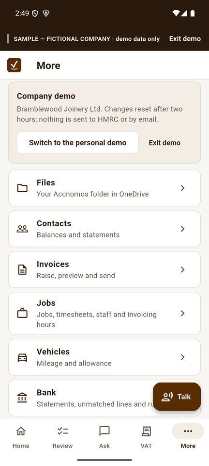

# How-to guides

Short guides for owners. Each says who it is for, gives numbered steps with the
exact page and button, a screenshot for every step and a "what can go wrong"
line where it helps. Where the Android app works differently, an **On Android**
section shows the phone.

Every screenshot comes from the demo sandbox's fictional sample books: the
company demo (Bramblewood Joinery Ltd, labelled SAMPLE — FICTIONAL COMPANY) and
the personal demo (the Harrison household, labelled SAMPLE — FICTIONAL
HOUSEHOLD). HMRC and PayPal contact is sandbox only. How the pictures are made is in
[img/SHOTS.md](img/SHOTS.md).

## Getting started

| Guide | Who it is for |
|---|---|
| [Try the demo or connect your books](connect-books.md) | Opening Accnomos for the first time |
| [Review and approve](review-approve.md) | Clearing the Review queue |
| [Talk to Accnomos, by voice or chat](voice-chat.md) | Asking in plain words, typed or spoken |
| [Import contacts](import-contacts.md) | Setting up customers and suppliers |

## Everyday books

| Guide | Who it is for |
|---|---|
| [Collect receipts by email](add-mailbox.md) | Collecting supplier receipts by email |
| [Reconcile bank lines](reconcile-bank.md) | Matching a statement against the books |
| [Notes, to-dos and events by voice](notes-tasks.md) | Capturing jobs and reminders on the go |
| [Calendar and deadlines](calendar.md) | Keeping VAT, payroll and Income Tax dates in view |
| [Set goals and track progress](goals.md) | Anyone with a target for the business or the household |
| [Personal finances](personal-finances.md) | A household, or an owner keeping personal money apart |

## PayPal

PayPal links, Sync PayPal and bill pay have been tried with PayPal's sandbox
only (disputes with a stand-in only), and you approve every posting and every
payment. These pictures use the test-mode stand-in for PayPal
(no real money moves) or the company demo's sample PayPal history. Each guide
links to the short version in the [help centre](https://accnomos.com/help).

| Guide | Who it is for |
|---|---|
| [Send an invoice with a PayPal pay link](paypal-invoice-link.md) | Getting invoices paid through PayPal |
| [Sync PayPal: approve, choose the VAT, tie out the balance](paypal-sync.md) | Bringing a PayPal account's history into the books |
| [Pay supplier bills with PayPal](paypal-bill-pay.md) | Paying suppliers on the due date, by hand or with limits |
| [Answer a PayPal dispute](paypal-disputes.md) | A customer has disputed an invoice payment |
| [Ask the assistant about PayPal](paypal-ask.md) | Balances, fees, reminders and pay links in plain words |
| [The Power grid add-on](power-grid.md) | Bulk approvals and ledger filtering on a wide screen |

## Tax, payroll and your accountant

| Guide | Who it is for |
|---|---|
| [Do a VAT return](vat-return.md) | VAT-registered and filing through MTD |
| [Income Tax quarterly update](income-tax-update.md) | Sole traders and landlords sending MTD updates |
| [Run payroll and file with Basic PAYE Tools](payroll-paye.md) | Employers running a pay run |
| [Invite your accountant](invite-accountant.md) | Giving your accountant access |
| [Export for your accountant](export-accountant.md) | Sending a period's records away |

## Web and phone

The web app has every page. The Android app has Home, Review, Ask and VAT along
the bottom, a **More** tab with files, contacts, invoices, jobs, vehicles, bank, payroll,
month-end, reports, goals, calendar, notes, your accountant and the audit trail, and the
**Talk** button on every screen. In the personal books the bottom bar becomes
Home, Review, Budget, Goals and More. Bank statement uploads, reconciling and
HMRC submissions stay on the web.

