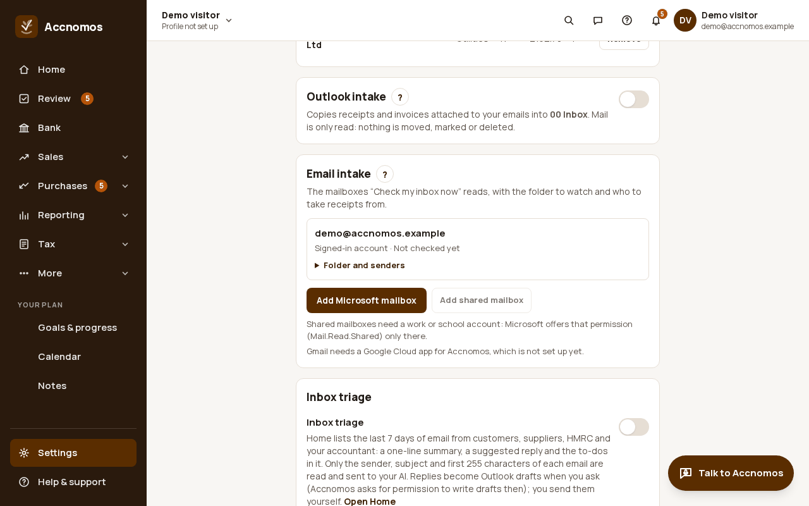
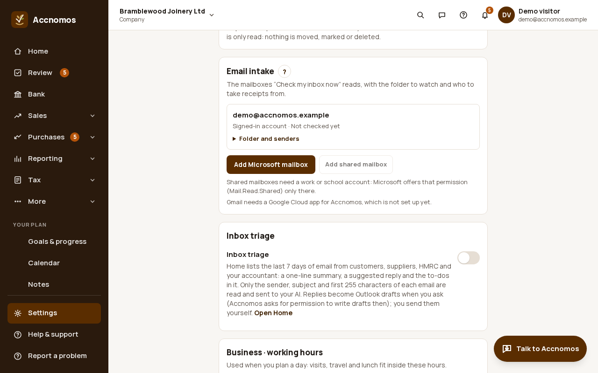
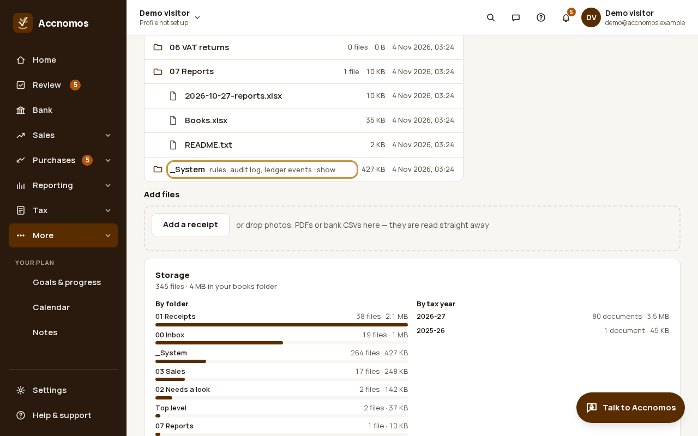

# Collect receipts by email

Who this is for: an owner who gets supplier receipts and invoices by email and
wants them picked up for Review. Mail is only read: Accnomos never sends,
moves, marks or deletes it.

1. Open **Settings › Automation** (`/settings`) and find **Outlook intake**.
   Switch it on to copy receipts and invoices attached to your emails into
   `00 Inbox`.
   
   If this goes wrong: Microsoft asks for more than reading mail, so cancel
   and tell us rather than accepting.
2. Under **Email intake**, check the mailbox listed (the one you signed in
   with), open **Folder and senders** to choose the folder to watch and who to
   take receipts from, or press **Add Microsoft mailbox** / **Add shared
   mailbox** for another one.
   
   If this goes wrong: a shared mailbox is refused, so check it is a work or
   school account: Microsoft only offers that permission there.
3. Press **Check my inbox now** in Outlook intake (it appears once intake is
   on). Likely receipts and invoices from the last 14 days are copied into
   `00 Inbox`, with duplicates left out, and each run is logged in
   `_System/Intake` in Files.
   
   If this goes wrong: the run finds nothing, so check the email is from the
   last 14 days, has an attachment and comes from a sender you allowed.
4. Open **Review** (`/review`): each attachment is a proposal card like any
   other, to approve, edit or reject (see [Review and approve](review-approve.md)).
   If this goes wrong: a receipt arrived twice, so reject the copy; the
   duplicate check also flags it.

**Inbox triage**, under Email intake, is separate: it lists the last 7 days of
email from customers, suppliers, HMRC and your accountant with a one-line
summary, a suggested reply and the to-dos. Replies become Outlook drafts only
when you ask.

## On Android

Mailboxes are set up on the web. On the phone, receipts from email simply
appear in **Review** with the others.
