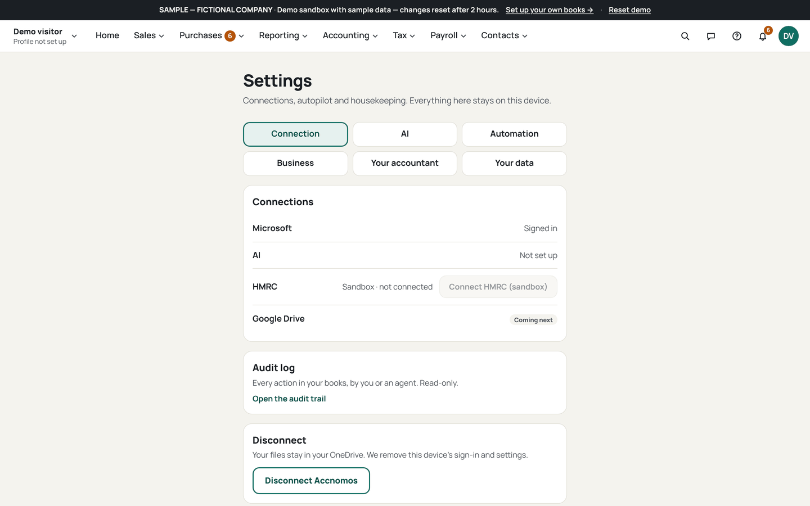
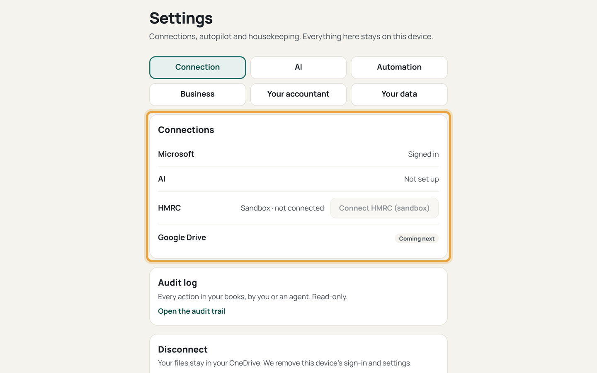
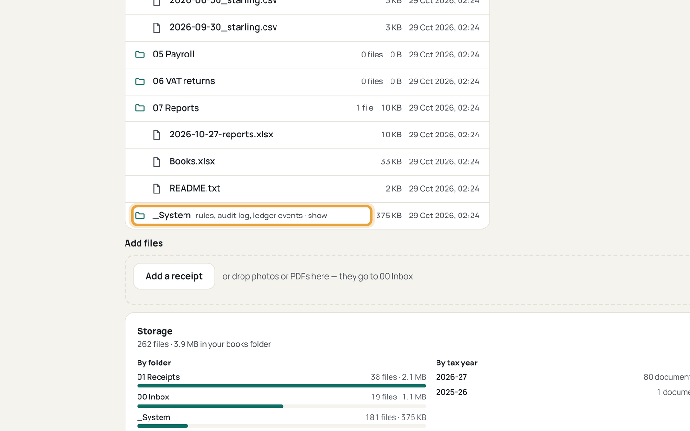

# Add a mailbox

Who this is for: an owner who gets supplier receipts by email and wants them
picked up automatically. Intake is read-only: it never sends, moves or deletes
mail. Never run against a real mailbox without testing on a throwaway first.

1. Open Settings (`/settings`) and find Outlook intake.
   
   Must be visible: the Settings page with the *Outlook intake* section and its
   off switch.
   If this goes wrong: the section is missing, so check you are signed in with
   a Microsoft account.
2. Switch Outlook intake on and grant `Mail.Read` only when asked.
   
   Must be visible: the consent screen asking for `Mail.Read` and nothing
   wider.
   If this goes wrong: consent asks for more than reading mail, so cancel and
   report it rather than accepting.
3. Add the mailbox and folder to watch in *Email intake*.
   
   Must be visible: the mailbox address, the watched folder (Inbox), and the
   sender list.
   If this goes wrong: the mailbox never appears, so sign that account in once
   in the same browser first.
4. Press *Check my inbox now* and wait for the run to finish.
   
   Must be visible: the run log in `_System/Intake/` with kept and dropped
   counts.
   If this goes wrong: the run finds nothing, so check the email is within the
   last 14 days and from an allowed sender.
5. Open Review (`/review`) and check the new proposal cards.
   
   Must be visible: one card per receipt with supplier, date and totals filled
   in, and the intake source line.
   If this goes wrong: a receipt landed twice, so reject the duplicate; the
   log keeps the original.
