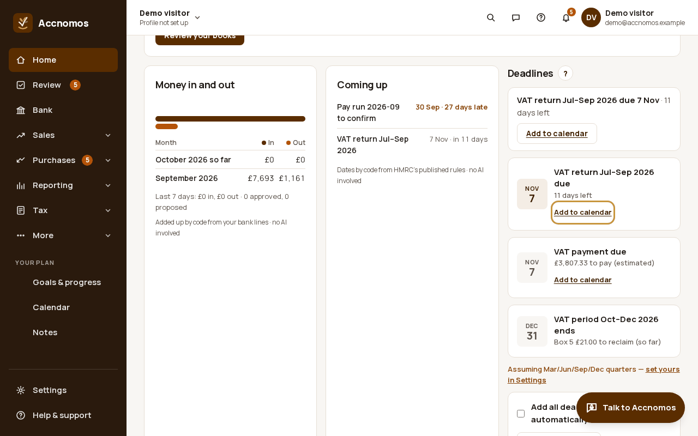
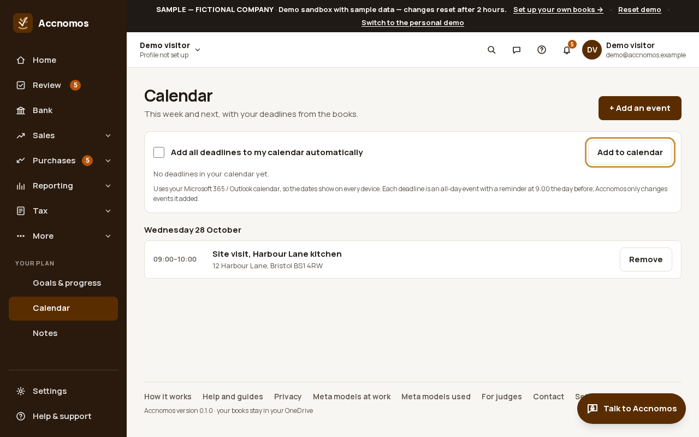
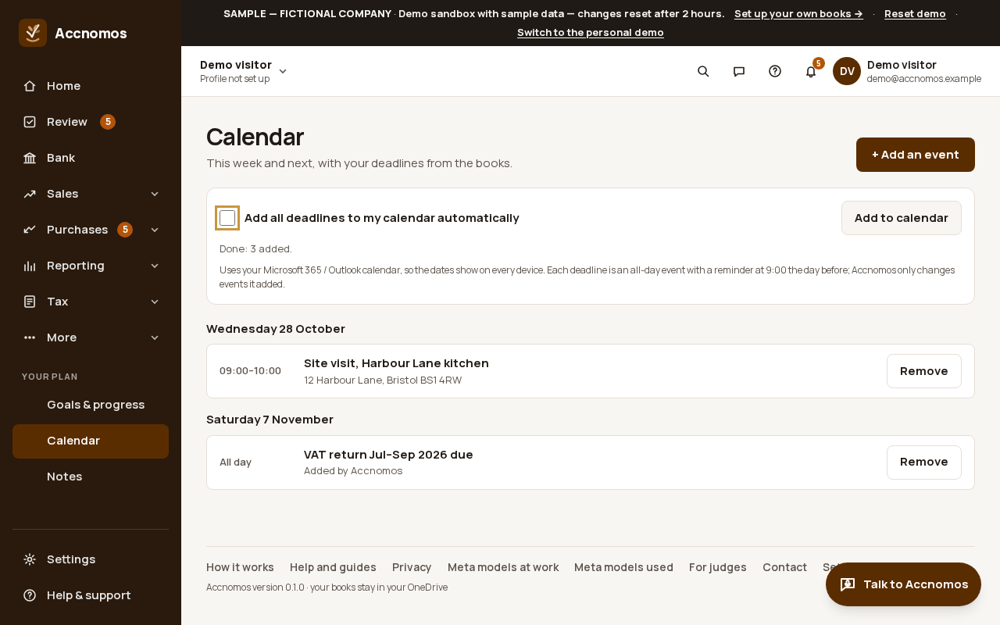
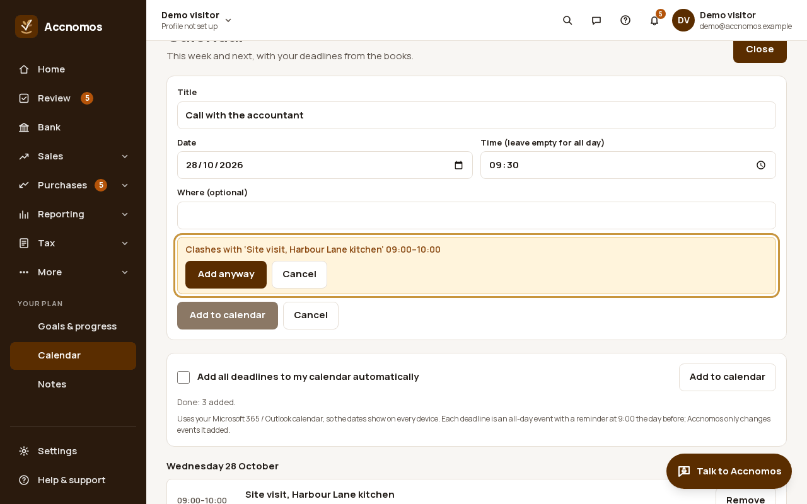

# Calendar and deadlines

Who this is for: an owner who wants VAT, payroll and Income Tax dates in the
calendar they already use. Accnomos uses your Microsoft 365 / Outlook
calendar, so the dates show on every device. Each deadline is an all-day event
with a reminder at 9:00 the day before.

1. On **Home**, the **Deadlines** card lists what is coming, worked out by code
   from HMRC's published rules. Press **Add to calendar** under one deadline to
   add just that one; it then says *In your calendar ✓*.
   
2. Open **Calendar** (`/calendar`, under **Your plan**) for this week and next:
   your events by day, with the deadlines from the books.
   
3. Press **Add to calendar** to add every deadline at once. Running it again
   adds nothing twice. Tick **Add all deadlines to my calendar automatically**
   to keep new deadlines going in on their own.
   
   If this goes wrong: an event you did not want is there, so press
   **Remove** beside it: Accnomos only changes events it added.
4. Press **+ Add an event** for anything else: title, date, time (or leave the
   time empty for all day) and where. If it clashes with something already in
   your calendar you are told before anything is written: **Add anyway** or
   **Cancel**.
   
5. You can also say it: "add a meeting with Hartwell tomorrow at 10" in the
   Talk panel makes a calendar card to approve (see
   [Notes, to-dos and events by voice](notes-tasks.md)).

## On Android

**More › Calendar** shows the next two weeks by day, with an *Added by
Accnomos* chip on the events it wrote, **Add an event** with the same clash
check before anything is written, **Remove** with a confirm, and the **Add all
deadlines to my calendar automatically** switch. The app asks for calendar
access when you first open this screen, never at sign-in; in the demo it uses
the demo's own calendar and nothing reaches Microsoft.
