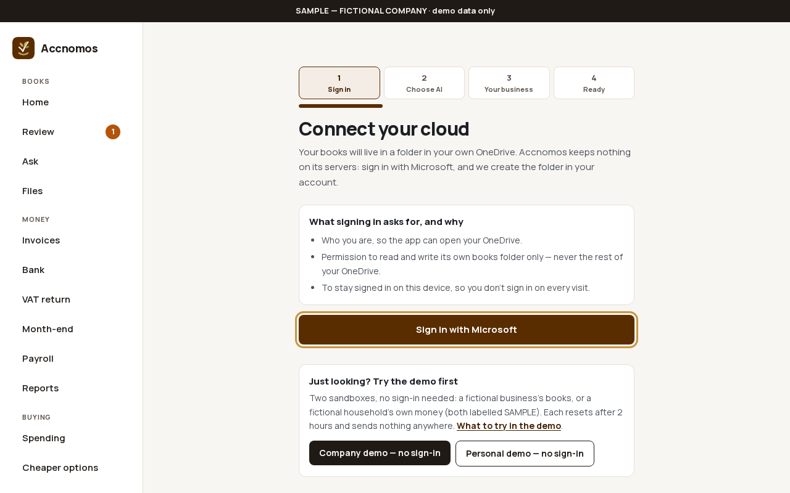
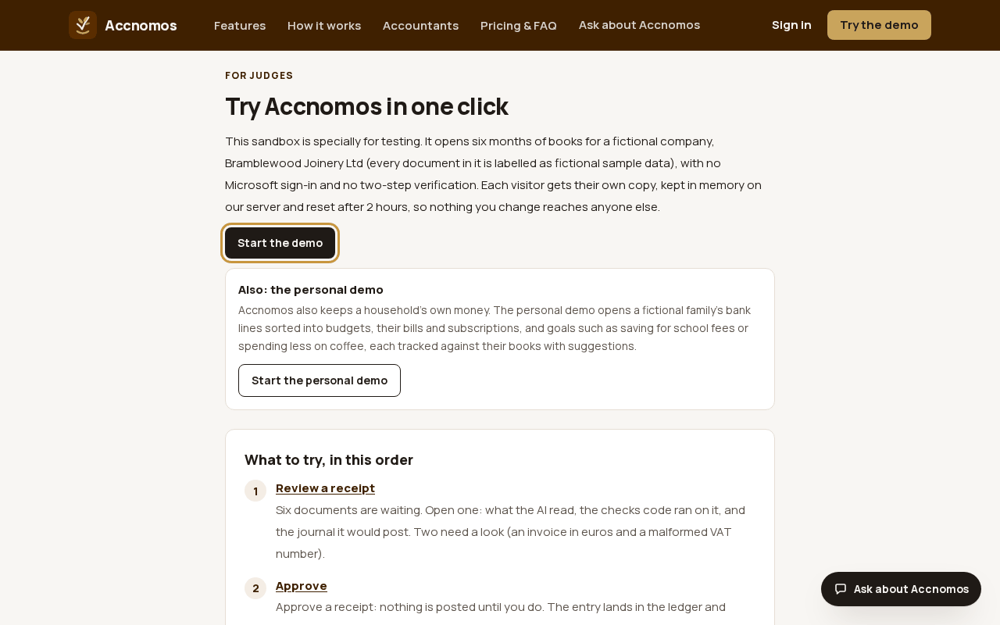
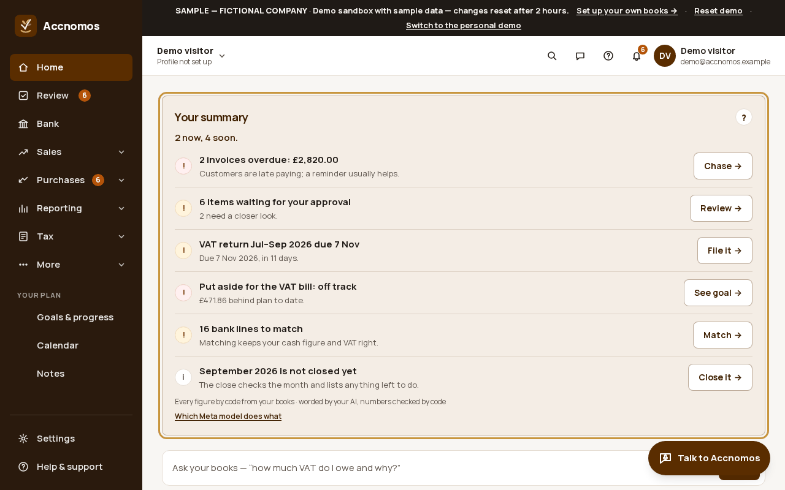
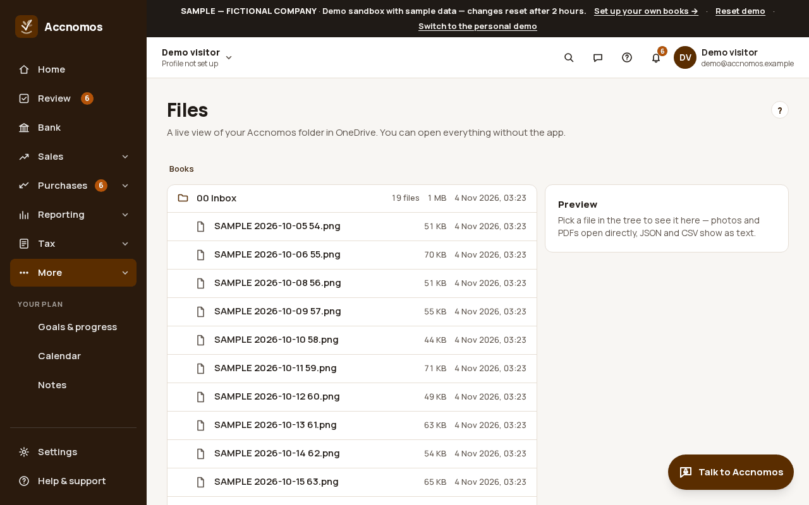
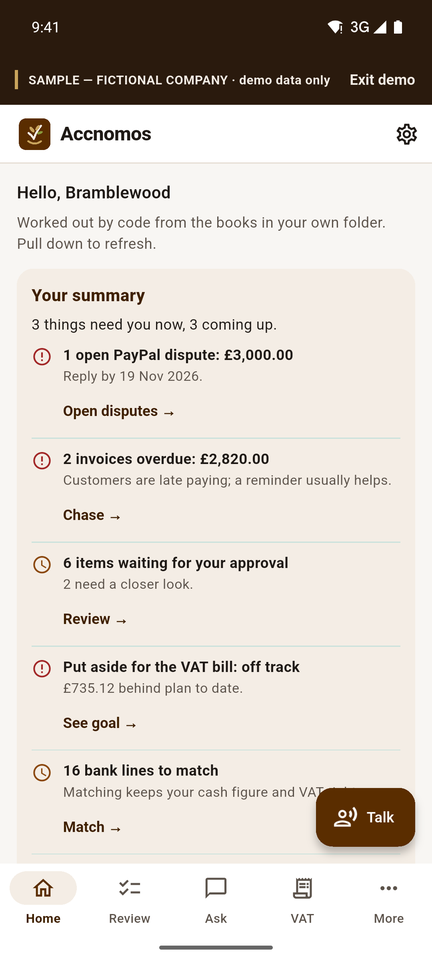

# Try the demo or connect your books

Who this is for: someone opening Accnomos for the first time. You can look
round the fictional sample books with no sign-in, or sign in with Microsoft
and keep your own books in a folder in your own OneDrive.

1. Open **Connect** (`/connect`). Read what signing in asks for, then choose
   **Sign in with Microsoft** for your own books, or **Company demo — no
   sign-in** / **Personal demo — no sign-in** to look first.
   
   If this goes wrong: the page never loads, so check you are on
   accnomos.com and not an old test address.
2. To try first, open the **Demo guide** (`/demo`, where **Try the demo**
   lands) and press **Start the demo** (a fictional company) or **Start the
   personal demo** (a fictional household). Each visitor gets their own copy,
   reset after 2 hours.
   
   If this goes wrong: the button says the sample books are being prepared,
   so wait: the first demo of the day takes a minute or two to build.
3. Read **Your summary** at the top of **Home**. It is a list sorted by what
   needs you first (overdue invoices, items to approve, the next deadline,
   goals off track, bank lines to match, the month to close), each with a
   button that takes you to the page that clears it.
   
   If this goes wrong: the summary says it is still working, so give it a
   few seconds; every figure in it is worked out by code from your books,
   the AI only words it.
4. Open **Files** (`/files`) to see the books folder: `00 Inbox` to
   `07 Reports`, `Books.xlsx` and `_System`. Everything Accnomos keeps is a
   file here.
   
   If this goes wrong: the tree is empty after signing in, so go back to
   `/connect` and finish the folder step.
5. Leave the demo with **Set up your own books →** in the demo bar, or start
   again with **Reset demo**.

## On Android

The app opens on the same Home: **Your summary**, then tiles for cash in bank,
money owed to you, the VAT estimate and what needs attention. **Try the demo**
on the welcome screen opens the company demo; **More › Switch to the personal
demo** swaps to the household.

