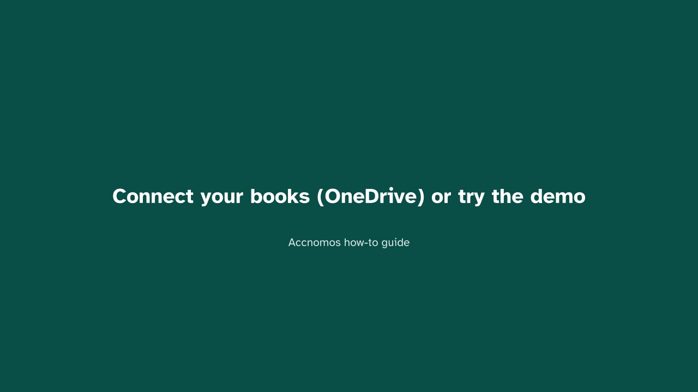
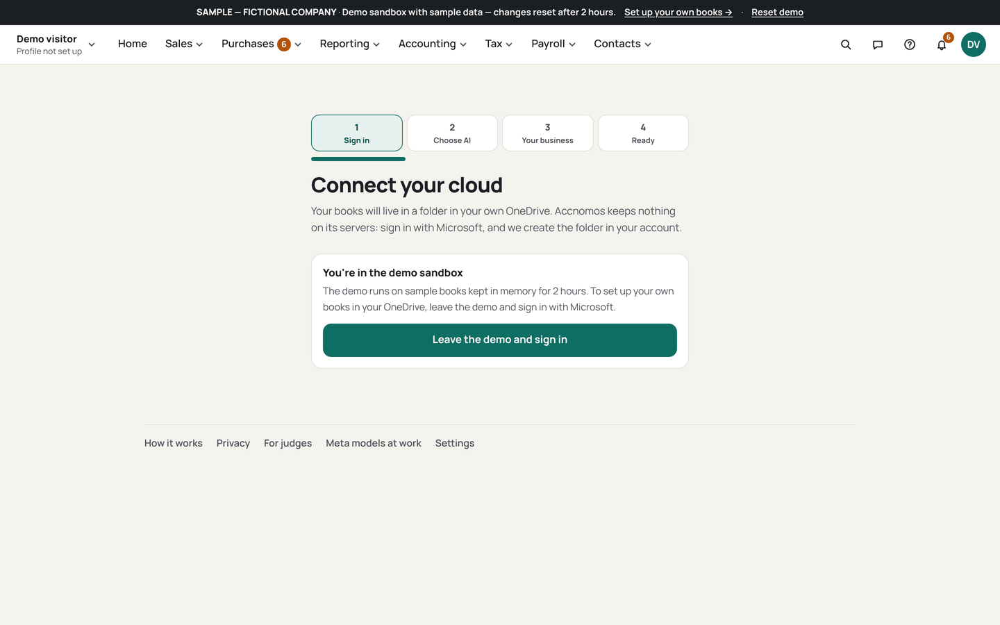
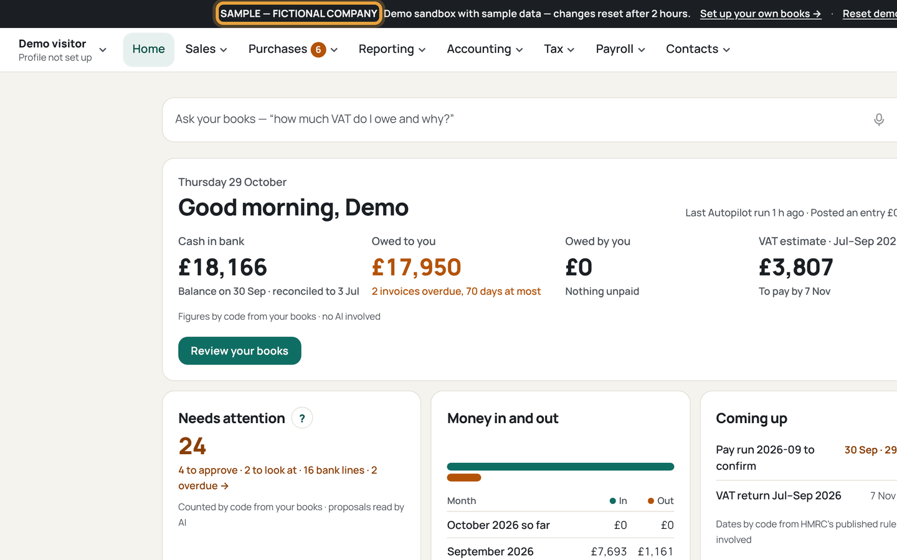
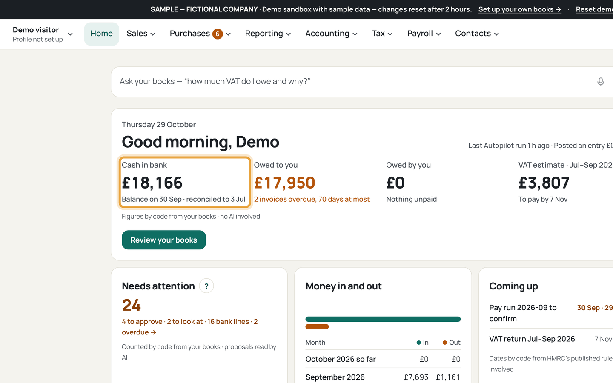
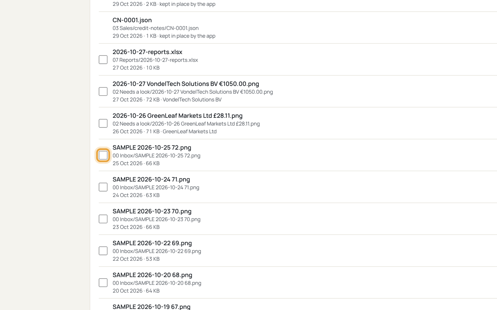
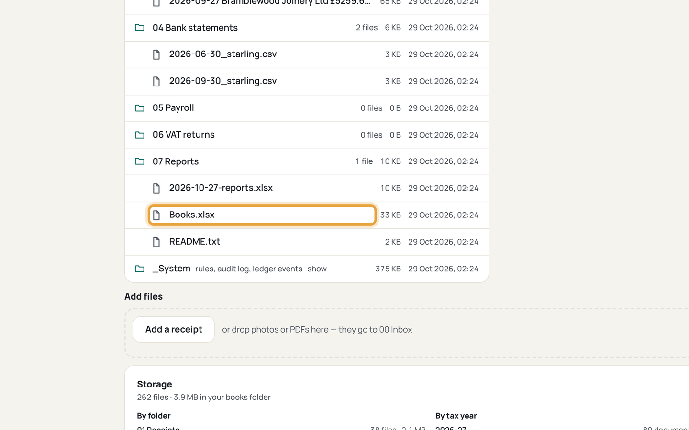

# Connect your books (OneDrive) or try the demo

Who this is for: a new owner opening Accnomos for the first time, with a
Microsoft account and no books set up yet. All data shown is the demo sandbox's
sample company, labelled SAMPLE — FICTIONAL COMPANY.

1. Open the Connect page (`/connect`) and choose how to start.
   
   If this goes wrong: the page never loads, so check you are on
   accnomos.com and not a stale test address.
2. To try first, press *Try the demo — no sign-in*.
   
   If this goes wrong: you land on the sign-in screen instead, so press the
   demo button on the signed-out Home page.
3. To keep your own books, sign in with a throwaway Microsoft account and
   press *Load sample books* for six months of a fictional company.
   
   If this goes wrong: nothing appears after a minute, so press
   *Load sample books* once more; a second press joins the same run.
4. Open Files (`/files`) and check your books folder exists.
   
   If this goes wrong: the tree is empty, so return to `/connect` and finish
   the folder setup step.
5. Press *Rebuild Books.xlsx* on Files and open the spreadsheet.
   
   If this goes wrong: the file is missing, so rebuild once more and reload
   the page.
