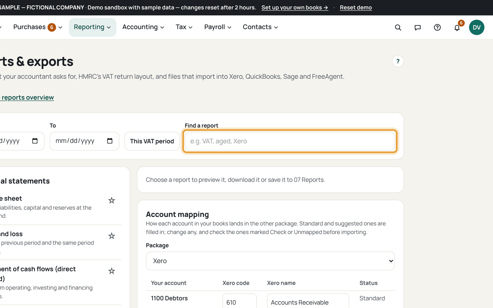
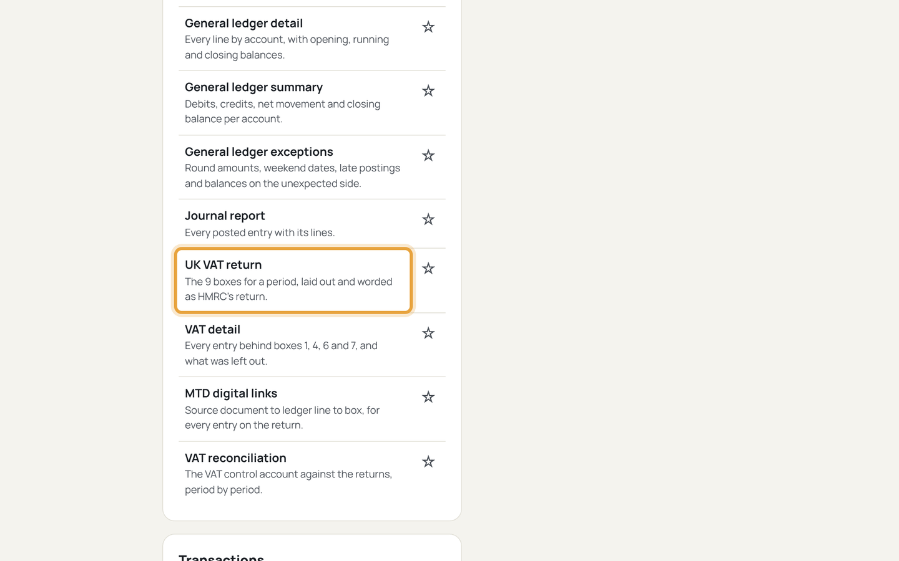
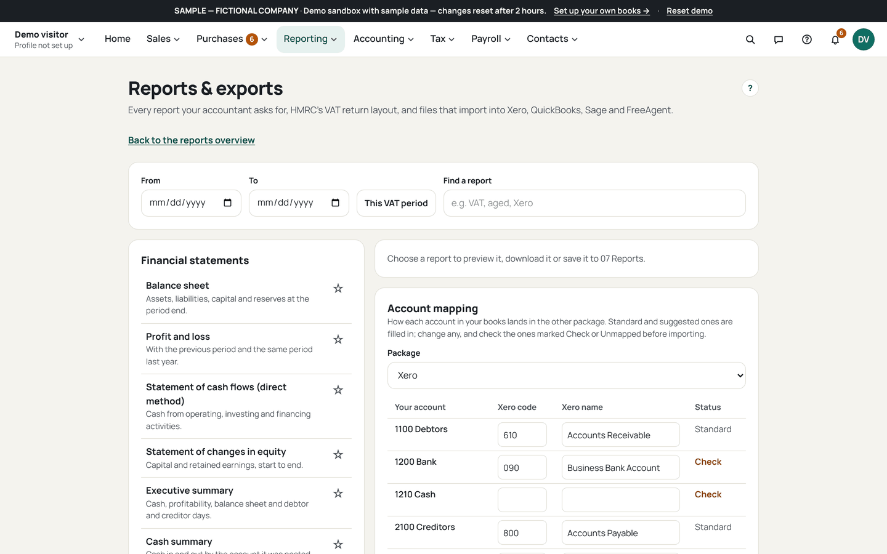
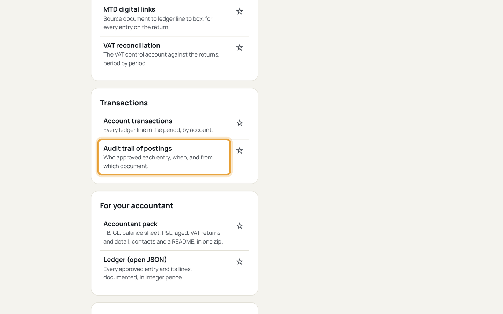
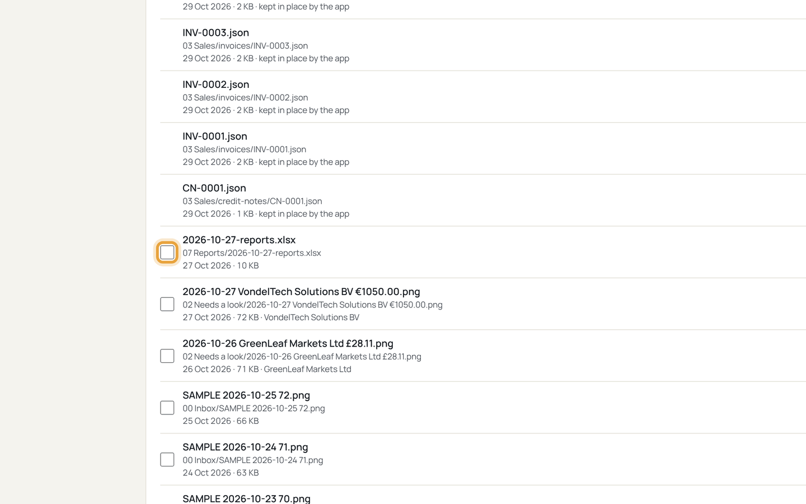

# Export for your accountant

Who this is for: an owner sending a period's records to their accountant.
Exports are copies; the books stay untouched in your OneDrive.

1. Open Reports and exports (`/reports/exports`) and pick the period.
   
   If this goes wrong: the period controls are disabled, so pick a report that
   takes a period first.
2. Export the VAT return as sent.
   
   If this goes wrong: the boxes differ, so the return was edited after
   submission; export again from the current page.
3. Export the Income Tax summary (SA103) for the period.
   
   If this goes wrong: a box is empty, so that trade had no entries in the
   period; check the date range.
4. Export the full ledger and the audit trail as CSV.
   
   If this goes wrong: a file opens with missing columns, so export again;
   headings are always written.
5. Send the files from `07 Reports/` with Books.xlsx beside them.
   
   If this goes wrong: Books.xlsx is stale, so press *Rebuild Books.xlsx* on
   Files before sending it.
