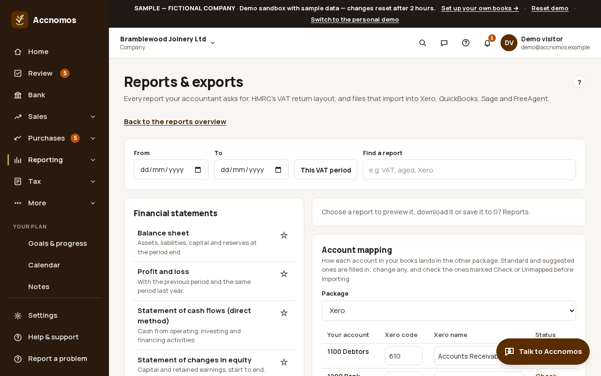
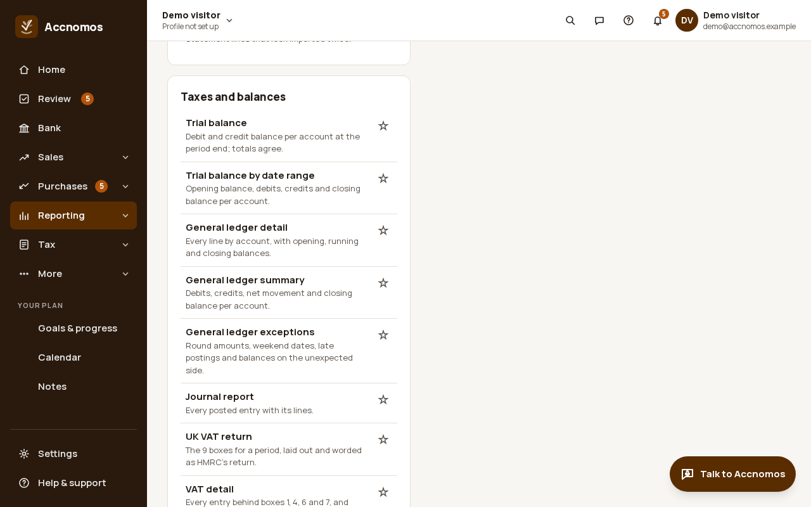
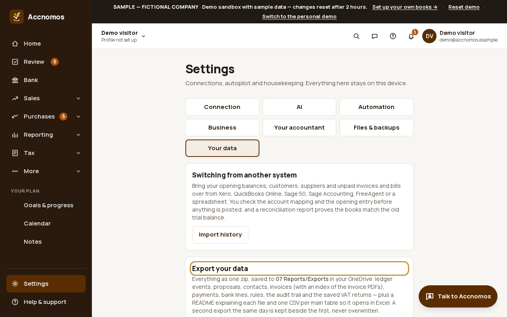

# Export for your accountant

Who this is for: an owner sending a period's records to their accountant, or
moving to other software. Exports are copies; the books stay as they are in
your OneDrive.

1. Open **Reports & exports** (`/reports/exports`, under **Reporting**). Set
   **From** and **To**, or press **This VAT period**, and search with **Find a
   report** if you know its name.
   
   If this goes wrong: a report ignores the dates, so it is one that has no
   period (a balance at a date); set the To date instead.
2. Pick a report to preview it, then download it or save it to `07 Reports`.
   **Taxes and balances** has the trial balance, general ledger, journal
   report, the UK VAT return as HMRC lays it out, and VAT detail by box.
   
   If this goes wrong: the VAT return differs from the VAT page, so check you
   picked the same period and scheme.
3. For another package, open **Account mapping**, choose Xero, QuickBooks,
   Sage or FreeAgent, and check the accounts marked *Check* or *Unmapped*
   before exporting.
4. For everything at once, open **Settings › Your data** and press **Export
   your data**: one zip in `07 Reports/Exports` with ledger events, proposals,
   contacts, invoices, payments, bank lines, rules, the audit trail and the
   saved VAT returns, plus a README and one CSV per table that opens in Excel.
   
5. Send the files from `07 Reports` with the current `Books.xlsx` beside them,
   or [invite your accountant](invite-accountant.md) to open the books
   themselves.

## On Android

**More › Reports** shows profit and loss, aged balances, VAT and the trend.
Exports are made on the web.
