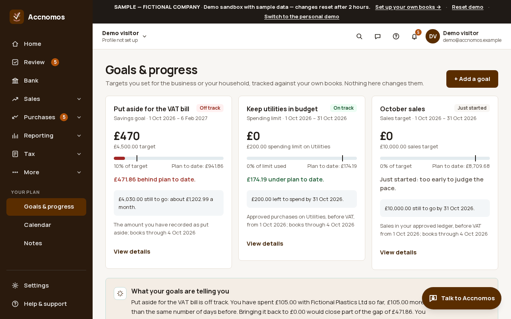
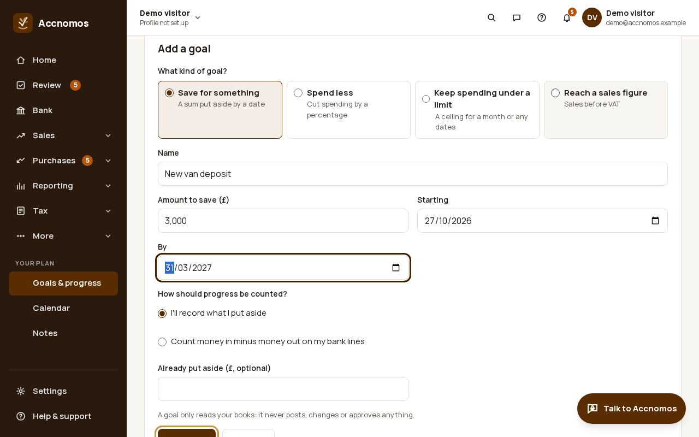
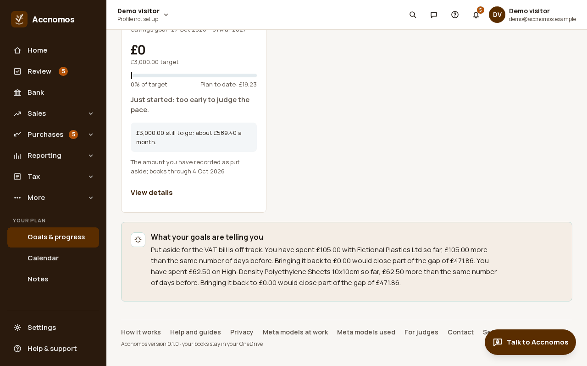
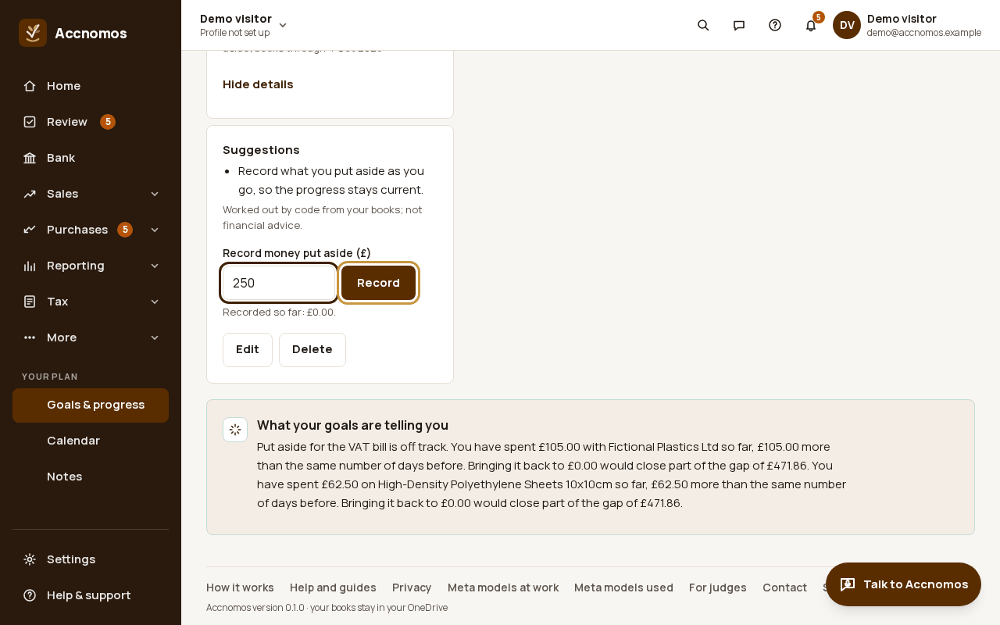
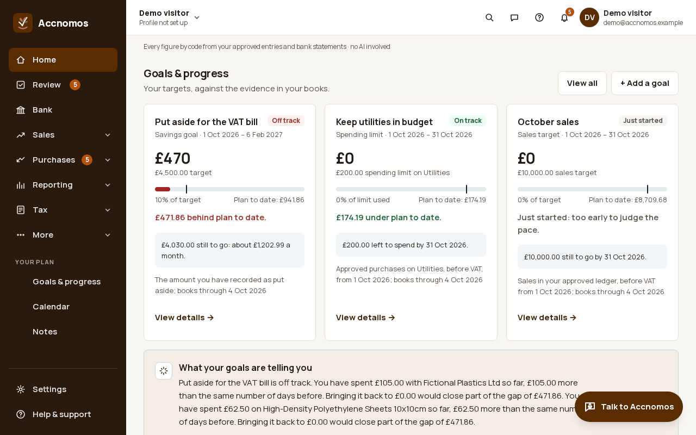
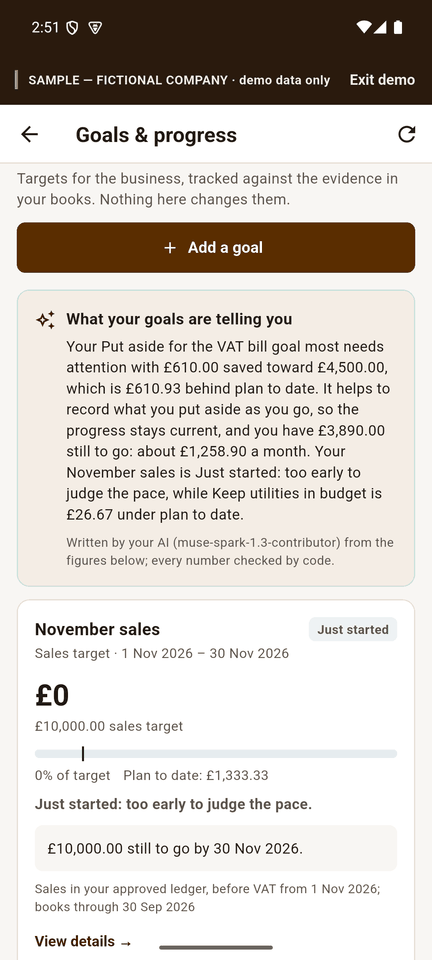

# Set goals and track progress

Who this is for: anyone with a target, for the business (put aside for the VAT
bill, a sales figure, a spending limit) or the household (school fees, a
holiday pot). Progress is measured against your own books; a goal never
posts, changes or approves anything.

1. Open **Goals & progress** (`/goals`, under **Your plan**). Each goal shows
   its figure, its target, a progress bar against the plan to date, and
   whether it is *On track*, *At risk*, *Off track* or *Just started*.
   
2. Press **+ Add a goal** and choose the kind: **Save for something**, **Spend
   less**, **Keep spending under a limit** or **Reach a sales figure**. Give
   it a name, an amount and the dates, and say how progress is counted:
   money you record as put aside, or money in minus money out on your bank
   lines.
   
   If this goes wrong: the form refuses the dates, so check the end date is
   after the start.
3. Read **What your goals are telling you**. Your AI writes a short note from
   the figures on the cards, and every number in it is checked by code.
   
4. Open a goal with **View details** to see the suggestions and, for savings,
   record money put aside with **Record**. **Edit** and **Delete** are there
   too.
   
5. Home shows your goals in **Goals & progress** with the same cards, and the
   summary at the top lists a goal that falls behind.
   

## On Android

**More › Goals** (or the **Goals** tab in personal books) shows the same
cards and the same note, with **Add a goal** at the top.

