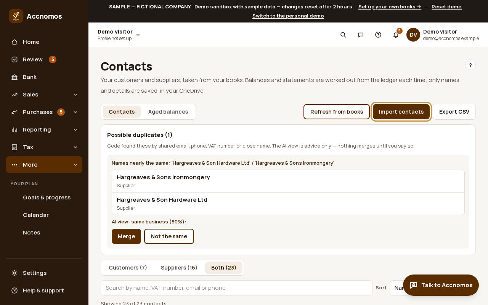
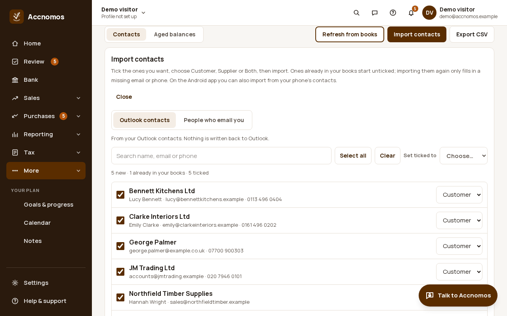
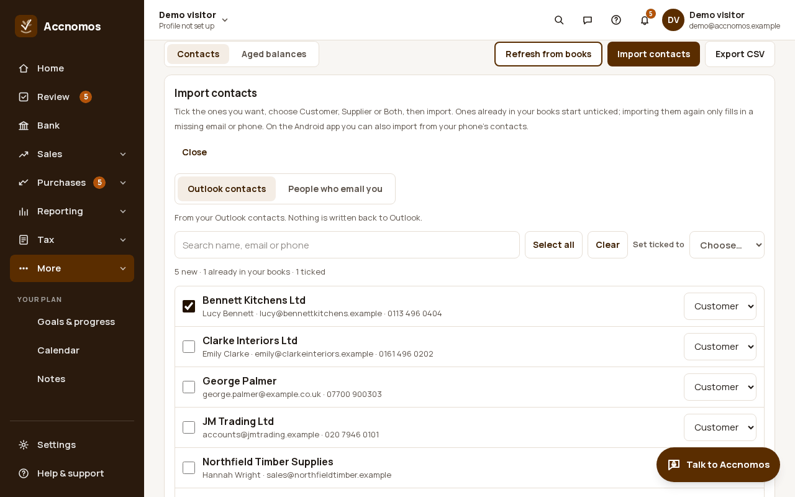
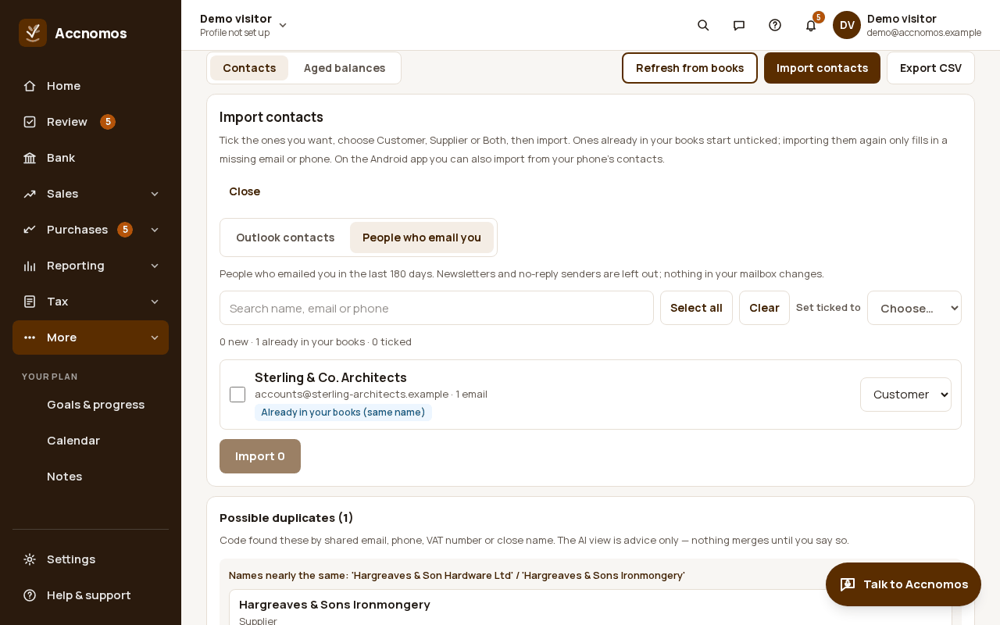
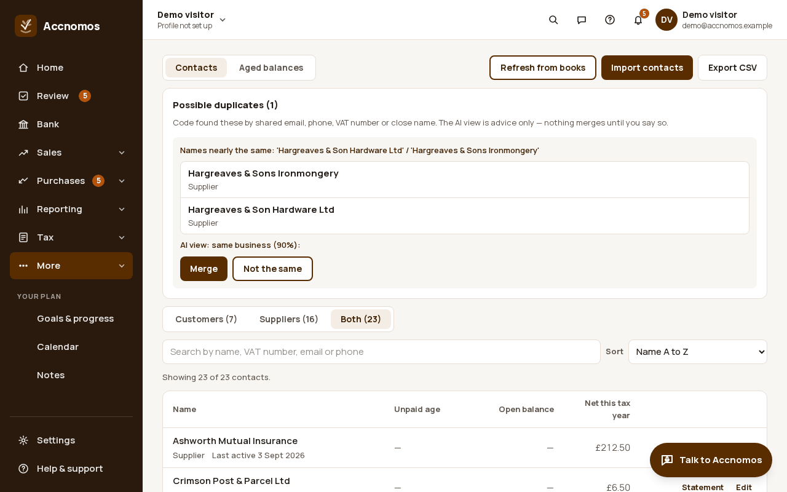
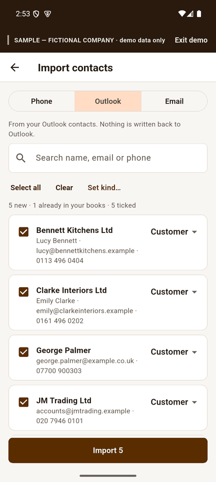
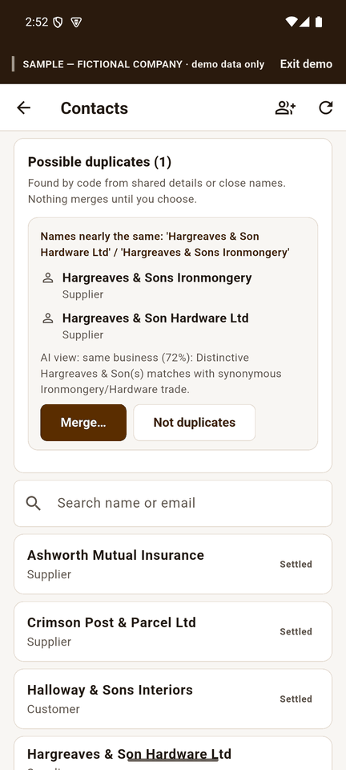

# Import contacts

Who this is for: an owner setting up customers and suppliers without typing
them in. Import all or only the ones you tick, from your Outlook contacts, from
the people who email you, or (on Android) from your phone. Nothing is written
back to Outlook or your phone, and possible duplicates are only merged when
you say so.

1. Open **Contacts** (`/contacts`) and press **Import contacts**.
   
2. On **Outlook contacts**, every new contact starts ticked; ones already in
   your books start unticked and say so. Search, **Select all** or **Clear**,
   and set each one to **Customer**, **Supplier** or **Both** (or set all the
   ticked ones at once with **Set ticked to**).
   
3. Press **Import N** to bring in the ticked ones. To take only some, press
   **Clear**, tick the ones you want, then import.
   
   If this goes wrong: you import someone twice, so check the message: a
   contact already in your books is skipped and only gains a missing email or
   phone.
4. On **People who email you**, Accnomos lists who emailed you in the last 180
   days, with newsletters and no-reply senders left out. Tick and import the
   same way.
   
5. Check **Possible duplicates** at the top of Contacts. Code finds them by a
   shared email, phone or VAT number or a close name, and the AI view says how
   likely they are the same business. Press **Merge** or **Not the same**;
   nothing merges until you choose.
   

## On Android

**More › Contacts** shows the same possible duplicates first. The import
button at the top opens three tabs: **Phone** (your phone's contacts, after
you allow access), **Outlook** and **Email**. In the demo anything you import
goes into the sample books only and disappears when the demo ends.

