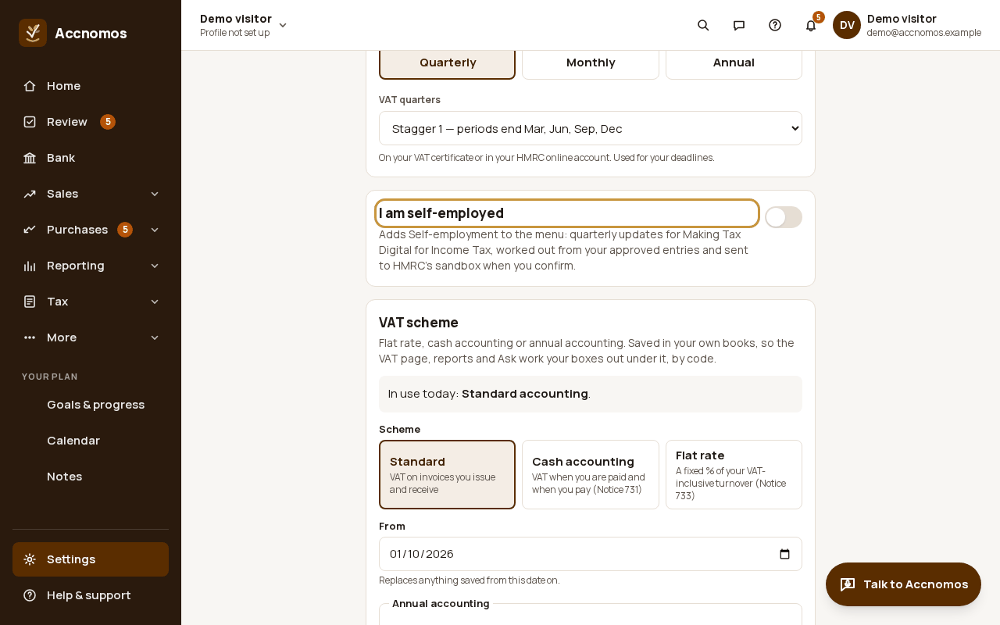
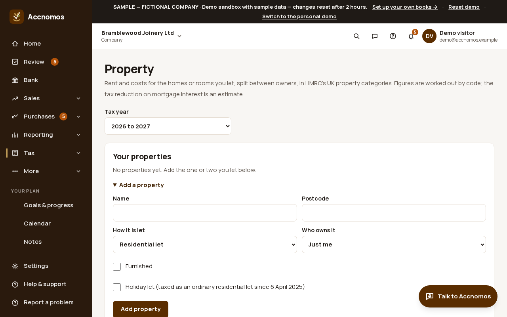
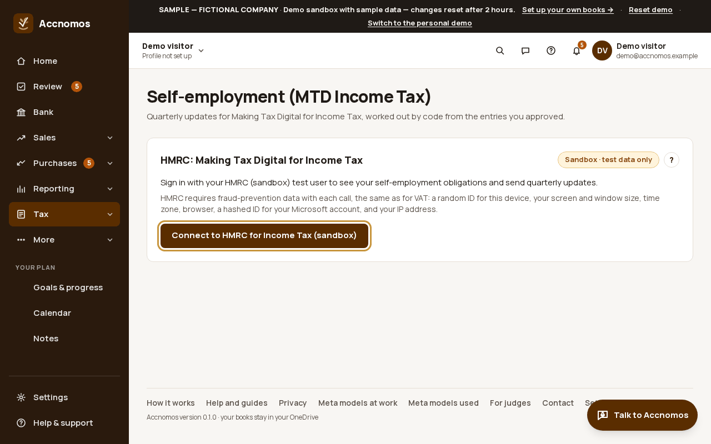

# Income Tax quarterly update (sole trader or landlord)

Who this is for: a sole trader or landlord sending Making Tax Digital for
Income Tax updates. Standard quarterly deadlines are 7 August, 7 November,
7 February and 7 May, with Self Assessment on 31 January. HMRC contact is
sandbox only.

1. Open **Settings › Business** (`/settings`) and switch on **I am
   self-employed**. Landlords also tick **I let property (landlord mode)**
   further down. Each adds its page to the menu under **Tax**.
   
   If this goes wrong: the page does not appear in the menu, so reload; the
   switches are saved in your books.
2. Landlords: open **Property** (`/property`), pick the tax year and add each
   property once (name, postcode, how it is let, who owns it, furnished or
   holiday let). Rent and costs are then split by property and by owner in
   HMRC's UK property categories.
   
   If this goes wrong: rent is missing from a property, so check the bank
   line or receipt is approved and tagged to it.
3. Open **Self-employment** (`/self-employment`) and press **Connect to HMRC
   for Income Tax (sandbox)**. Sign in with your HMRC sandbox test user to see
   your obligations.
   
   If this goes wrong: the connection asks for a live account, so stop: this
   flow works in HMRC's sandbox only.
4. Check the period's turnover and expense boxes. Each figure is worked out
   by code from your approved entries and opens the ledger lines behind it.
   If this goes wrong: a box misses a payment, so check the accounting basis
   in **Settings › Business**: cash counts payments, traditional counts
   invoices.
5. Tick to confirm and send the cumulative period summary. The receipt is
   saved in your books folder.
6. Read HMRC's tax calculation as HMRC's figures: anything HMRC leaves out
   shows as a dash, nothing is estimated in its place.

The quarterly deadlines are on Home's **Deadlines** card and can go into your
calendar (see [Calendar and deadlines](calendar.md)).

## On Android

Income Tax updates are done on the web. The phone shows the deadlines on Home
and in the Talk assistant's answers.
