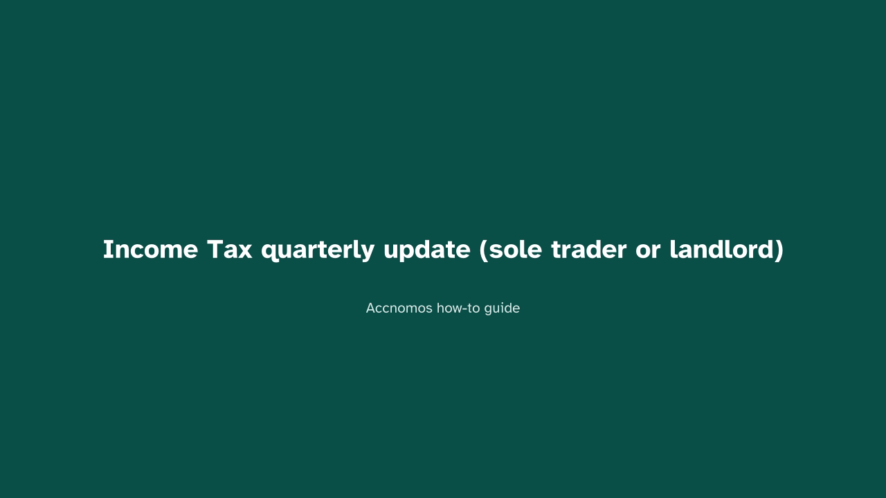
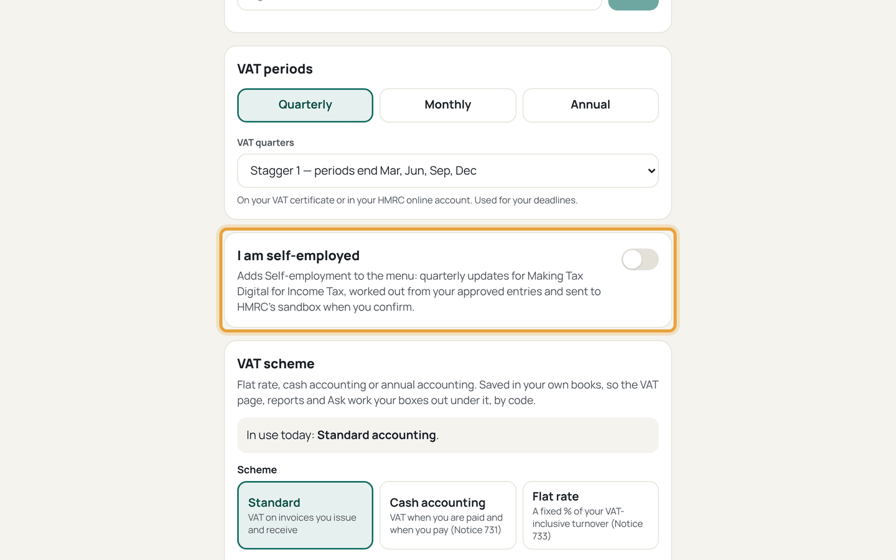
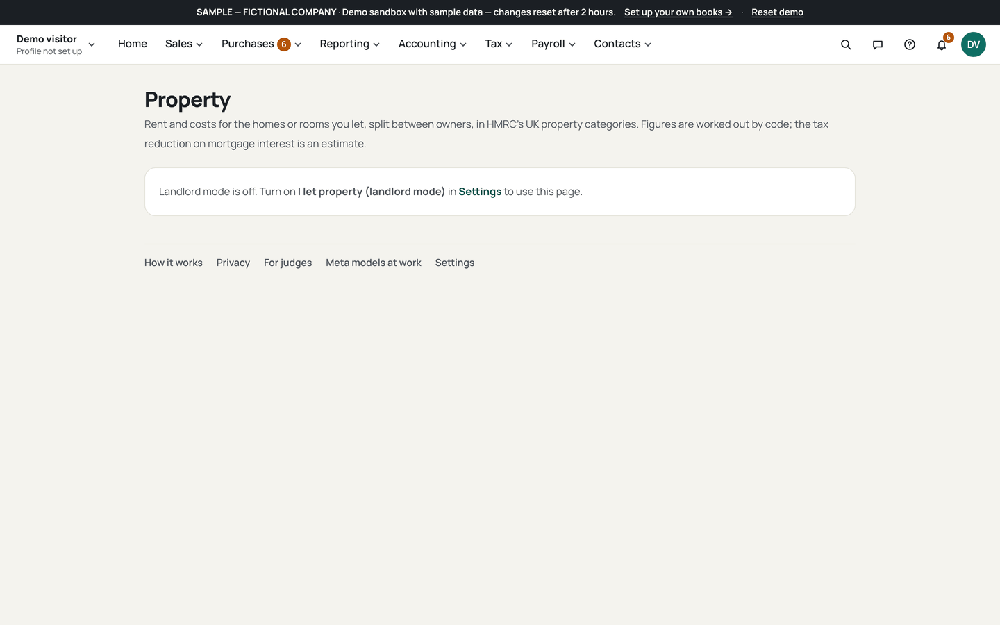
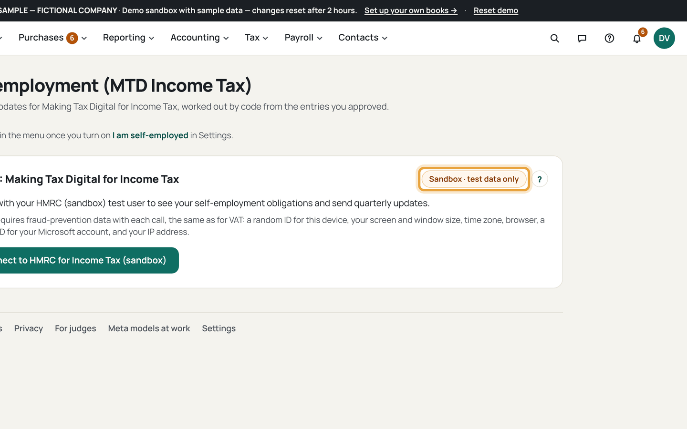
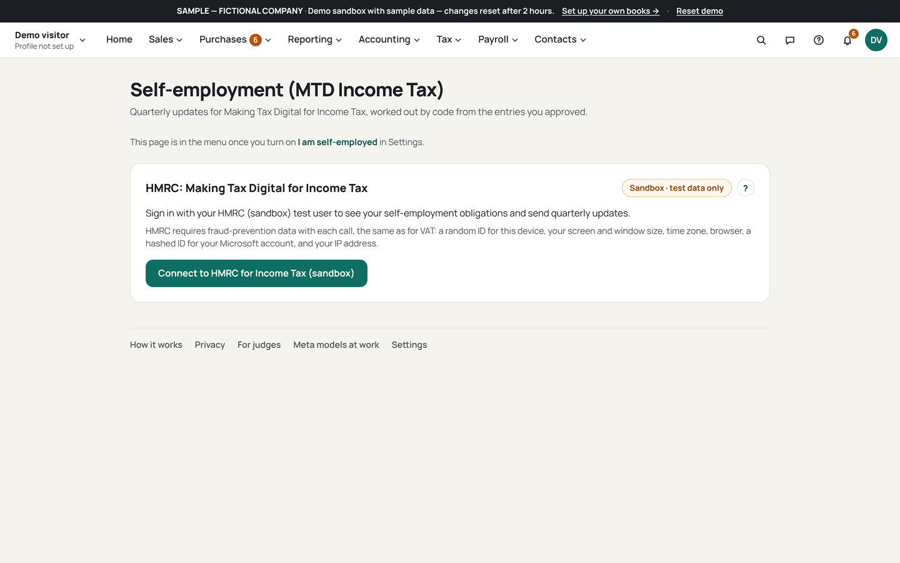

# Income Tax quarterly update (sole trader or landlord)

Who this is for: a sole trader or landlord sending Making Tax Digital Income
Tax updates. Deadlines for standard quarters: 7 August, 7 November, 7 February
and 7 May, with Self Assessment on 31 January. HMRC contact is sandbox only.

1. Open Settings (`/settings`) and switch on *I am self-employed*.
   
   If this goes wrong: nothing changes on Home, so check the switch saved for
   this device.
2. Landlords: register each property on Property (`/property`) first.
   
   If this goes wrong: rental income is missing below, so the property was
   never registered.
3. Open Self-employment (`/self-employment`) and connect HMRC's Income Tax
   scopes.
   
   If this goes wrong: the connection asks for production, so stop: this
   product works in the sandbox only.
4. Check the SA103-style figures and the ledger lines behind each box.
   
   If this goes wrong: a box misses a payment, so check the accounting basis:
   cash counts payments, traditional counts invoices.
5. Tick to confirm and submit the cumulative period summary.
   
   If this goes wrong: the page still shows the period open, so the submit
   never left; check the connection and retry.
6. Read HMRC's tax and NI calculation as HMRC's, not yours.
   
   If this goes wrong: a figure you expected is a dash, so HMRC left it out of
   the response; nothing is estimated.
