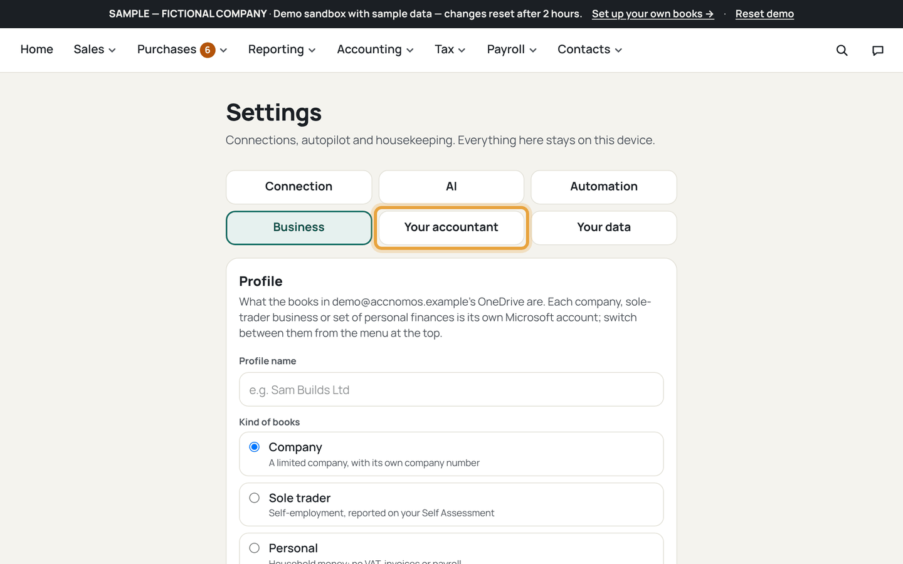
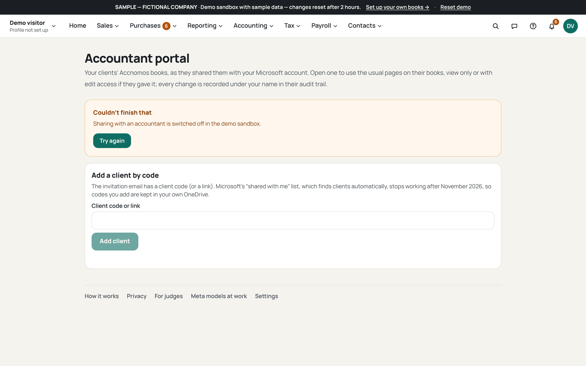
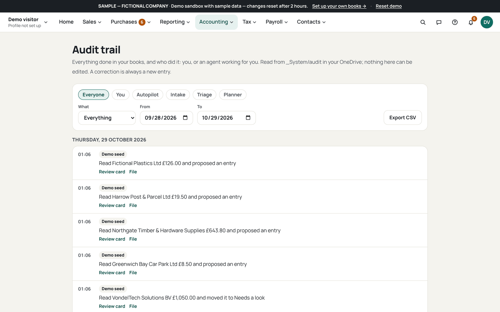

# Invite your accountant

Who this is for: an owner giving their accountant access to the same books.
They open your files; every change they make is recorded under their name.

1. Open Settings (`/settings`) and find *Your accountant*.
   
   If this goes wrong: the section is missing, so check you are signed in with
   the Microsoft account that owns the books.
2. Enter their email and choose view-only or edit access.
   
   If this goes wrong: the wrong level is picked, so change it before sending;
   wider access cannot be taken back silently.
3. Press Invite and let Microsoft email them the link.
   
   If this goes wrong: they never get the email, so use *Record access* after
   sharing the folder from OneDrive yourself.
4. Ask them to open your books through Accountant (`/accountant`).
   
   If this goes wrong: your books are missing there, so the invite went to a
   different Microsoft account; re-invite the right one.
5. Check the audit trail for their first visit.
   
   If this goes wrong: nothing is recorded, so they opened the books without
   signing in; ask them to sign in first.
