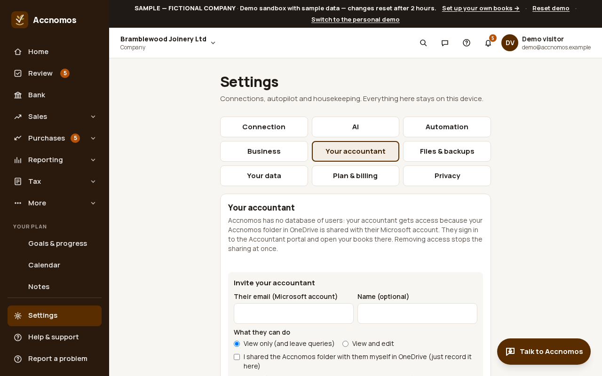
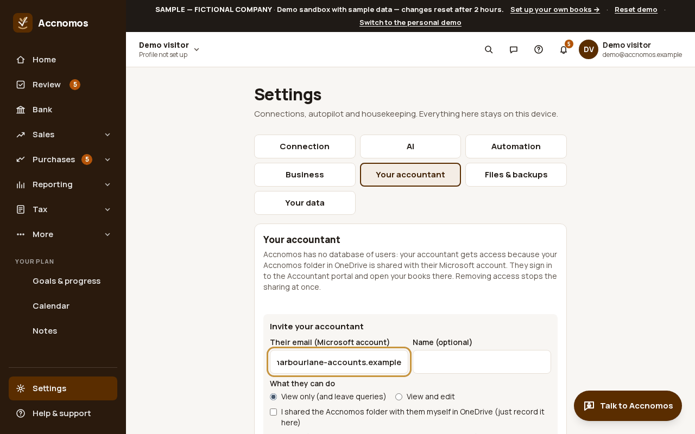

# Invite your accountant

Who this is for: an owner giving their accountant access to the same books.
Accnomos keeps no database of users: your accountant gets access because your
Accnomos folder in OneDrive is shared with their Microsoft account. Removing
access stops the sharing at once.

1. Open **Settings › Your accountant** (`/settings`).
   
   If this goes wrong: the tab is missing, so check you are signed in with
   the Microsoft account that owns the books.
2. Enter their email (the Microsoft account they use) and choose **View only
   (and leave queries)** or **View and edit**, then press **Invite**.
   Microsoft emails them the link.
   
   If this goes wrong: they never get the email, so share the folder from
   OneDrive yourself and tick **I shared the Accnomos folder with them myself
   in OneDrive (just record it here)**, then press **Record access**.
3. Your accountant opens your books from the **Accountant portal**
   (`/accountant`), which lists every client who shared books with them, or
   adds you with the client code from the invitation.
   If this goes wrong: your books are missing there, so the invite went to a
   different Microsoft account; invite the right one.
4. They can leave a query on a transaction or document; you answer it in
   **Settings › Your accountant**. With edit access, every change they make is
   in the **Audit trail** (`/audit`) under their name, and anything can be put
   right with a reversing entry, never a delete.
5. To stop, press **Remove access** beside their name. The sharing ends at
   once.

Where it is offered, the same tab has a separate opt-in for a review by
Accnomos accountants: you read what they can see before you agree, and
**Stop reviews** removes the sharing. They never submit anything to HMRC for
you and never move money. Sharing is switched off in the demo sandbox.

## On Android

**More › Your accountant** has the same invite, remove access and queries.
