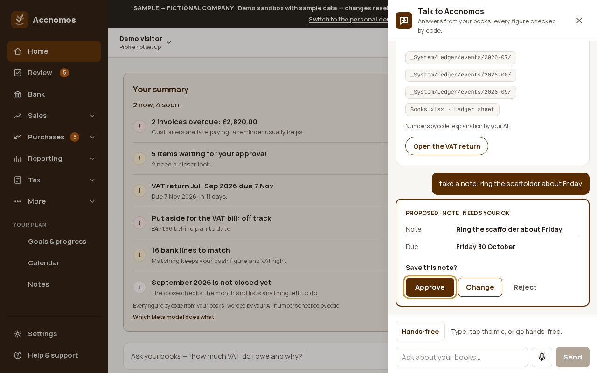
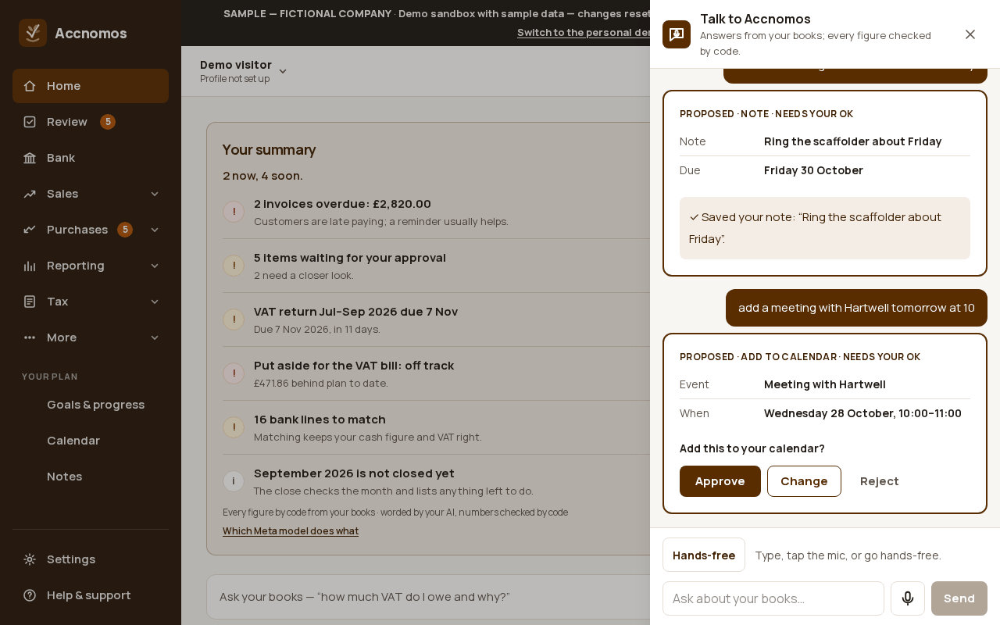
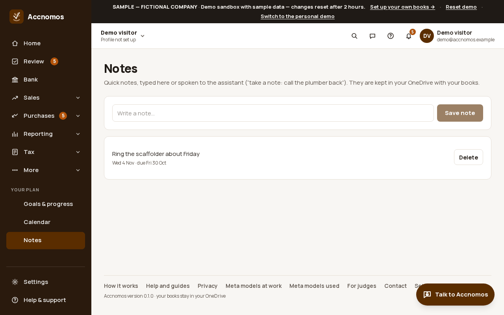

# Notes, to-dos and events by voice

Who this is for: an owner on a site or in the van who wants to capture a job,
a reminder or a meeting without typing into a form. You say it to the
assistant; it makes a card; nothing is saved until you approve it.

1. Open **Talk to Accnomos** and say or type "take a note: ring the
   scaffolder about Friday". The assistant proposes a **Note** card with the
   text and the due day it understood.
   
   If this goes wrong: the note says the wrong day, so press **Change** and
   fix it before approving.
2. Press **Approve** (or, hands-free, say "yes" when it asks "Shall I go
   ahead?"). The card says *Saved your note*.
3. Say "add a meeting with Hartwell tomorrow at 10". It proposes an **Add to
   calendar** event with the time; approve it and it goes into your Outlook
   calendar. Ask "what's on my calendar tomorrow?" to hear it back.
   
   If this goes wrong: the time clashes with something already in your
   calendar, so the card says so before you approve.
4. Open **Notes** (`/notes`, under **Your plan**) to see every note, type a new
   one, or delete one you have done. Notes are kept in your OneDrive with your
   books.
   
   If this goes wrong: a note is missing, so check it was approved: a card
   left on screen saves nothing.

Approving by voice works for notes, to-dos and events. Anything that sends or
moves money always needs a tap on **Approve**.

## On Android

**More › Notes** lists the same notes, and the **Talk** button makes the same
cards. See the [voice and chat guide](voice-chat.md) for the phone's Talk
panel.
