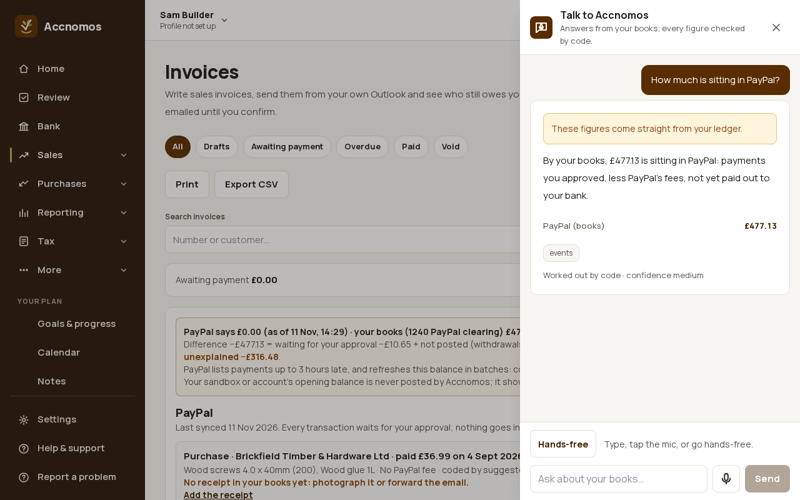
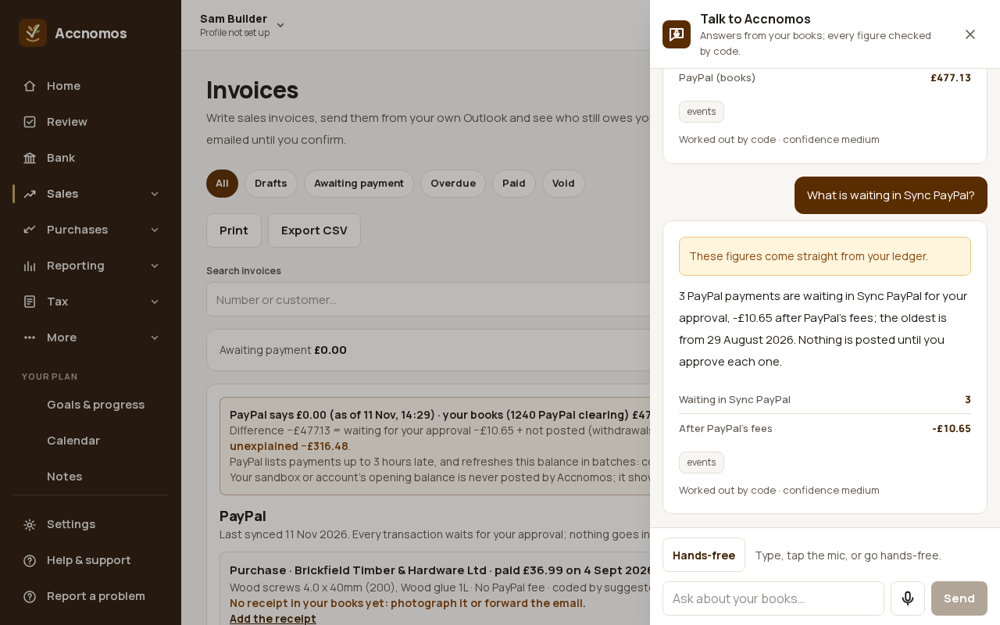

# Ask the assistant about PayPal

Who this is for: anyone who would rather ask than look. **Talk to Accnomos**
answers PayPal questions from your books: the figures are worked out by code,
and the AI only writes the words. Anything that would send or change something
(a PayPal reminder, a payment-link message) comes back as a card you approve.
These pictures use the test-mode stand-in for PayPal and fictional books.

1. Press **Talk to Accnomos** (bottom right of any page) and ask, typed or
   spoken: "How much is sitting in PayPal?". The answer quotes the **1240
   PayPal clearing** balance by your books (payments you approved, less fees,
   not yet paid out to your bank), with the figure beside it.
   
2. Ask what is waiting: "What is waiting in Sync PayPal?" gives how many
   transactions wait for approval, their total after PayPal's fees and the
   oldest; open **Invoices** to approve them ([Sync PayPal](paypal-sync.md)).
   
   If this goes wrong: the answer has no figures, so name the thing you mean
   ("PayPal fees this quarter", "PayPal disputes").
3. Other questions it answers from the books: "What did PayPal cost me this
   quarter?", "When was my last PayPal payout?", "Do I have any PayPal
   disputes?", "Which bills are due through PayPal?" and "Who owes me money?"
   (with each customer's pay-link status).
4. Things to do: "Send a PayPal reminder to everyone who owes me" or "Remind
   Harbour Cafe through PayPal" makes a card listing who, how much and how many
   days overdue; PayPal sends its own reminder only when you tap **Approve**.
   "WhatsApp Harbour Cafe the payment link" makes a short message to copy, with
   links that open your own app; nothing is sent from Accnomos. Cards that send
   always need a tap, even in hands-free.

More on the assistant: [Talk to Accnomos, by voice or chat](voice-chat.md) and,
in the help centre,
[Use the assistant by voice or chat](https://accnomos.com/help/voice-assistant).
