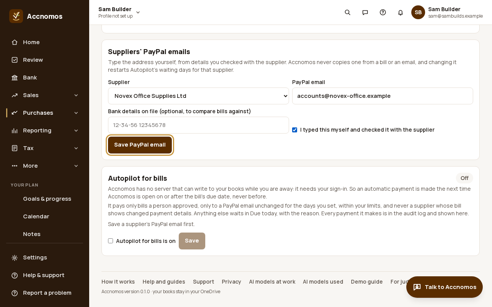
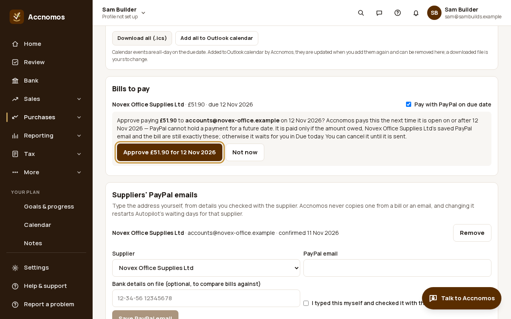
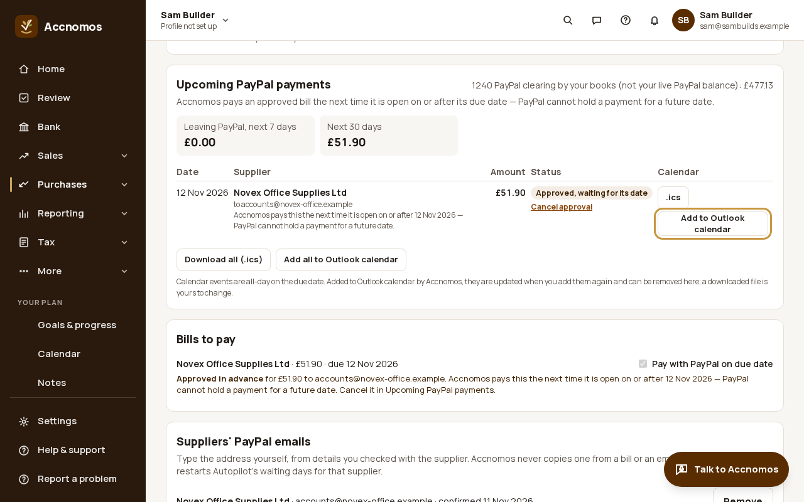
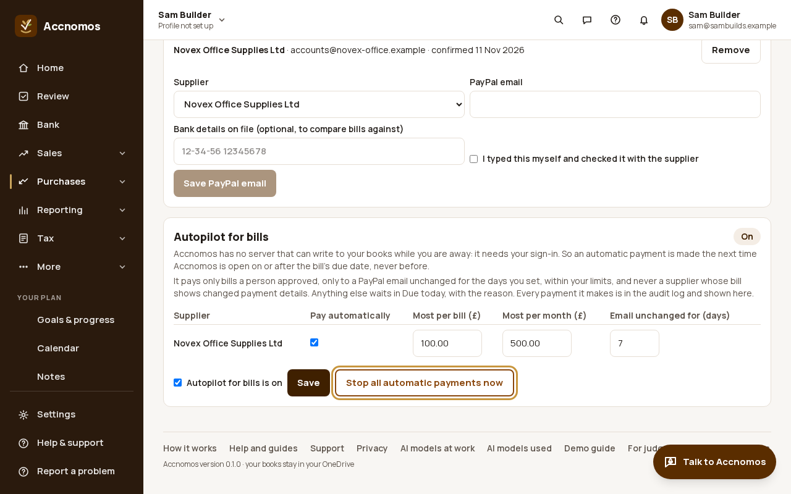
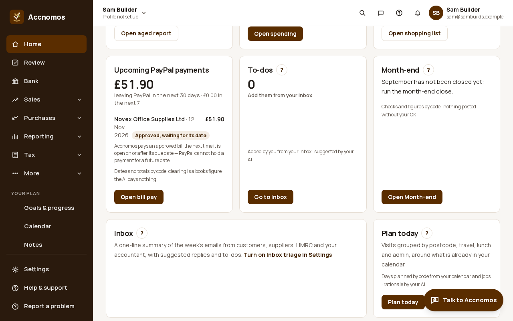

# Pay supplier bills with PayPal

Who this is for: a business that pays some suppliers by PayPal. Bills you
approved in Review can be paid from your PayPal account (PayPal Payouts) on
their due date: you approve each payment, approve it now to be paid on the due
date, or let Autopilot pay suppliers you set limits for, with one switch that
stops it all. A supplier's PayPal email is only ever the one you type, never one
read from a bill. Tried with PayPal's sandbox only: these pictures use the
test-mode stand-in for PayPal and a fictional supplier, and no real money moved.

Short version in the help centre:
[Pay supplier bills with PayPal](https://accnomos.com/help/bill-pay-paypal).

1. Open **Purchases** (`/purchases`) and scroll to **Pay bills with PayPal**.
   Under **Suppliers' PayPal emails**, pick the supplier, type the PayPal email
   they gave you, tick **I typed this myself and checked it with the supplier**
   and press **Save PayPal email**. Adding bank details on file lets code
   compare later bills against them.
   
   If this goes wrong: **Save PayPal email** stays greyed out, so tick the
   confirmation; changing an email restarts Autopilot's waiting days for that
   supplier.
2. Under **Bills to pay**, each bill has **Pay with PayPal on due date**. For
   a bill that is not due yet, press **Approve now, pay on due date**, read what
   will be paid, to whom and when, and press **Approve £… for <date>**. It is
   paid the next time Accnomos is open on or after that date, and only if the
   amount owed, the supplier's saved email and the bill are still exactly
   these; otherwise it waits for you in **Due today**. A bill already due shows
   in **Due today** with **Approve payment**.
   
   If this goes wrong: **Payment details changed on a bill**, so ring the
   supplier on a number you already had before paying, then tick **I checked
   with the supplier**.
3. **Upcoming PayPal payments** lists every approved payment with its date,
   what leaves PayPal in the next 7 and 30 days, and **Cancel approval** until
   it is sent. Press **Add to Outlook calendar** for one payment (or **Add all**)
   to put an all-day event on the due date, or **.ics** for a calendar file.
   
   If this goes wrong: you cancelled a payment that is in your calendar, so
   use the button above the table to remove its event; an event added from a
   file has to be deleted by hand.
4. Optional: **Autopilot for bills**. Tick **Pay automatically** for a
   supplier, set **Most per bill (£)** and **Most per month (£)**, tick
   **Autopilot for bills is on** and press **Save**. It pays only bills a person
   approved, to a PayPal email unchanged for the days you set, within your
   limits. The kill switch, **Stop all automatic payments now**, turns it off at
   once and also holds back payments approved in advance.
   
5. **Home** shows the same **Upcoming PayPal payments** card, with **Open bill
   pay**. Payments run when Accnomos is open: if a bill was not paid on its due
   date, open Home or Purchases.
   
   If this goes wrong: **Waiting for the supplier to claim it**, so the email
   has no PayPal account yet; nothing is posted until they claim it, and PayPal
   returns it after 30 days.

Once PayPal says a payment succeeded, code posts it against the bill (Dr 2100
Creditors, Cr 1240 PayPal clearing) and PayPal's fee as a bank charge.
