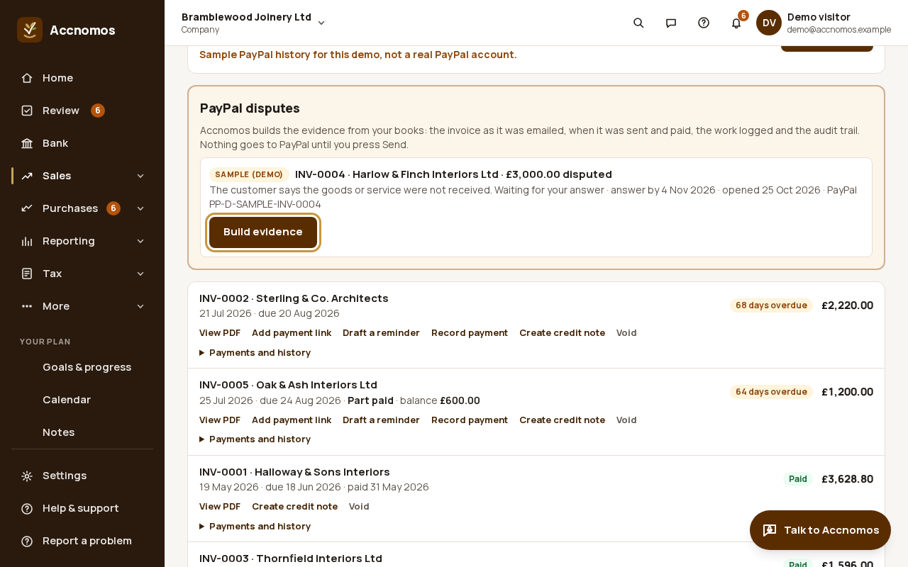
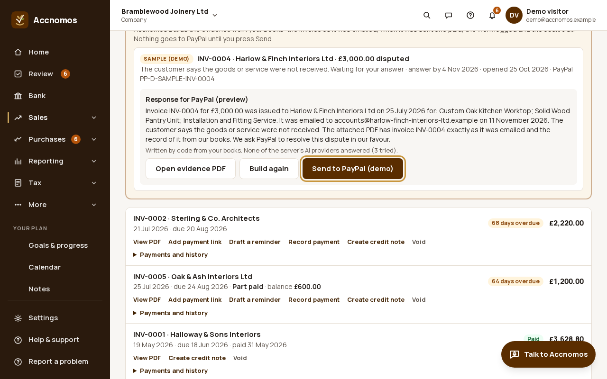
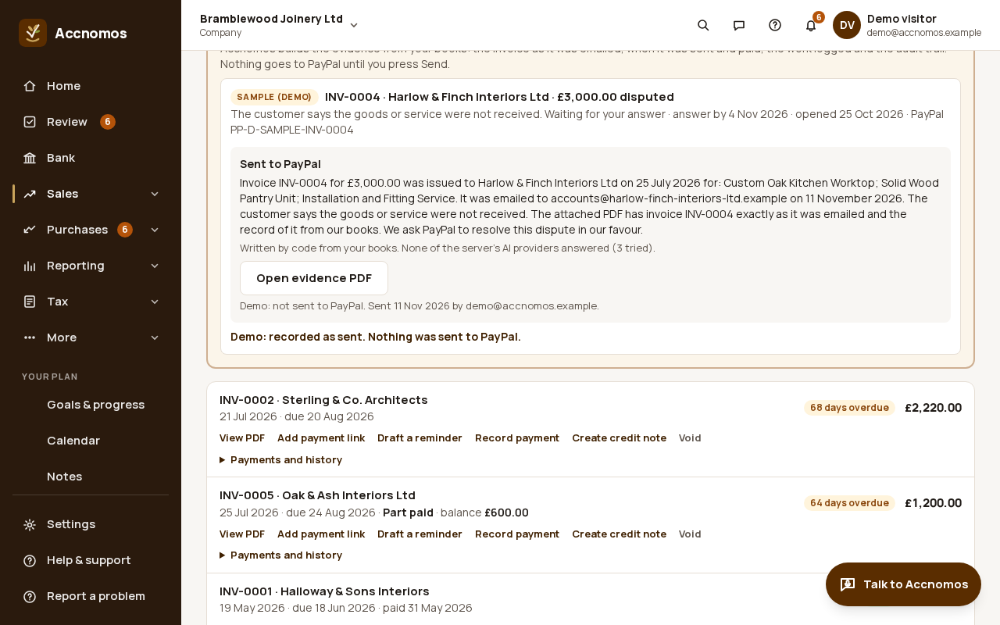

# Answer a PayPal dispute with evidence from your books

Who this is for: a business whose customer has opened a PayPal dispute on a
payment made through one of its invoice links. Accnomos gathers the evidence
from your own books (the invoice, when and to whom it was emailed, the payment
and your reminders) into one PDF and drafts a short, factual response. You read
both, then send; nothing reaches PayPal before you press **Send to PayPal**.
These pictures are the company demo's sample dispute (Bramblewood Joinery Ltd,
fictional): in the demo nothing is sent. Disputes are checked against a stand-in
for PayPal only: no sandbox dispute was available, so sending evidence has not yet
met PayPal itself.

Short version in the help centre:
[Respond to a PayPal dispute](https://accnomos.com/help/paypal-disputes).

1. Open **Invoices**. **PayPal disputes** lists each dispute on a payment
   Accnomos knows about, with the invoice it matched, the amount, the reason,
   and when PayPal needs your answer. Press **Build evidence**.
   
   If this goes wrong: the dispute says **Not a payment Accnomos knows
   about**, so answer it in PayPal's Resolution Centre: there is no record of
   that payment in your books.
2. Read **Response for PayPal (preview)** and press **Open evidence PDF** to
   check the pack. Every figure and date in the draft is checked against your
   books by code; if the AI cannot draft it, code writes it from your books and
   says so. **Build again** makes a fresh draft. When you are happy, press
   **Send to PayPal**.
   
3. The dispute then says **Sent to PayPal**, with when and by whom. If PayPal
   later finds for the customer and refunds the whole payment, the dispute
   offers the reversing entry so the invoice is open again; it is posted only if
   you say yes.
   
   If this goes wrong: Could not check PayPal disputes, so check PayPal is
   still connected in **Settings › Online payments**; account holds, limits
   and the dispute decision itself are PayPal's
   ([PayPal problems: where to get help](https://accnomos.com/help/paypal-help)).
