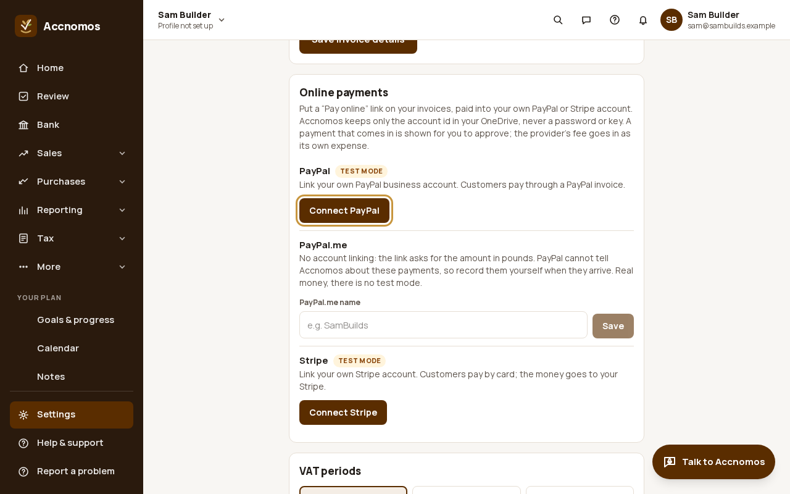
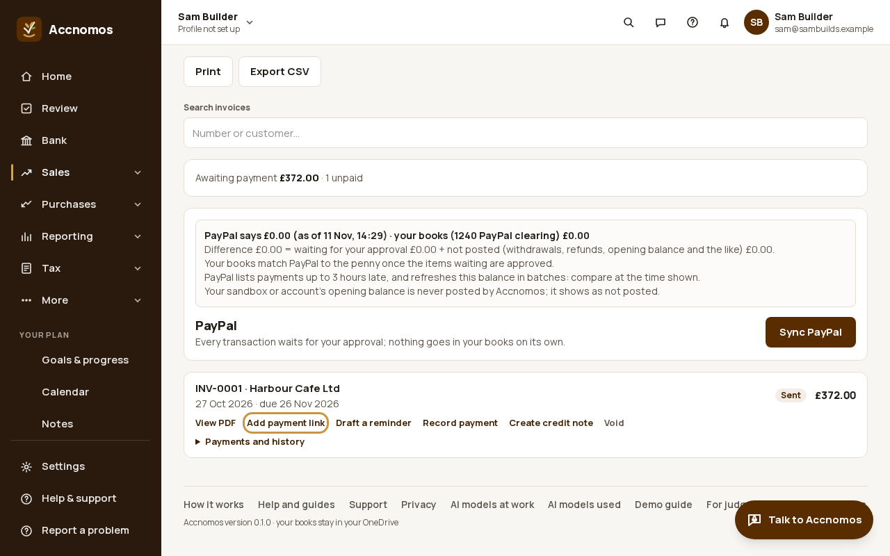
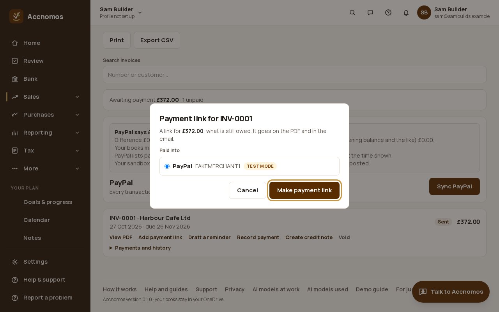
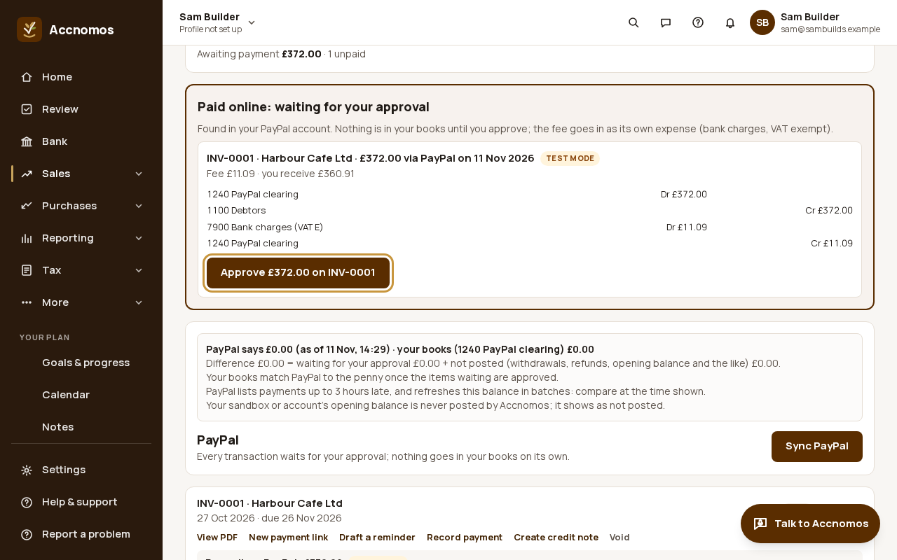

# Send an invoice with a PayPal pay link

Who this is for: a business that wants customers to pay its invoices through
PayPal. You connect your own PayPal business account once; each invoice can
then carry a **Pay online** link, printed on the PDF and put in the email. A
payment that arrives waits on **Invoices** until you approve it. PayPal has
been tried with PayPal's sandbox only: these pictures use the test-mode stand-in
for PayPal and fictional customers, and no real money moved.

The help centre has the same steps in short:
[Send an invoice with a PayPal pay link](https://accnomos.com/help/invoices-paypal-links).

1. Open **Settings › Business › Online payments** and press **Connect PayPal**.
   Sign in to your PayPal business account and come back; the card then says
   which PayPal account is connected.
   
   If this goes wrong: Connect says PayPal is not available on this server,
   so save a PayPal.me name instead (those payments are not found by code) or
   raise a ticket on **Support**.
2. Open **Invoices** (`/invoices`), find the invoice and press **Add payment
   link**. Make the invoice first with **New invoice**, or ask the assistant:
   "send a £300 invoice to Hartwell for the October work".
   
3. Check the amount (what is still owed) and that **PayPal** is picked under
   **Paid into**, then press **Make payment link**. **Copy link** sends it
   another way, for example in a text message.
   
   If this goes wrong: the link asks for an old amount after a part payment
   or a credit note, so make a new payment link: a link has a fixed amount.
4. When the customer pays, open **Invoices** again. The payment waits under
   **Paid online: waiting for your approval** with PayPal's fee and the entries
   approving makes. Press **Approve**: the payment goes against the invoice and
   the fee goes to **7900 Bank charges**.
   
   If this goes wrong: the payment does not appear, so open Invoices again:
   payments are looked for when the page opens, not in the background.

Next: [Sync PayPal](paypal-sync.md) brings in everything else in your PayPal
account, and [Ask about PayPal](paypal-ask.md) can send PayPal reminders to
everyone who owes you.
