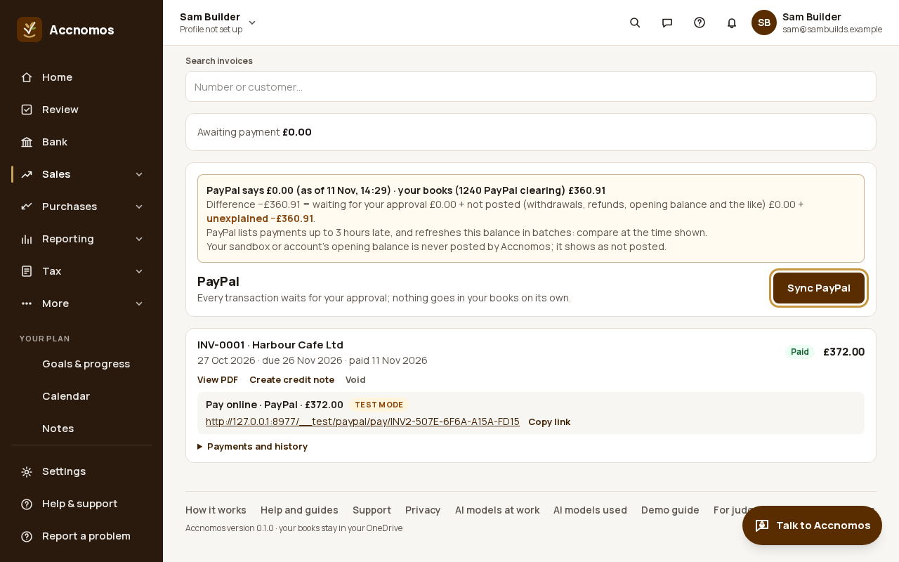
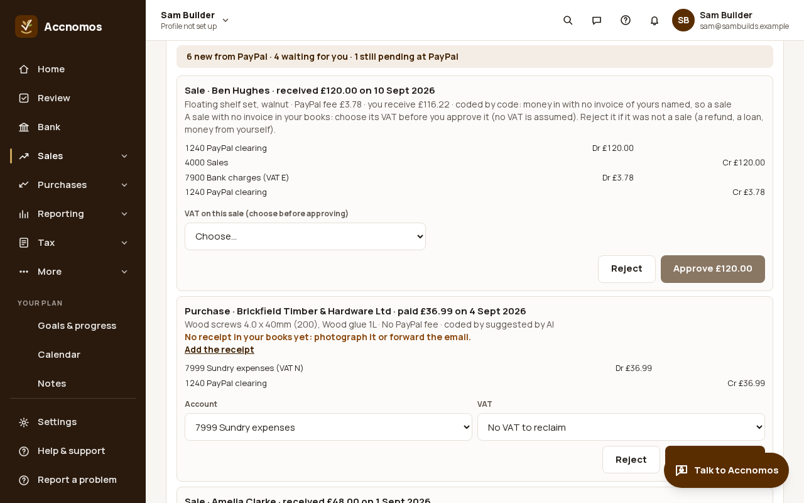
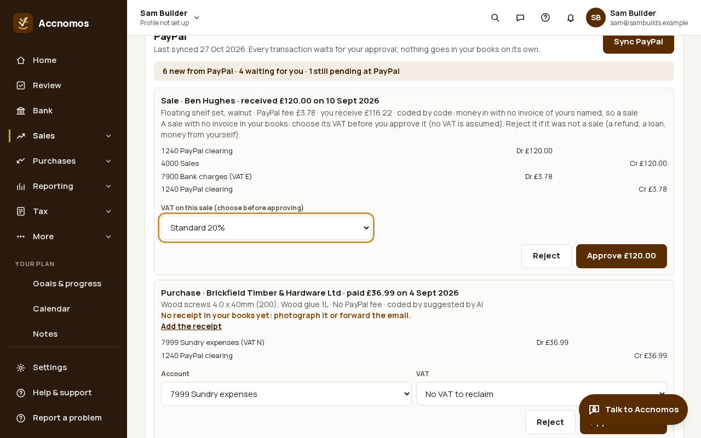
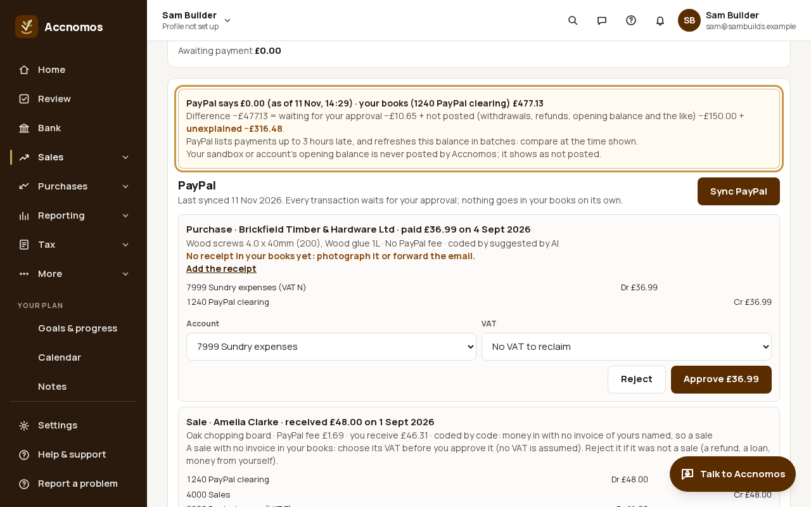

# Sync PayPal: approve, choose the VAT, tie out the balance

Who this is for: a business with a PayPal account that has more in it than
invoice payments: sales with no invoice, purchases paid by PayPal, PayPal's
fees and withdrawals to the bank. **Sync PayPal** reads the PayPal history and
proposes each transaction for your books; nothing posts until you approve it.
Tried with PayPal's sandbox only: these pictures use the test-mode stand-in for
PayPal with a fictional joinery's month of transactions.

Short version in the help centre: [Sync PayPal](https://accnomos.com/help/sync-paypal).

1. Connect PayPal first (**Settings › Business › Online payments**, see
   [Send an invoice with a PayPal pay link](paypal-invoice-link.md)). Then open
   **Invoices** and press **Sync PayPal** in the **PayPal** panel. The first
   sync reads the last 90 days; later ones carry on from the last, and nothing
   is proposed twice.
   
   If this goes wrong: Could not sync PayPal, so check Online payments still
   shows PayPal connected and try again; if it keeps failing, raise a ticket
   with **Include PayPal details** ticked.
2. Read the list. Each transaction says what it is (a sale, a purchase, an
   invoice payment or a fee), the PayPal fee, what you receive, who or what
   coded it (your rule, code, or the AI) and the journal approving makes. A
   purchase with no receipt in your books says **No receipt** and links to
   **Add the receipt**. Withdrawals, refunds and other currencies are listed
   under the others but never posted.
   
3. A sale with no invoice of yours asks for its VAT: **VAT on this sale
   (choose before approving)**. No VAT is ever assumed, because standard,
   zero-rated, exempt and outside-the-scope money all reach PayPal. Choose it,
   then press **Approve**. For a purchase you can change the **Account** and
   **VAT** before approving; **Reject** anything that was not a sale (a refund,
   a loan, money from yourself).
   
   If this goes wrong: **Approve** stays greyed out, so choose the VAT first.
4. Check the tie-out at the top of the panel: **PayPal says** your balance,
   beside **your books (1240 PayPal clearing)**, with the difference split
   into what is waiting for your approval and what is never posted
   (withdrawals, refunds, the opening balance). Anything left over shows as
   **unexplained**.
   
   If this goes wrong: an unexplained difference stays after you approved
   everything, so sync again later (PayPal lists some transactions up to three
   hours late) and compare at the time shown. In the picture the PayPal
   stand-in reports a balance of £0.00, so the whole difference is shown as
   unexplained: this is what a real mismatch looks like.

With the [Power grid](power-grid.md) add-on on, the same transactions open in
one grid where you can tick several and approve them together.
