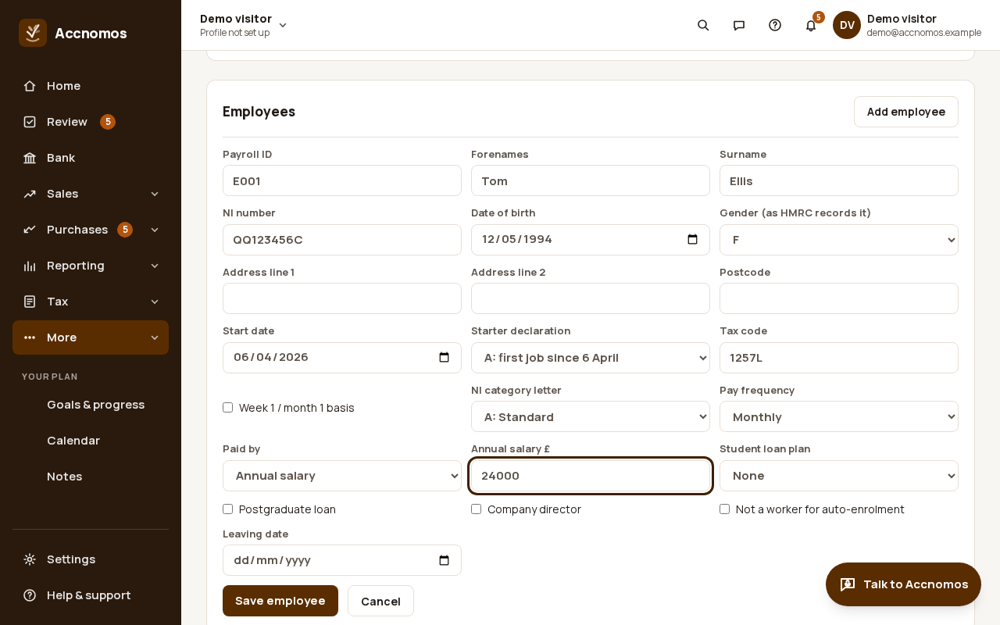
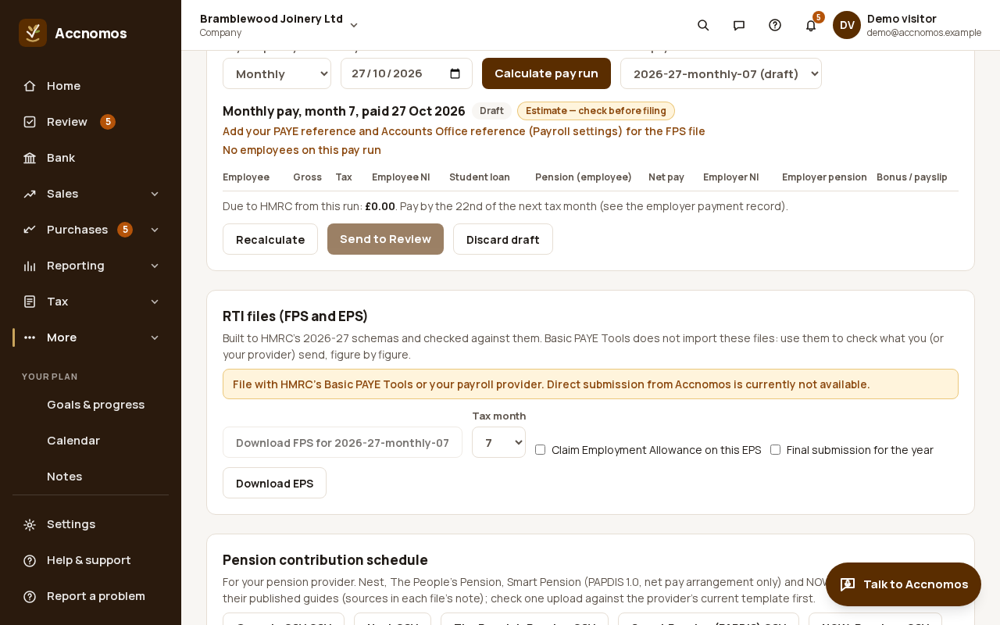
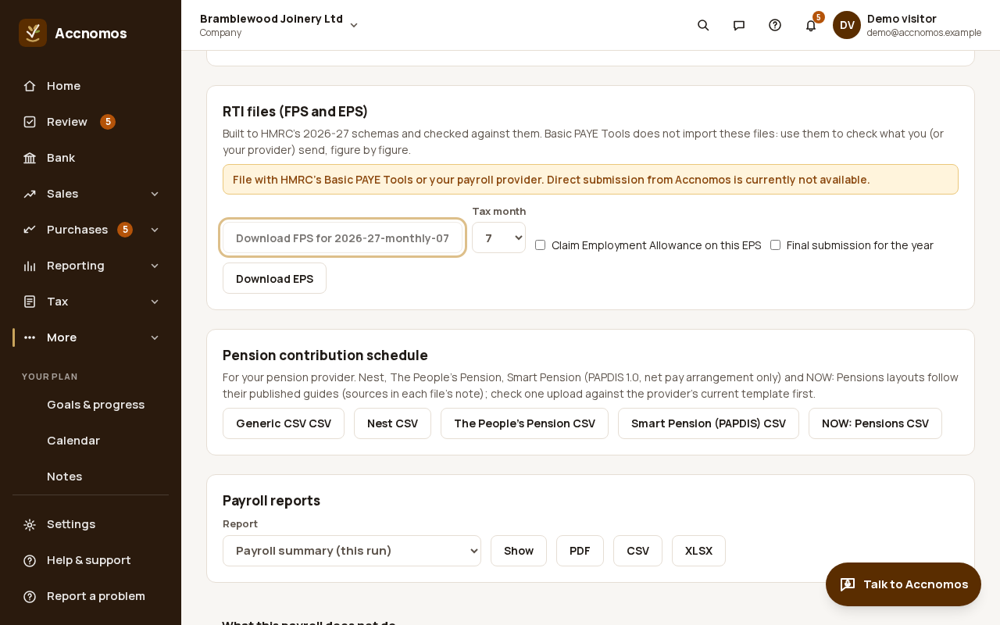

# Run payroll and file with Basic PAYE Tools

Who this is for: an employer running a pay run. Accnomos calculates PAYE, NI,
student loans and pensions at HMRC's 2026-27 rates, approves the run into your
books and prepares the files. It does not submit to HMRC: you file with HMRC's
Basic PAYE Tools or your payroll provider, and pay HMRC and your staff
yourself.

1. Open **Payroll** (`/payroll`, under **More**). Fill in **Payroll settings**
   once (employer name, HMRC office number, PAYE and Accounts Office
   references, pension provider), then press **Add employee** and enter each
   person: payroll ID, names, NI number, date of birth, start date, starter
   declaration, tax code, NI category, pay frequency and pay.
   
   If this goes wrong: the tax code changes as you pick the starter
   declaration, so check it last: the code is suggested from the declaration.
2. Under **Pay runs**, choose the frequency and pay date and press
   **Calculate pay run**. The draft lists gross, tax, NI, student loan,
   pension and net pay per employee and what is due to HMRC, marked
   *Estimate — check before filing*.
   
   If this goes wrong: the run says what is missing (for example your PAYE
   reference, or no employees on this pay run), so fill that in and press
   **Recalculate**.
3. Press **Send to Review** and approve the run there: that posts the staff
   costs to your books.
4. Download the **FPS** for the run and the **EPS** for the tax month, the
   pension schedule for your provider (Nest, The People's Pension, Smart
   Pension, NOW: Pensions or a generic CSV), and the payroll reports
   (payslips, P32, P11, P60, P45 figures).
   
5. File the FPS and EPS in Basic PAYE Tools yourself, using the files to check
   what you send figure by figure; Basic PAYE Tools does not import them.
6. Pay HMRC and your staff from the bank, then match those bank lines in
   [Bank](reconcile-bank.md).

## On Android

**More › Payroll** shows the pay runs to prepare, export and confirm. Setting
up employees is easier on the web.
