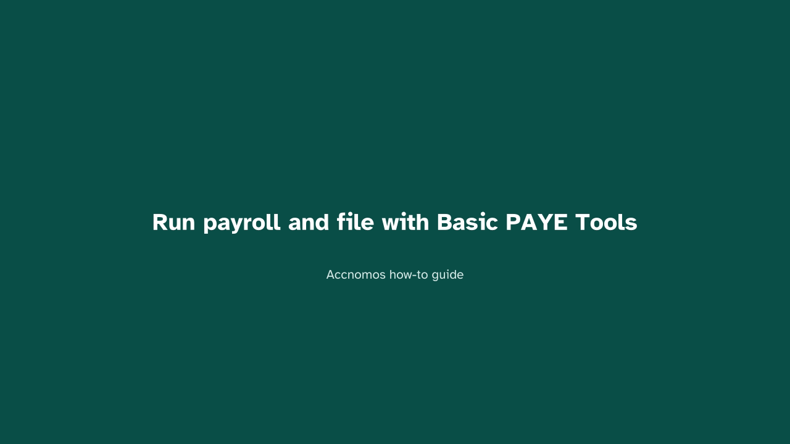
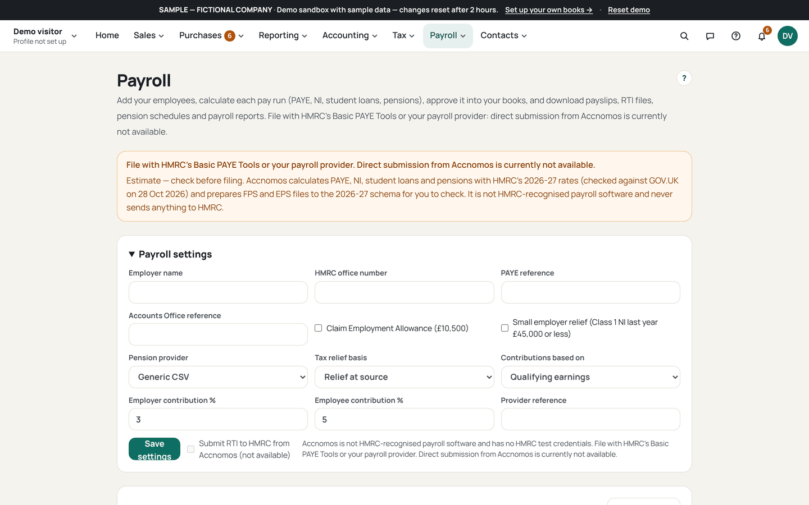

# Run payroll and file with Basic PAYE Tools

Who this is for: an employer running a pay run. Accnomos estimates the run
and prepares the files; it never files payroll or pays HMRC. You file with
HMRC's Basic PAYE Tools or your payroll provider.

1. Open Payroll (`/payroll`) and add each employee once.
   
   If this goes wrong: a tax code changes while you type, so wait for the
   starter-code suggestion to finish before typing.
2. Enter this period's hours and rates.
   
   If this goes wrong: the gross looks wrong, so check the rate belongs to the
   right employee row.
3. Confirm the run and read every line of the estimate.
   
   If this goes wrong: a deduction is missing, so the employee record lacks
   the detail behind it; fix the record and re-run.
4. Download the payslips, the FPS and EPS files, and the pension schedule.
   
   If this goes wrong: a file is for the wrong period, so check the period
   shown on the run before downloading again.
5. File the FPS and EPS in HMRC's Basic PAYE Tools yourself.
   
   If this goes wrong: the tool rejects a file, so use the Accnomos figures
   to check what you typed; the files only stand beside your filing.
6. Pay HMRC and your staff outside Accnomos, then record it.
   
   If this goes wrong: the run still shows unpaid, so match the bank line to
   it by hand.
