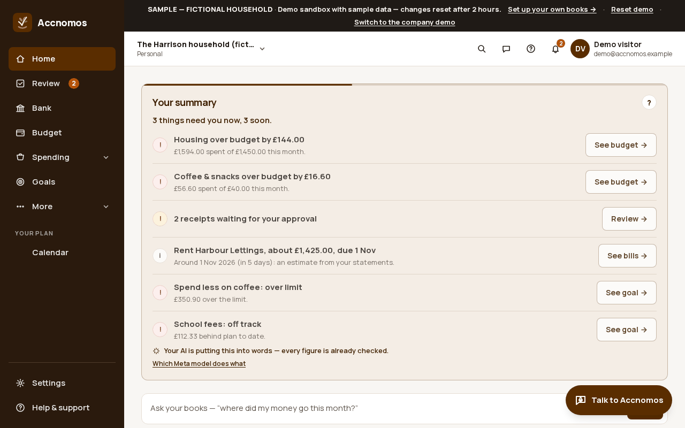
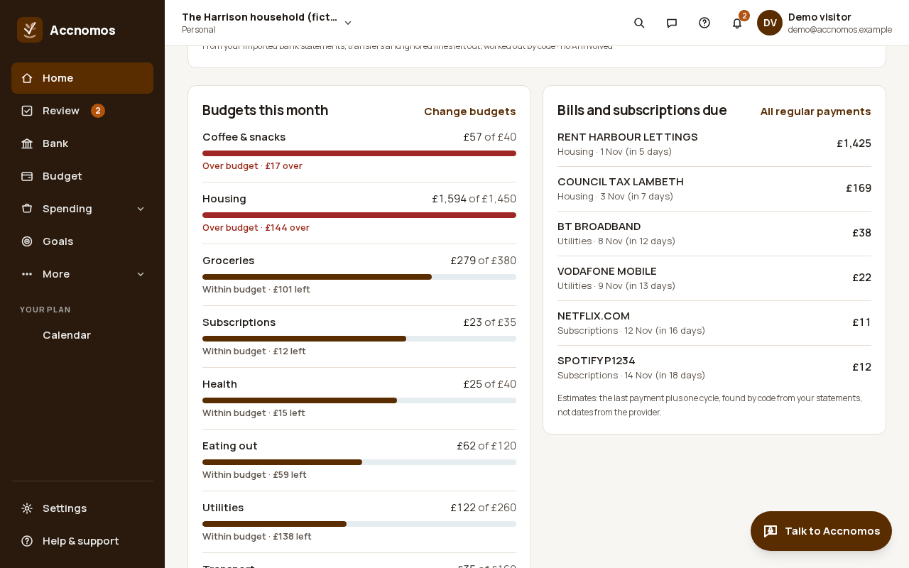
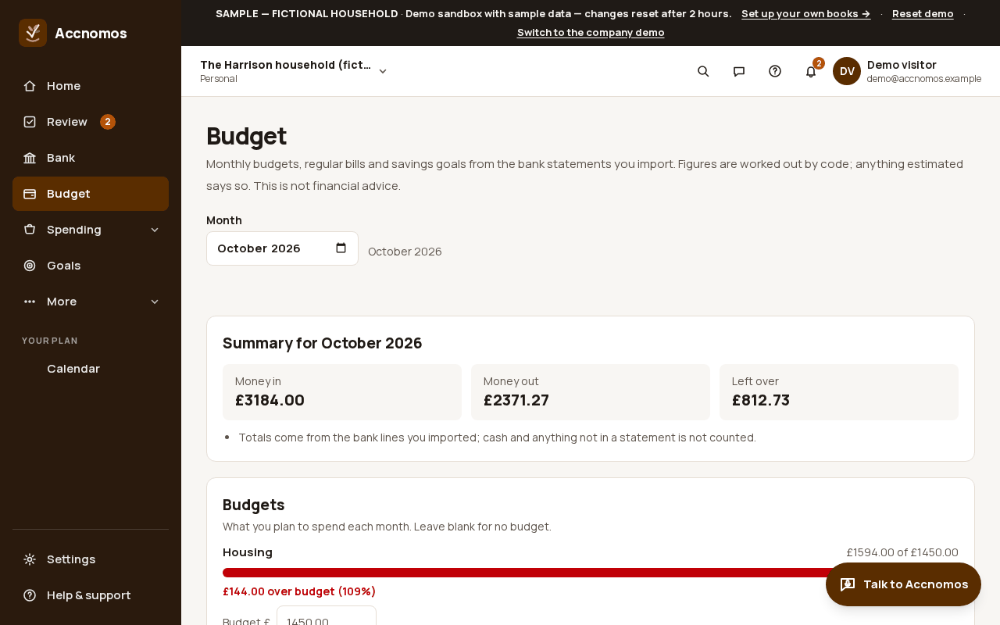
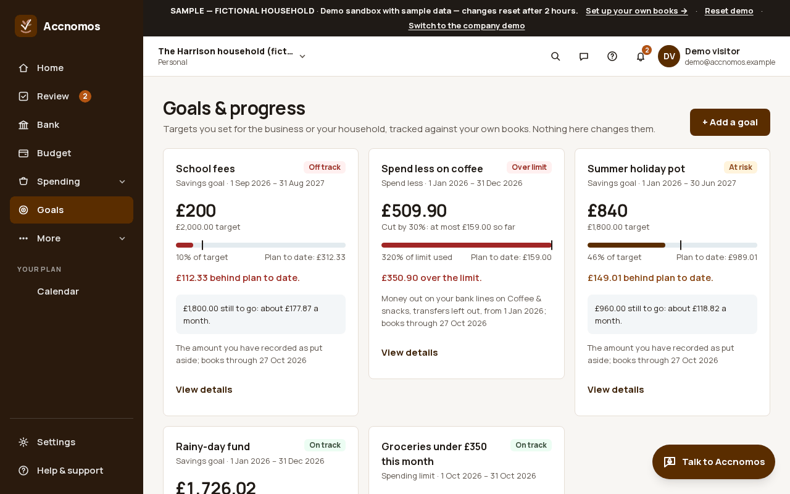
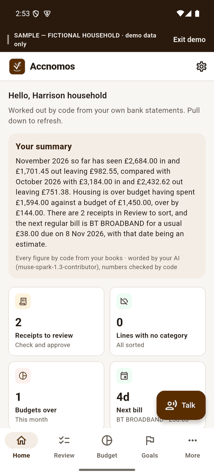
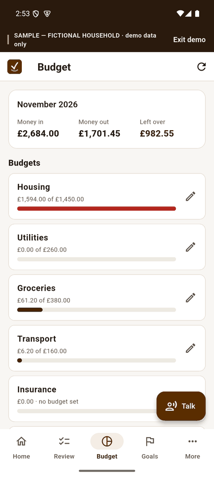

# Personal finances

Who this is for: a household keeping its own money in order, or an owner who
wants personal money kept apart from the business. Budgets, regular bills and
savings goals come from the bank statements you import. There is no
investment advice and no credit score; anything estimated is labelled.

To try it, press **Try the personal demo** on the home page (the fictional
Harrison household). For your own books, choose personal books in the set-up
wizard, or in business books switch on **Show personal finances** in
**Settings › Business**.

1. **Home** becomes the household's own: **Your summary** lists what needs you
   (budgets over, receipts to approve, the next bill, goals behind), each with
   a button, and the tiles below count receipts to review, spending with no
   category, budgets over and the next regular bill.
   
2. Scroll to **Budgets this month** and **Bills and subscriptions due**. Each
   budget shows what was spent of the limit; bills are found by code from the
   statements, with the next date estimated from the last payment.
   
3. Open **Budget** (`/personal`) to pick the month, read money in, money out
   and what is left, and set each category's budget.
   
   If this goes wrong: a total looks low, so import the month's statement in
   **Bank**: cash and anything not on a statement are not counted.
4. **Goals** works as in [Set goals and track progress](goals.md), with
   household kinds such as school fees, a holiday pot or spending less on
   coffee.
   

## On Android

In personal books the bottom bar is **Home, Review, Budget, Goals, More**.
Home has the summary and the same tiles; **Budget** shows the month and each
budget with a pencil to change it.

