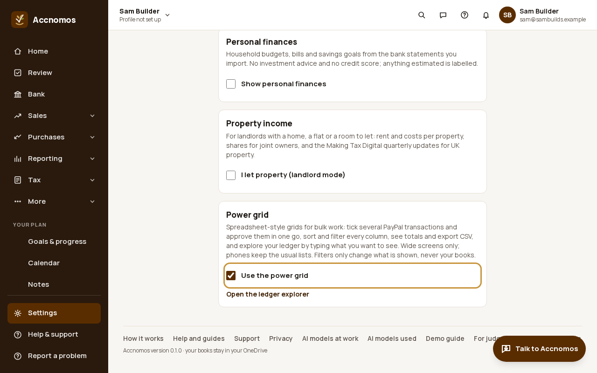
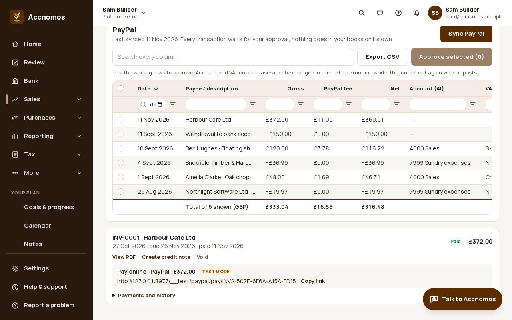
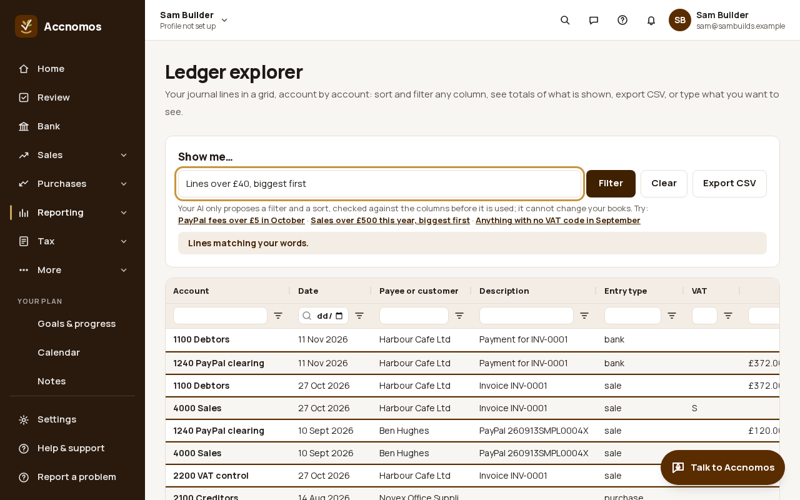

# The Power grid add-on

Who this is for: an owner or bookkeeper doing bulk work on a wide screen. The
Power grid is an optional add-on, off by default and set per device: the PayPal
panel opens as one sortable, filterable grid where you can tick several
transactions and approve them together, and **Reporting › Ledger explorer**
shows your journal lines in a grid that you can filter by typing what you want.
Phones and narrow windows keep the usual lists. These pictures use the test-mode
stand-in for PayPal and fictional books.

1. Open **Settings › Business**, scroll to **Power grid** and tick **Use the
   power grid**. **Open the ledger explorer** is right below.
   
2. Open **Invoices**. The PayPal panel is now a grid: every synced transaction
   with date, payee, gross, PayPal fee, net, account and VAT, and a total of
   what is shown. Search every column, sort or filter a column, tick the
   waiting rows and press **Approve selected**; **Export CSV** saves what is
   shown. A sale with no invoice still asks for its VAT before it can be
   approved.
   
   If this goes wrong: you see the usual list, so widen the window; the grid
   is for wide screens only.
3. Open **Reporting › Ledger explorer** (`/reports/ledger-grid`). Type what
   you want in **Show me…**, for example "Lines over £40, biggest first", and
   press **Filter**. The AI only proposes a filter and a sort; code checks them
   against the columns before they are used, and it cannot change your books.
   **Clear** takes the filter off.
   

The approving rules are the same as in [Sync PayPal](paypal-sync.md); the grid
only lets you do several at once.
