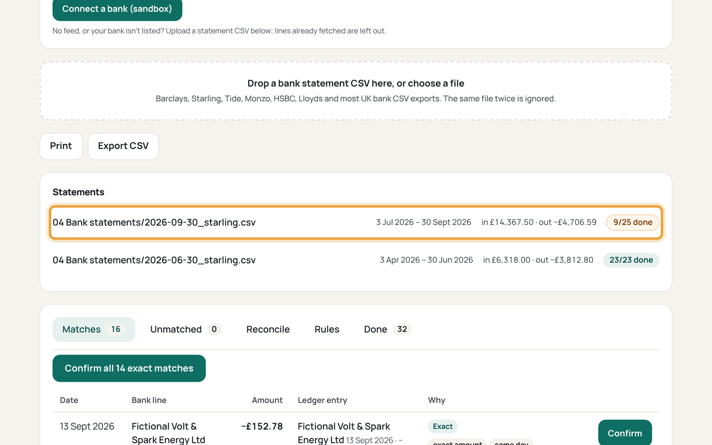
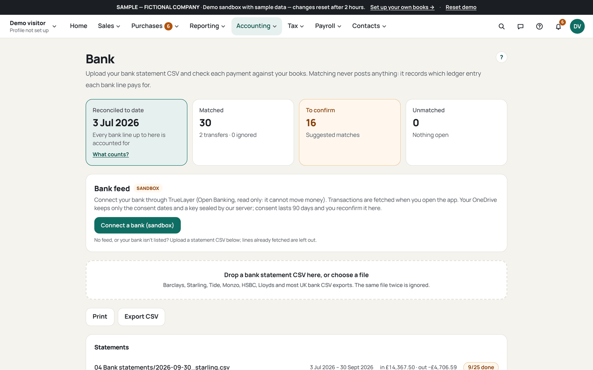
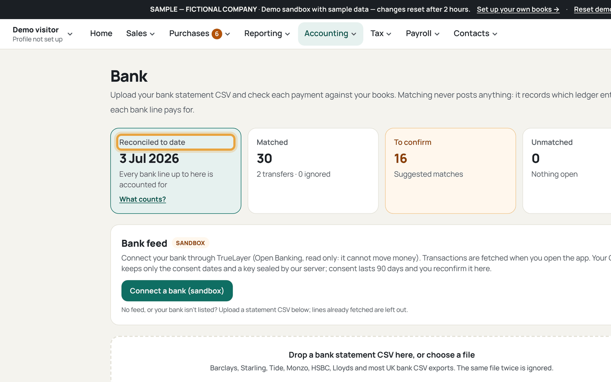

# Reconcile bank lines

Who this is for: an owner matching a bank statement against the books. Import
a CSV; Accnomos never connects to your bank.

1. Open Bank (`/bank`) and import the statement CSV.
   
   Must be visible: the Bank page with the file picker and the supported
   layouts note (Barclays, Starling, Tide, Monzo, HSBC, Lloyds).
   If this goes wrong: the file is refused, so save it as CSV with one header
   row and try again.
2. Check the imported lines saved under `04 Bank statements/`.
   
   Must be visible: the saved statement file named by date and bank, with the
   line count.
   If this goes wrong: the same file imports twice, so check the hash: an
   identical file is a no-op and adds nothing.
3. Work through the suggested matches and press Confirm.
   
   Must be visible: each suggestion with amount within 1p, date within 5 days,
   and the counterparty name.
   If this goes wrong: a match looks wrong, so leave it; Confirm only what the
   statement supports.
4. Deal with the unmatched lines one by one.
   
   Must be visible: the *Create expense proposal*, *Mark as transfer* and
   *Ignore* buttons on an unmatched line.
   If this goes wrong: an expense claims VAT it should not, so the proposal
   lands in Review with no VAT for you to check.
5. Read the *Reconciled to date* tile and the Bank sheet.
   
   Must be visible: the reconciled-to date on the tile and matching statuses
   in the Bank sheet of `Books.xlsx`.
   If this goes wrong: the date stops early, so an unmatched line is still
   waiting above.
