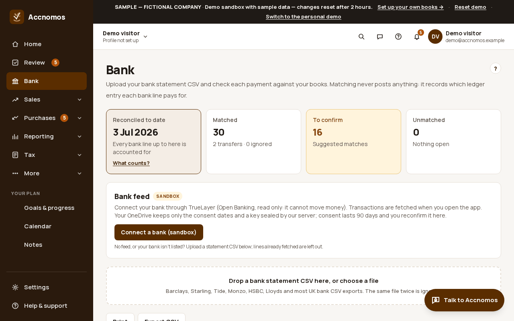
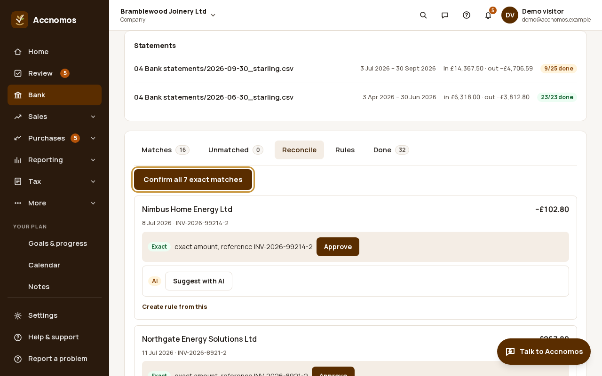
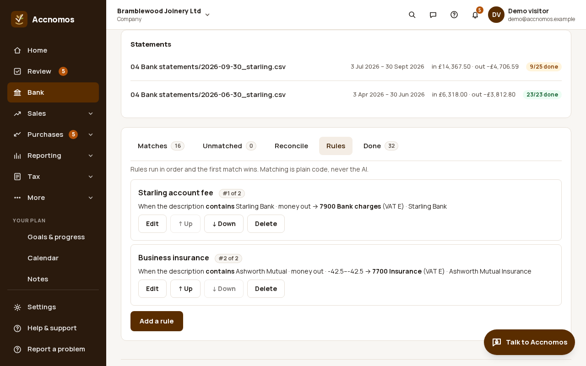

# Reconcile bank lines

Who this is for: an owner matching a bank statement against the books. Import
a statement CSV, or connect a bank feed in the sandbox; matching never posts
anything on its own.

1. Open **Bank** (`/bank`). The tiles show the **Reconciled to date**, how
   many lines are matched, how many suggested matches wait **To confirm**, and
   what is **Unmatched**. Drop a statement CSV in the box below (Barclays,
   Starling, Tide, Monzo, HSBC, Lloyds and most UK bank exports); the same file
   twice is ignored.
   
   If this goes wrong: the file is refused, so save it as CSV with one
   header row and try again.
2. Open the **Reconcile** tab. Exact matches (same amount, a reference that
   matches the invoice) can be confirmed together with **Confirm all exact
   matches**; the rest are listed one by one with **Approve**, or **Suggest
   with AI** where code found nothing certain.
   
   If this goes wrong: a match looks wrong, so leave it; confirm only what
   the statement supports.
3. For lines nothing matches, create an expense proposal (it lands in Review),
   mark it as a transfer, or ignore it. **Create rule from this** turns a line
   into a rule for next time.
4. Open the **Rules** tab to see, reorder or edit your rules. Rules run in
   order and the first match wins; matching is plain code, never the AI.
   
   If this goes wrong: a rule catches the wrong lines, so move the more
   specific rule above it with **Up**.
5. Check the **Reconciled to date** tile again: it moves forward once every
   line up to that date is accounted for.

## On Android

**More › Bank** lists statements, unmatched lines and rules to check on the
go. Uploading a statement and confirming matches are done on the web.
