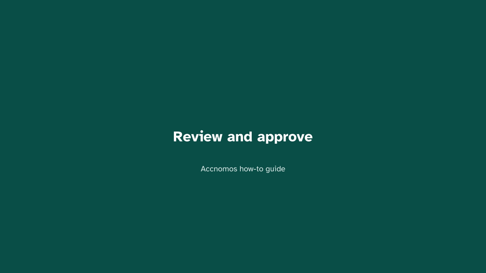
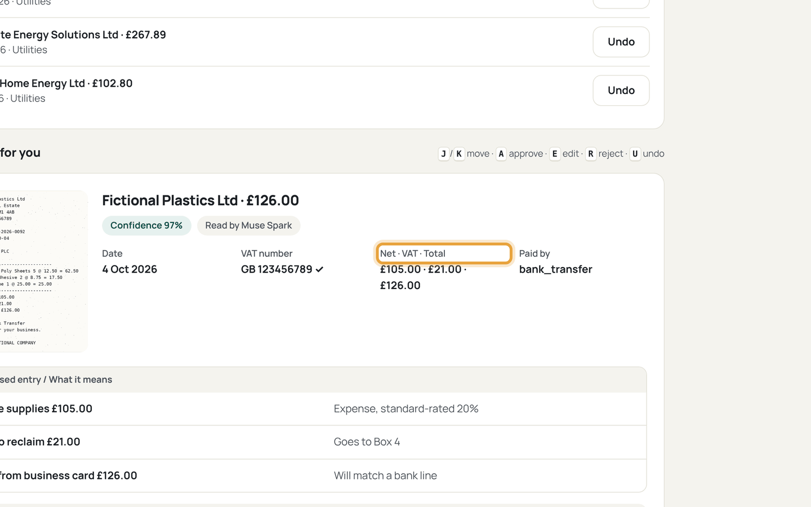
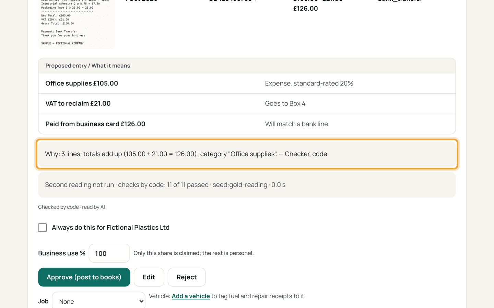
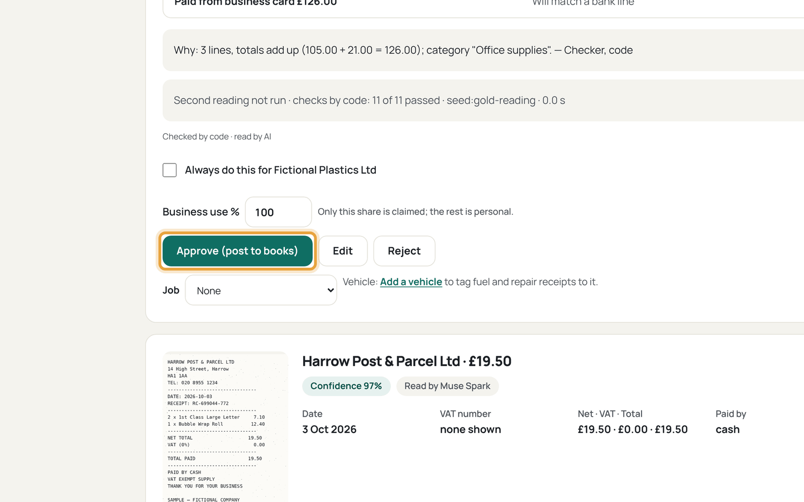
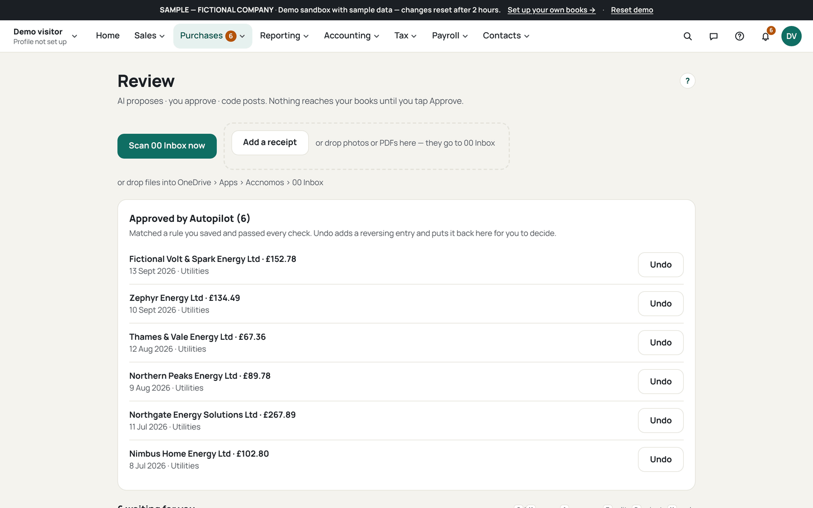
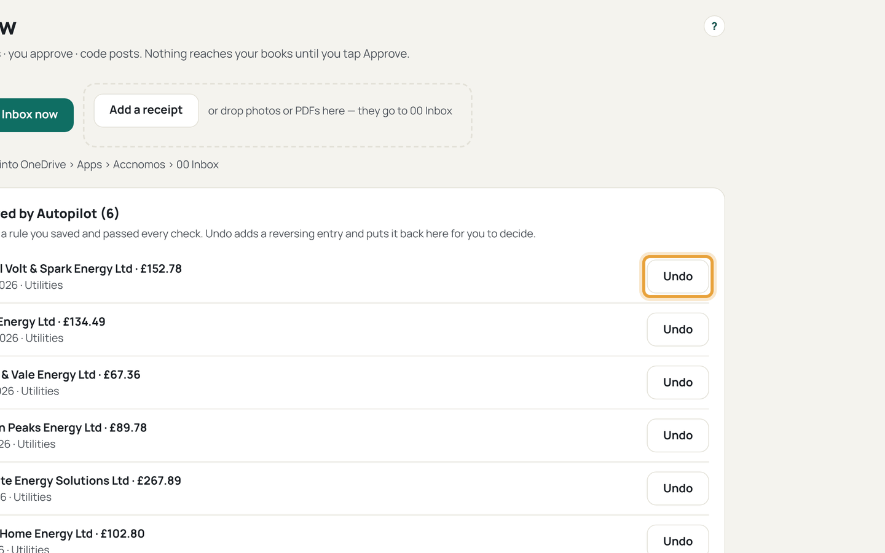

# Review and approve

Who this is for: an owner clearing the Review queue. AI proposes, code checks,
you approve: nothing posts on its own.

1. Open Review (`/review`) and read the queue counts.
   
   If this goes wrong: the queue is empty after a scan, so check the intake
   log for dropped files.
2. Open one card and compare every field against the receipt image.
   
   If this goes wrong: the image is unreadable, so reject the card and
   photograph the receipt again.
3. Read the code checks and the second reading before deciding.
   
   If this goes wrong: the two readings disagree, so the card sits in
   *Needs a look* with both values; pick the one the image supports.
4. Press Approve, Edit, or Reject.
   
   If this goes wrong: Approve stays disabled, so fill the highlighted missing
   field first.
5. Optional: tick *Always do this for this supplier* for Autopilot L1.
   
   If this goes wrong: later receipts from that supplier still wait in Review,
   so check the rule totals: Autopilot only posts under twice the usual.
6. Undo a mistake from the ledger entry, never by deleting.
   
   If this goes wrong: the period is already submitted, so the correction is
   dated today in the open period instead.
