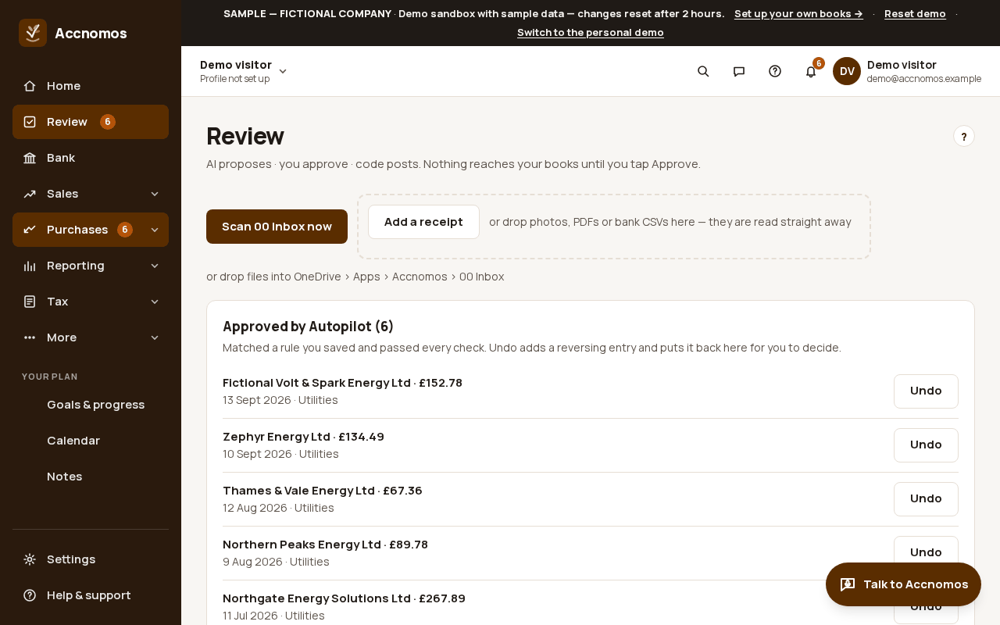
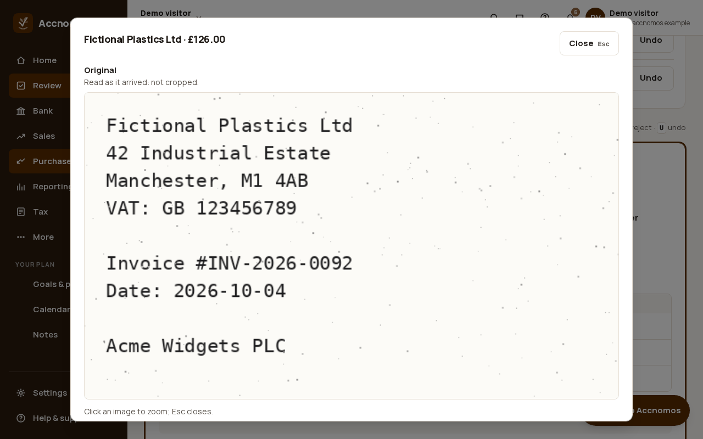
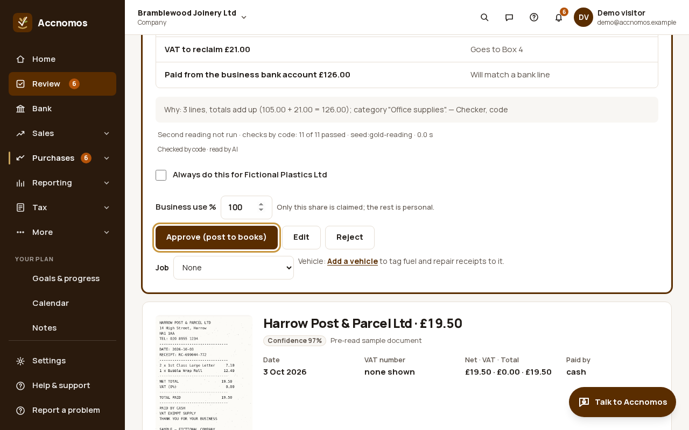
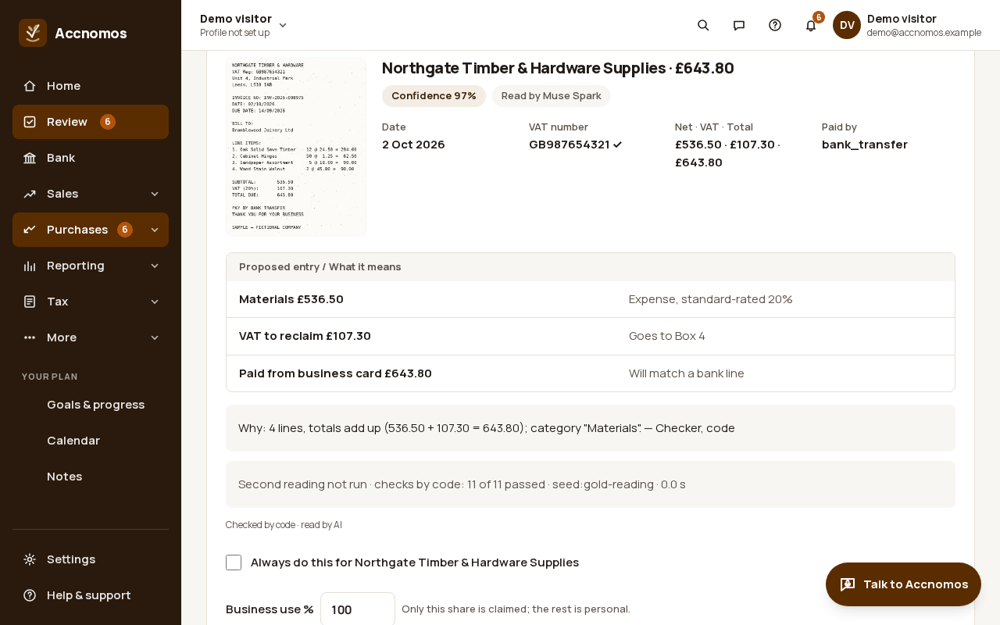
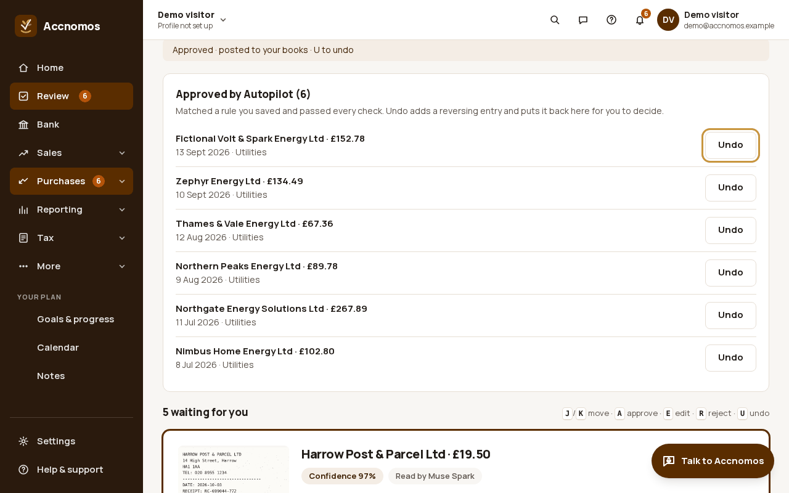
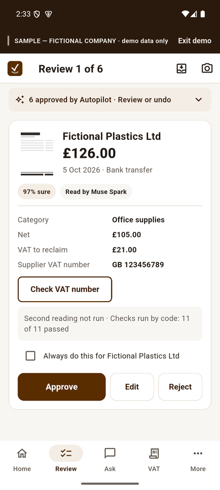

# Review and approve

Who this is for: an owner clearing the Review queue. The AI proposes, code
checks, you approve: nothing reaches your books until you tap Approve.

1. Open **Review** (`/review`). At the top, **Scan 00 Inbox now** and **Add a
   receipt** bring documents in (pick or drop photos, PDFs and bank CSVs, a
   **zip**, or a whole folder with **Choose a folder**; zips and folders are
   opened for you and everything lands flat in `00 Inbox`); **Approved by Autopilot** lists what your own
   rules approved, each with **Undo**; below it, the count of documents
   waiting for you.
   
   If this goes wrong: the queue is empty after a scan, so check the file
   landed in `00 Inbox` and is a photo, PDF or CSV. Anything else in a zip or
   folder is skipped, and the summary under the buttons says how many and why.
   A zip over 500 files or 500 MB is refused: split it and add the parts.
2. Open the document from its card and compare it with the reading: supplier,
   VAT number, date, net, VAT and total.
   
   If this goes wrong: the image is unreadable, so reject the card and
   photograph the receipt again.
3. Read the **Why** line, the second reading and the code checks, and the
   proposed entry (what goes to Box 4, what will match a bank line). Then
   press **Approve (post to books)**, **Edit** or **Reject**.
   
   If this goes wrong: the two readings disagree, so the card sits in *Needs
   a look* with both values; pick the one the document supports.
4. The next card opens. Keys work too: **J**/**K** move, **A** approves,
   **E** edits, **R** rejects and **U** undoes the last approval.
   
5. Tick **Always do this for …** on a supplier you trust and Autopilot approves
   their next documents that pass every check. Undo any of them from
   **Approved by Autopilot**: Undo adds a reversing entry, it never deletes.
   
   If this goes wrong: a supplier's bill is unusually large, so it waits in
   Review even with a rule: Autopilot only posts up to twice the usual.

## On Android

**Review** is a tab of its own, one card at a time (*Review 1 of 6*), with the
same checks, the **Always do this** tick and **Approve**, **Edit** and
**Reject**. The camera button at the top photographs a receipt straight into
`00 Inbox`.

