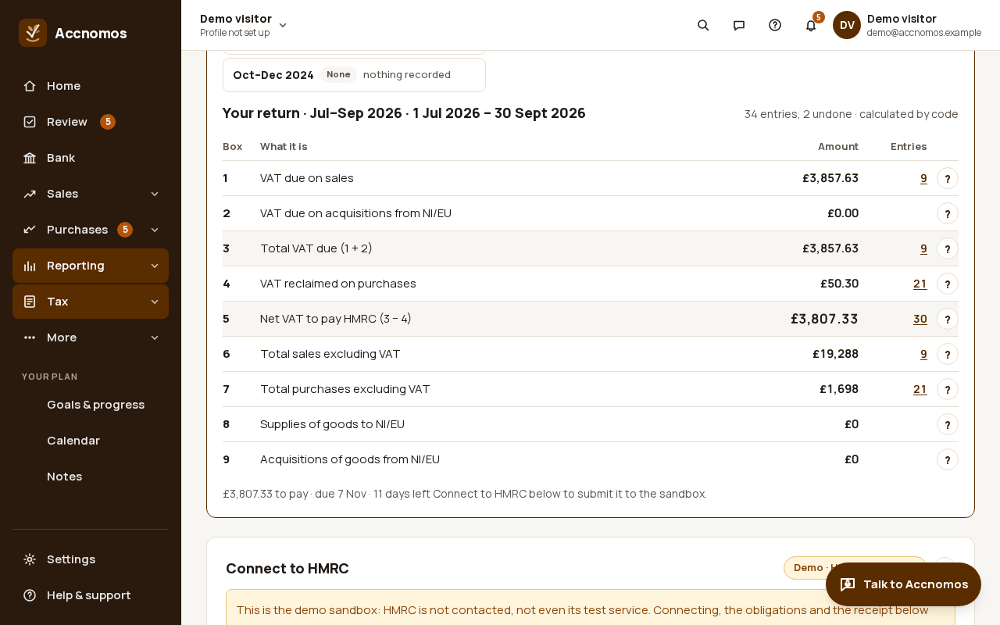
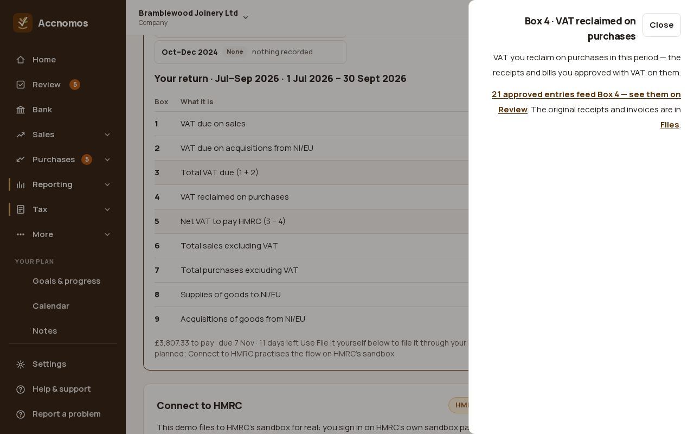
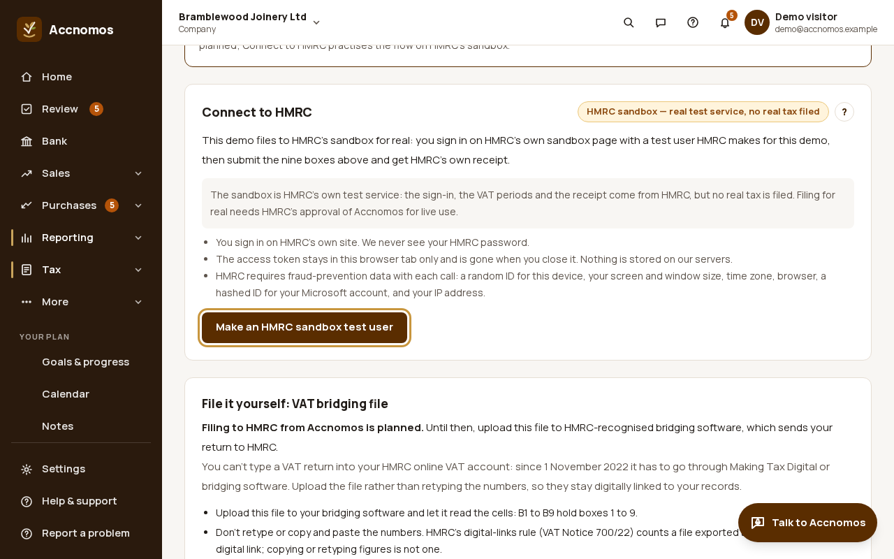
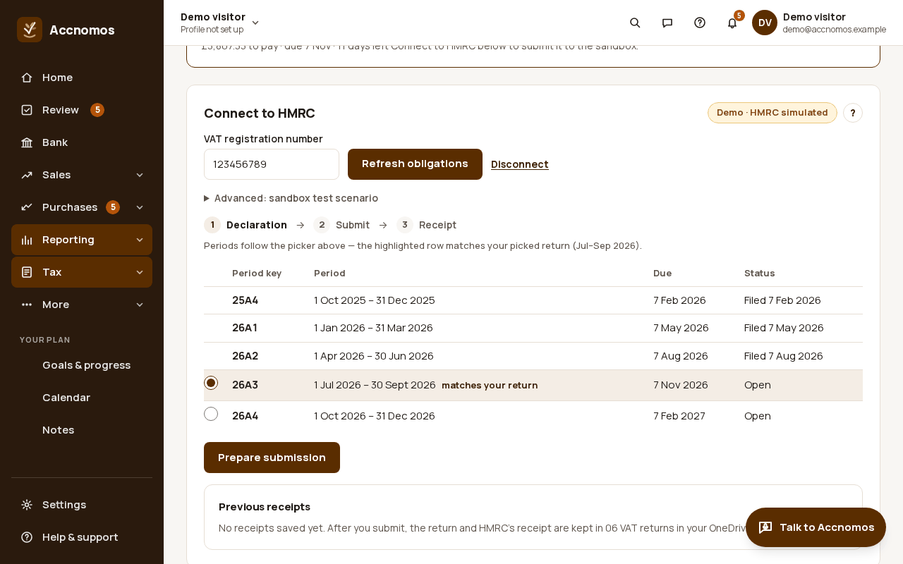
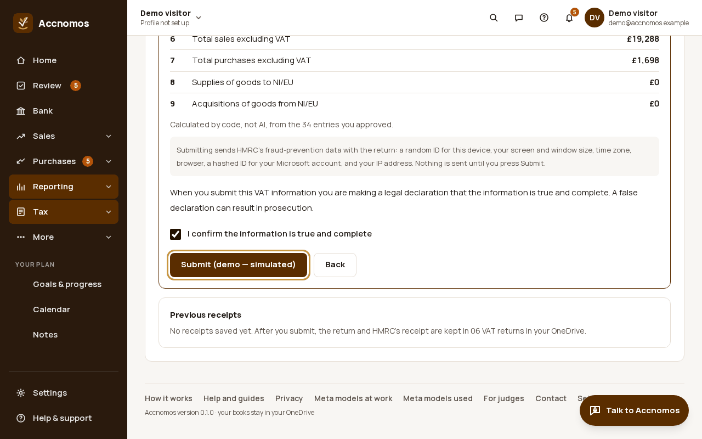
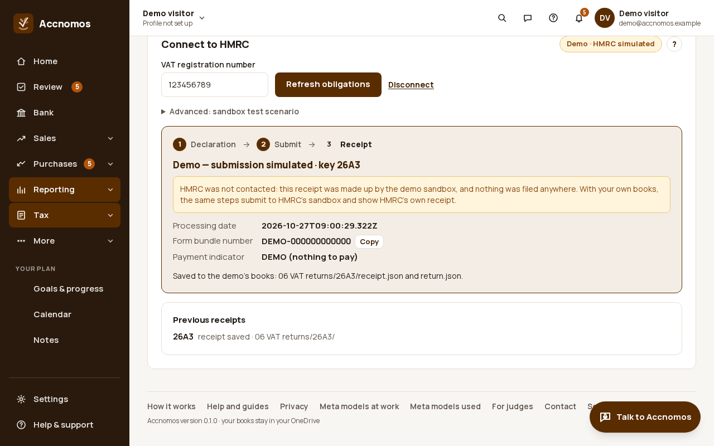
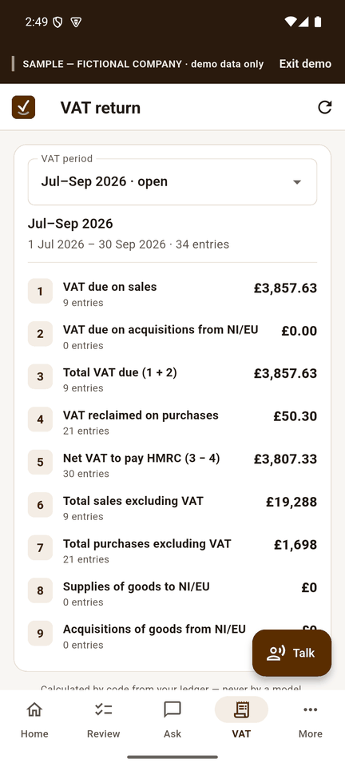

# Do a VAT return

Who this is for: a VAT-registered owner filing through Making Tax Digital.
The HMRC connection here is sandbox only: it practises the full flow, not a
live filing. In the demo, HMRC is not contacted at all and the receipt is made
up so you can see every step.

1. Open **VAT return** (`/vat`, under **Tax** in the menu) and pick the
   quarter in **VAT period**. Each period shows whether it is open and when it
   is due. The nine boxes are worked out by code from the entries you
   approved, with the number of entries behind each.
   
   If this goes wrong: the periods are the wrong months, so set your VAT
   quarters in **Settings › Business** first.
2. Press **?** beside a box for what it means, or the entries count to see the
   documents behind it.
   
   If this goes wrong: a figure looks off, so find the entry in Review or
   Bank and undo it; the boxes rebuild.
3. Under **Connect to HMRC**, press **Connect to HMRC (sandbox)** (in the demo,
   **Connect to HMRC (simulated)**) and sign in with HMRC's test user.
   
   If this goes wrong: the sign-in page does not come back, so close it and
   press Connect again; **Settings › Connection** shows whether HMRC is
   connected.
4. Press **Show obligations** and pick the period that matches your return.
   The row for your picked quarter says *matches your return*.
   
   If this goes wrong: nothing matches, so a return filed elsewhere may
   already cover it; check HMRC's list first.
5. Press **Prepare submission**, read the declaration, tick **I confirm the
   information is true and complete**, and submit.
   
   If this goes wrong: the button stays disabled, so tick the declaration;
   nothing is sent until you do.
6. Keep the receipt: it is saved to `06 VAT returns/<period key>/` with the
   return, and listed under **Previous receipts**.
   

Home's **Deadlines** card and the [Calendar](calendar.md) show the due date,
and **Add to calendar** on the VAT page puts it in your Outlook calendar.

## On Android

**VAT** is a tab of its own: pick the period and read the nine boxes and their
entry counts. Connecting to HMRC and submitting are done on the web.

