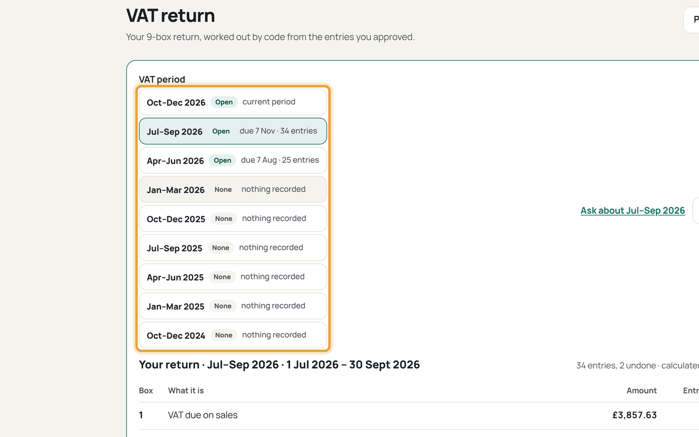
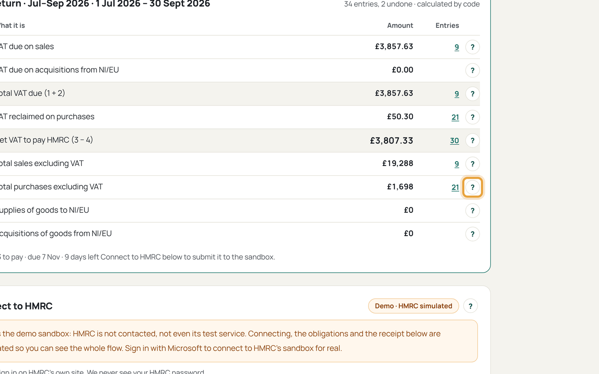
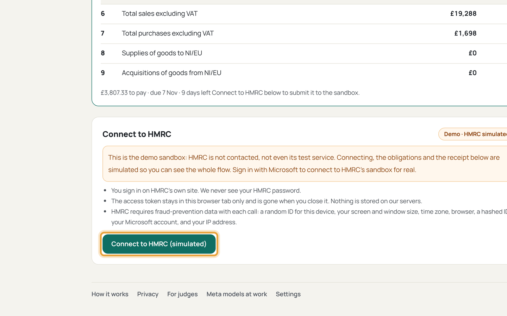
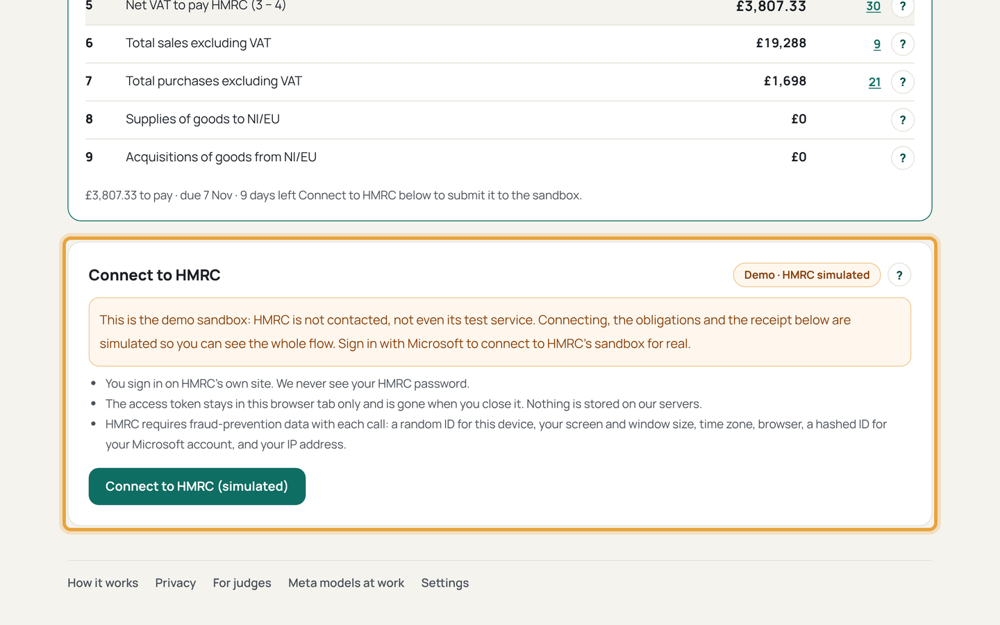
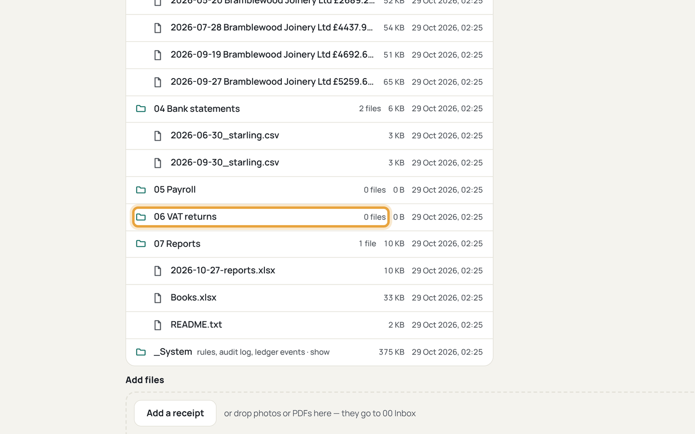

# Do a VAT return

Who this is for: a VAT-registered owner filing through Making Tax Digital. The
HMRC connection in the product today is sandbox only: it practises the full
flow, not a live filing.

1. Open the VAT return (`/vat`) and pick the quarter.
   
   If this goes wrong: the boxes show the wrong period, so check the stagger
   in onboarding and Settings first.
2. Check each box against the ledger lines behind it.
   
   If this goes wrong: a figure looks off, so find the entry in Review or Bank
   and undo it; the boxes rebuild.
3. Press *Connect to HMRC (sandbox)* and sign in with the test user.
   
   If this goes wrong: the redirect fails, so check the relay address allows
   this site before retrying.
4. Open obligations and pick the matching period.
   
   If this goes wrong: nothing matches, so a return filed elsewhere already
   covers it; check HMRC's list first.
5. Read the declaration, tick it, and submit.
   
   If this goes wrong: the button stays disabled, so scroll back: a box was
   edited after the last check.
6. Keep the receipt saved to `06 VAT returns/<periodKey>/`.
   
   If this goes wrong: the period still shows open, so reload; the receipt
   file is what counts.
