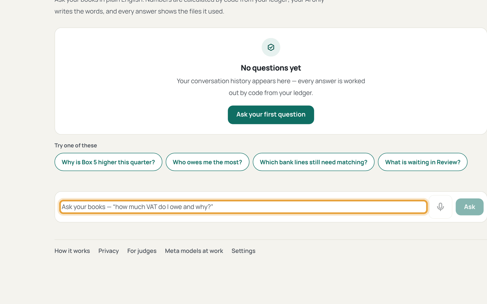
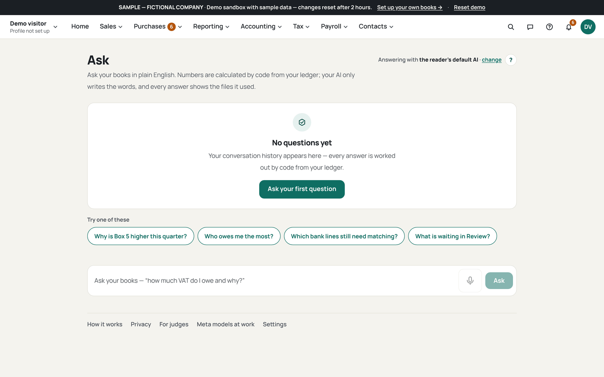
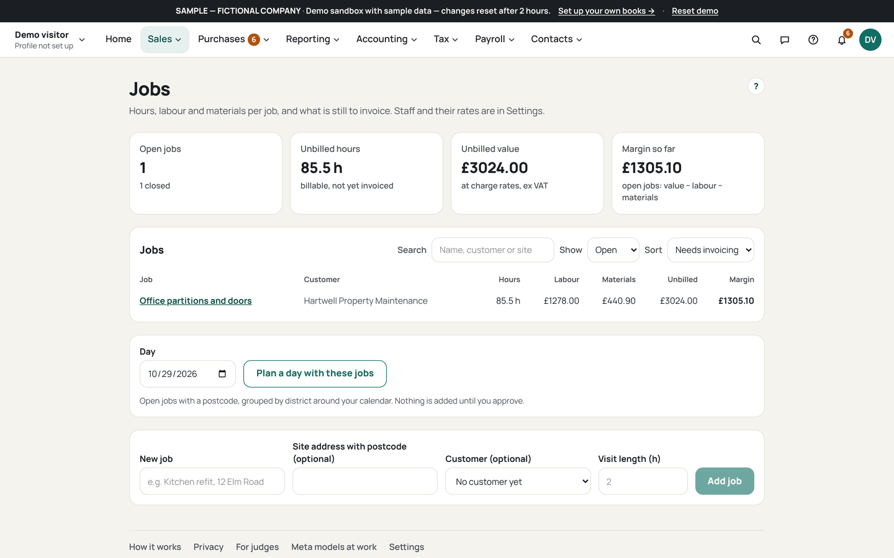

# Use voice and chat

Who this is for: an owner asking about the books hands-free or in plain words.
Answers are grounded in your books; instructions become cards that wait for
Approve. Voice needs key mode with your Meta key; the browser records, the
audio is not kept, and nothing is read aloud.

1. Open Ask (`/ask`) and type a question with a figure in it.
   
   Must be visible: the Ask thread with your question and the answer beside
   its cited book figures.
   If this goes wrong: the answer shows no figures, so ask with the period
   named, for example this quarter.
2. Hold the mic button and speak the overtime line.
   
   Must be visible: the recording state, then your words as the message:
   "Andy did 2 hours overtime at double time on the Hendon job".
   If this goes wrong: the button refuses, so check key mode is on with your
   Meta key; voice is off in local mode.
3. Check the transcript and the action card it becomes.
   
   Must be visible: the timesheet card naming Andy, 2 hours, double time and
   the Hendon job, with Approve, Change and Reject.
   If this goes wrong: the card names the wrong person, so press Change or
   Reject and say the surname next time.
4. Press Approve and find the entry in the job.
   
   Must be visible: the posted timesheet on the Hendon job page.
   If this goes wrong: nothing was recorded, so the card expired after 15
   minutes; ask again.
5. Try a quote and a shopping list the same way.
   
   Must be visible: the quote card with code-priced lines, and the to-do
   "Remember to order 2-inch bolts for the Hendon job".
   If this goes wrong: the quote prices a stranger, so the customer is not in
   your contacts; add them first.
