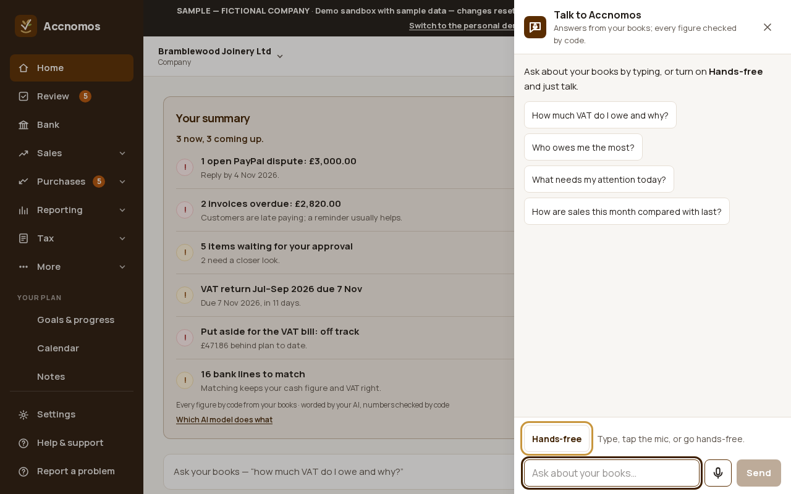
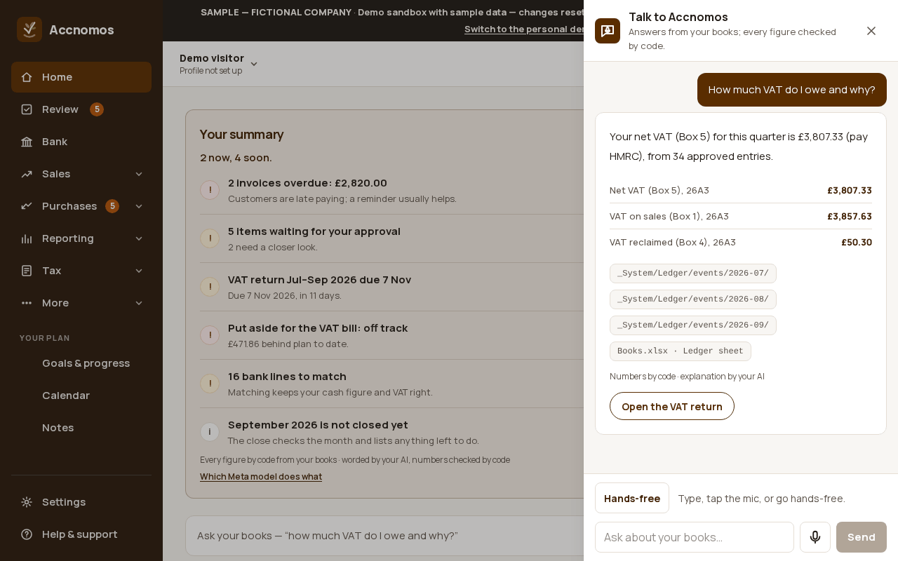
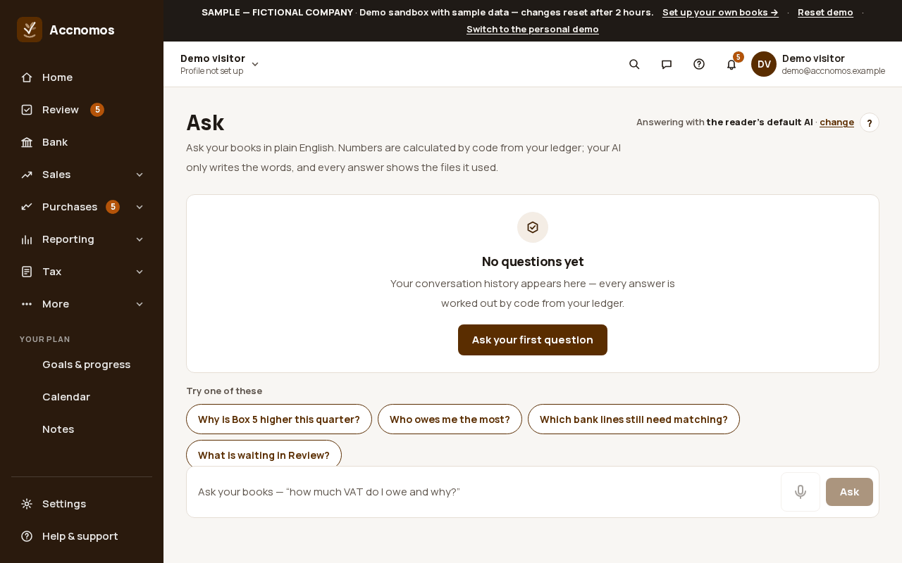
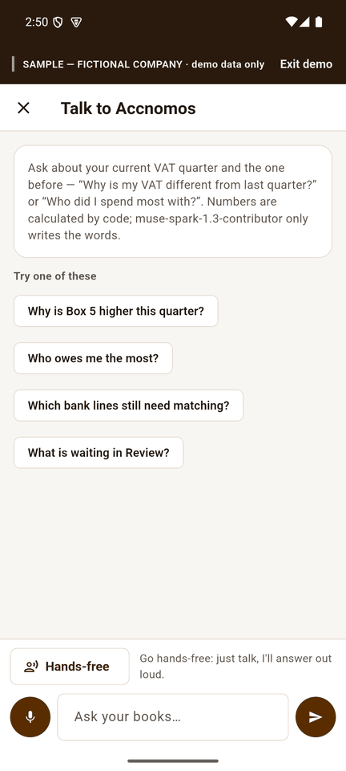
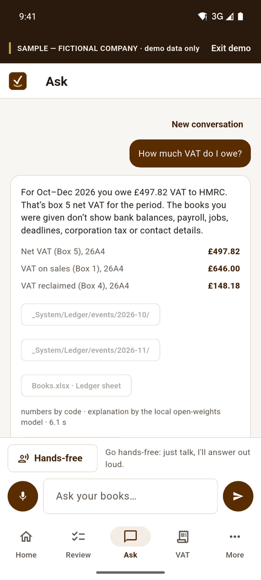

# Talk to Accnomos, by voice or chat

Who this is for: an owner who wants to ask about the books, or get something
done, in plain words, typed or spoken. Every figure in an answer is worked out
by code from your books; Meta's Muse models only write the words. Anything
that would change your books comes back as a card that waits for your
approval.

1. Press **Talk to Accnomos** (bottom right of every page). Type a question,
   pick one of the suggestions, tap the mic for one spoken question, or press
   **Hands-free** and just talk.
   
   If this goes wrong: the mic is refused, so allow the microphone for
   accnomos.com in your browser and try again.
2. Read the answer. The figures sit beside it with the files they came from
   (`_System/Ledger/events/…`, `Books.xlsx`), and a button takes you to the
   page, here **Open the VAT return**.
   
   If this goes wrong: the answer shows no figures, so name the period, for
   example "this quarter" or "in September".
3. Hands-free listens, sends what it heard, reads the answer aloud and listens
   again; two quiet turns end it. When it proposes something, it reads the
   card back and asks "Shall I go ahead? Say yes or no." A clear yes approves
   it, marked as spoken; no, silence or two unclear replies leave the card on
   screen for you.
4. Cards that send or move money (a payment reminder, an invoice) always need
   a tap on **Approve**, even in hands-free: it says so and pauses.
5. The **Ask** page (`/ask`) keeps the same questions as a full-page
   conversation history.
   

For notes, to-dos and calendar events by voice, see
[Notes, to-dos and events by voice](notes-tasks.md).

## Which AI answers

In **Settings › AI** you choose where documents are read and questions are
answered: on your own machine with Meta's open-weight Muse models, or with
Meta's Muse models through the Meta Model API with your key. There is also a
routing choice for answers: **Meta API first**; **local first**, handing to the
Meta API when the local answer is unsure; or **local only**, so nothing leaves
your network. Spoken questions are transcribed by Muse Voice Transcribe when the
server has a Meta key. The audio is not kept.

## On Android

The **Talk** button sits on every screen, and **Ask** is a tab. Hands-free
works the same way: the phone reads the answer aloud and listens again.

