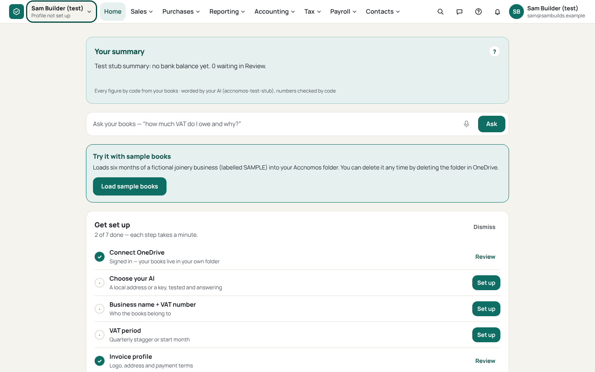
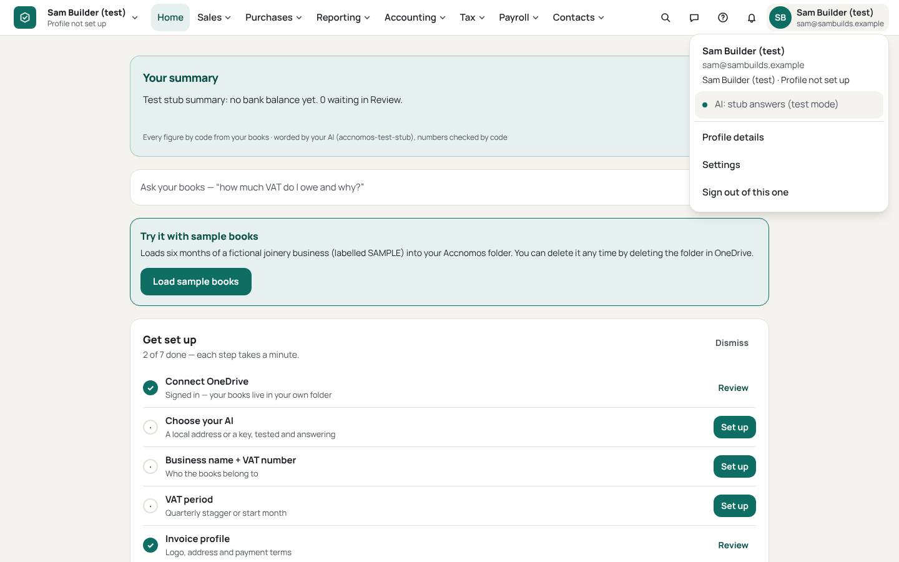
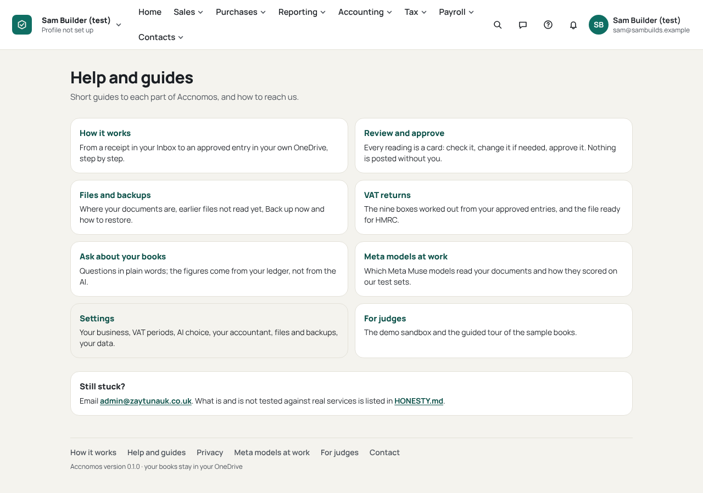
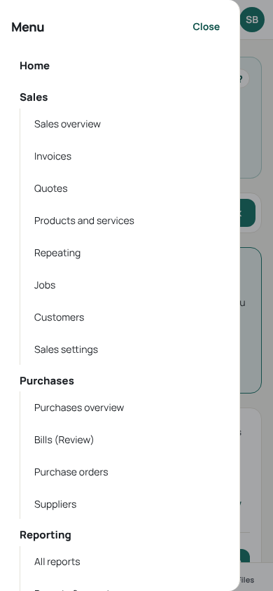
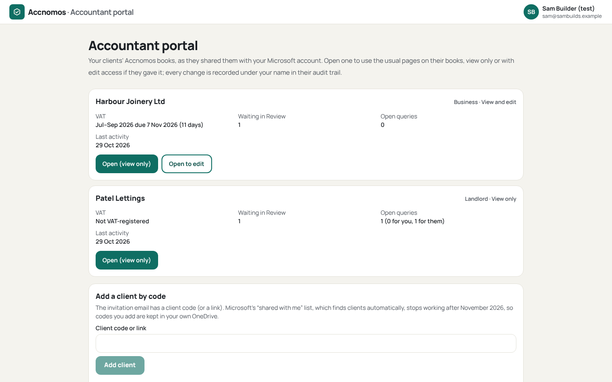
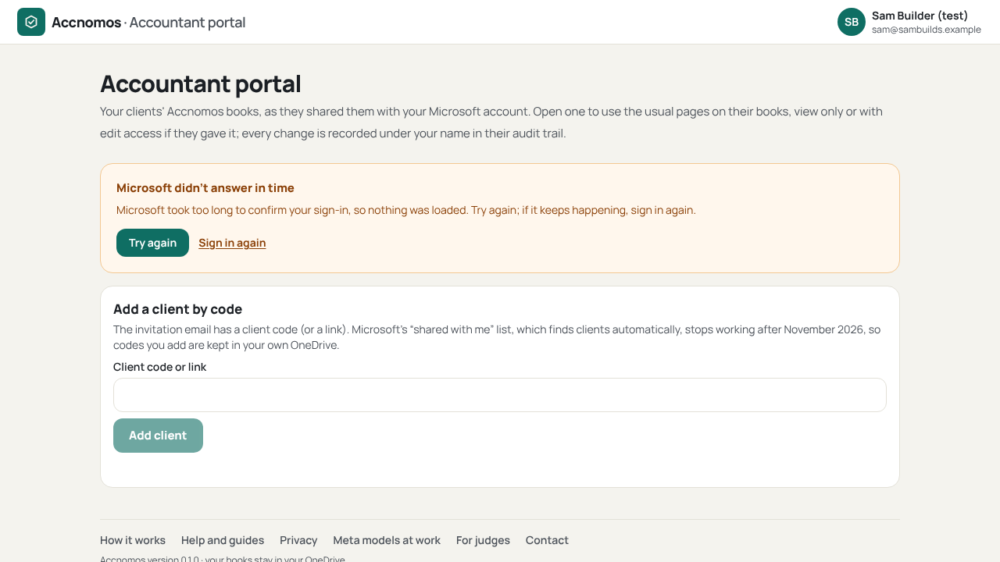
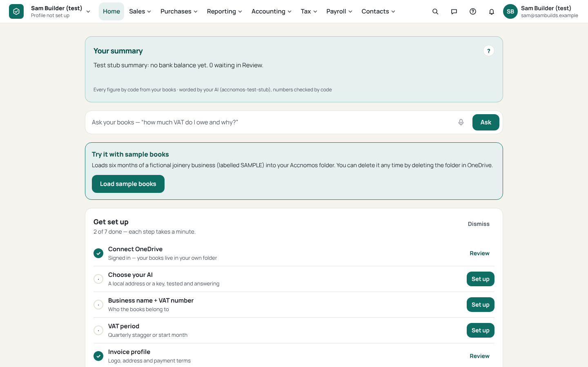
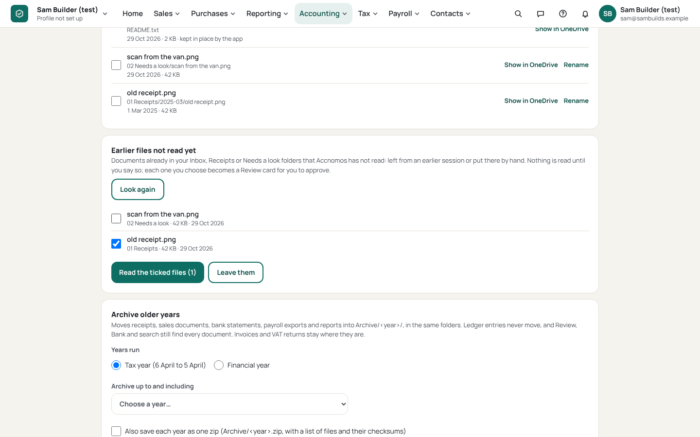
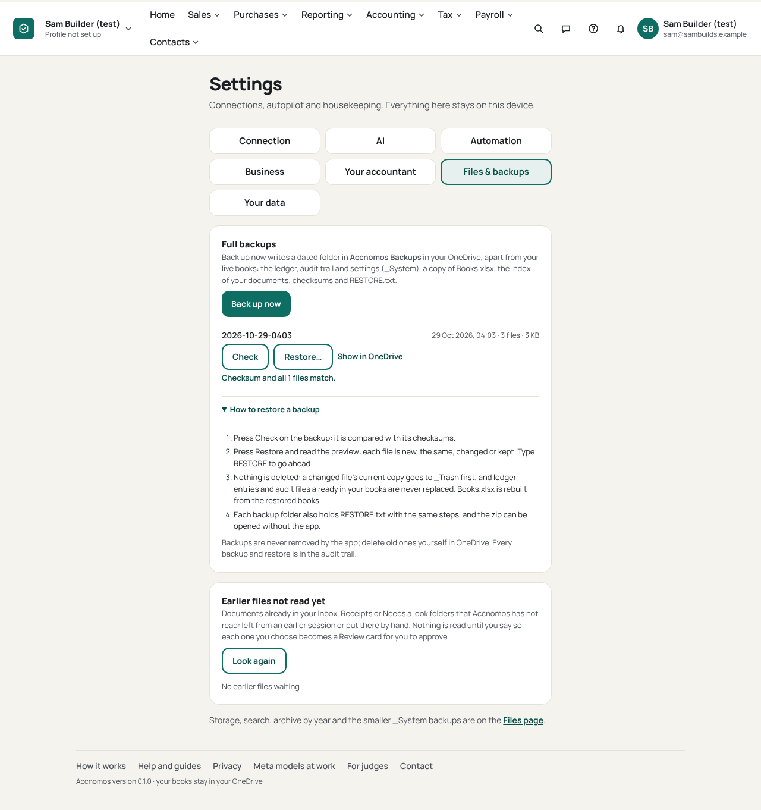

# Review: claude/app-shell

Branch `claude/app-shell` from `origin/main` (55349d5). The owner's report (live site, signed in, `/accountant`): only a
left sidebar with every link, no top bar, no footer, no name, account or profile; an "Accountant portal" link for a
normal user; `Couldn't finish that: timed_out (MSAL)`; no way to read files left in OneDrive earlier; no "Back up now"
to a separate folder; and "AI: Glimmer 30B on your machine" on the hosted app.

## 1. Why the top bar was missing (root cause)

`TopBar` (from `claude/profiles`, merged; restyled by `claude/dashboard-ui`) was not lost in a later merge and has
nothing to do with submission mode (`NEXT_PUBLIC_SUBMISSION_MODE` only switches the sign-up and launch copy). It was
in the build, and it **returned `null` whenever MSAL gave no account**. The shell decided "signed in" separately,
from localStorage (`lib/signed-in.ts` and the pre-paint probe in `lib/public-site.ts`): *any `msal.*` key except
`msal.version`* meant signed in. That test was written for MSAL 2's key names. MSAL 5.26 (the version in the lockfile)
writes `msal.3.account.keys`, `msal.3.token.keys.<clientId>`, `msal.<clientId>.active-account-filters`, `msal.3|…`
entries, and encrypts its cache with a key held in a **session cookie** (`msal.cache.encryption`, read in
`node_modules/@azure/msal-browser/dist/cache/LocalStorage.mjs`): when the browser is closed the key is gone and MSAL
can no longer read its own accounts, but its keys are still in localStorage. So the shell said "signed in" (app shell,
not the public site), the menu bar said "no account" (nothing), and the CSS that hides the sidebar only when the bar
is present (`group-has-[[data-topnav]]`) showed the signed-out sidebar: exactly the screenshot.

Fixes:

- `hasMsalSignIn` and `SIGNED_IN_PROBE` read MSAL 5's real keys: a non-empty `msal.N.account.keys` list, else any
  `msal.N|` entry, plus this app's own test and demo stand-ins (`msal.accnomos-…`). `msal.version`,
  `active-account-filters` and empty lists are not a sign-in. (e2e: "MSAL v5's leftover keys … are not a sign-in".)
- The menu bar never disappears on a signed-in device: `useLinkedProfiles` is now tri-state (checking / none /
  accounts) and, with no account MSAL can use, the bar stays and shows **Sign in again** where the account menu goes.
  (e2e: "a sign-in MSAL can no longer read keeps the top bar and says Sign in again (the live-site bug)".)
- The sidebar is no longer hidden by a CSS trick that depended on the bar rendering: `AppShell` renders the bar for a
  signed-in device and the sidebar only for a signed-out one; `html[data-signed-in] [data-signed-out-chrome]` hides
  the sidebar before React runs, so it never flashes.

This cause is inferred from the code and MSAL's source and reproduced with the test sign-in; it was not reproduced on
the live site with a real account (docs/HONESTY.md › App shell).

## 2. Sidebar or top bar

`docs/research/DASHBOARD.md` §9 recommends a left sidebar (NN/g: application navigation on the left, scales
vertically; QuickBooks, FreeAgent and Dext use one). The owner asked earlier for a Xero-like top menu, and
`claude/profiles`/`claude/dashboard-ui` built it. Decision, as the brief set: **the top bar is primary on desktop**;
under 900 px the groups are in a modal drawer ("Menu") plus the five-tab bar; **no sidebar for signed-in pages**, so the
links are listed once. What the research warns about is kept out: menus open on click or keyboard, never on hover
(NN/g #13); second-level links look lower than the groups (§9). The research's case for a sidebar (many sections) is
met by the grouped dropdowns and Search (find a page). Signed out, the sample books keep their small sidebar: there is
no bar there to duplicate it.

## 3. What the shell has now

| Requirement | Where |
| --- | --- |
| Logo (link home) | `TopBar.tsx` (wordmark from 1536 px) |
| Menu groups with dropdown sub-menus | `TopBar.tsx` `GroupBar`, `lib/nav.ts` (unchanged groups) |
| Search / Ask / review count | Search (find a page), Ask, Help (`/help`), Notifications with the Review count |
| Signed-in name and Microsoft email | on the bar from 1024 px (initials below), and in the account menu |
| Current profile, its kind, profile switcher | `ProfileSwitcher` (far left): name, kind; menu lists every linked profile, *Add another account / business* |
| Sign out | account menu › *Sign out of this one* |
| Footer on every app page | `AppFooter.tsx`: How it works, Help and guides (`/help`, new), Privacy, Meta models at work, For judges, Contact (mailto), "Accnomos version 0.1.0 · build <sha>" (from the deploy's `/version.json` when present) |
| Accountant portal only for accountants | account menu item only when this account's portal has listed ≥ 1 client on this device (`lib/accountant.ts` `hasSharedClients`); removed from the sidebar; reachable from the public Accountants page |
| Accountant's own shell | `/accountant` with no client open: logo, "Accountant portal", name/email, *Your own books*, Settings, sign out; no business menu, no tab bar |
| MSAL silent timeout | `lib/msal.ts` `getToken`: `timed_out` / `monitor_window_timeout` → one interactive redirect per scope set per 5 minutes (Microsoft's documented remedy, [MSAL.js errors](https://learn.microsoft.com/entra/msal/javascript/browser/errors#browserautherrors), checked 29 Oct 2026); after that a plain sentence. `States.tsx` `SignInSlowNote`: "Microsoft didn't answer in time", Try again, Sign in again. `errorText` never passes MSAL's words through |
| Earlier files | `app/previous_files.py`, `GET /files/previous`, `POST /files/previous/queue`, `/leave`; Home notice with the count; list on Files and Settings › Files & backups |
| Back up now | `app/full_backup.py`, `GET/POST /backups/full` (`?stream=1` progress events); `FullBackupPanel.tsx` on Files and Settings › Files & backups |
| AI line | `aiLabel`: "AI: Meta Muse models" (", your own key" / " on your own computer"), linking to `/meta-models` (new route, the `/models` page); no model or third-party names |

## 4. Back up now

`Accnomos Backups/YYYY-MM-DD-HHMM/` (London time; `-2` for a second in the same minute): `books-system.zip` (every
`_System` file with an inner manifest, built by the same code as the dated zips, now `backups.system_zip`),
`books-system.zip.sha256`, `Books.xlsx` (when there is one), `documents-index.json` (the Files page's index: every
document, its date, tax year and what points at it), `manifest.json` (each file's size and sha256, who and when) and
`RESTORE.txt`. Restore reuses `app/backups.py` (verify, preview, `RESTORE` typed, never deletes) on the full backup's
zip. Audited as `full_backup_created`; the audit trail words it. The folder is protected (no moves, no archive, not in
the documents index). It sits inside the books folder because a personal account's `Files.ReadWrite.AppFolder` reaches
only `Apps/Accnomos` ([app folder security](https://learn.microsoft.com/graph/onedrive-sharepoint-appfolder#security),
checked 29 Oct 2026). `claude/files-archive` (merged) had the dated `_System` zips and restore; both stay.

## 5. Earlier files

Readable documents (the Inbox's types) in 00 Inbox, 01 Receipts (all months) and 02 Needs a look that no proposal or
bank statement points at, minus those the user left alone. Nothing is read until the user ticks files and presses
*Read the ticked files*: those outside the Inbox move into it (recorded, so links follow) and the usual scan makes
Review cards (AI proposes, user approves). *Leave them* is remembered in `_System/Settings/previous-files.json`.
Home shows "N earlier files in your OneDrive not read yet" with *See the list* and *Not now* (hidden until the count
changes). Audited as `previous_files_queued` and `previous_files_left`.

## 6. Tests

- Runtime: `tests/test_full_backup_previous_files.py`, 12 tests (dated folder and contents with checksums, two in a
  minute, verify and restore through the usual restore, protection, an unfinished backup listed, streamed progress
  route, user required; find, queue, refusals, leave, routes).
- e2e: `e2e/app-shell.spec.ts`, 12 tests: top bar contents (logo, sub-menu, search, Ask, review count, name and email
  on the bar, profile and kind, switcher, sign out, no sidebar); footer on five signed-in pages and /help; phone drawer;
  no accountant link for a normal user and the portal's own shell; Back up now in Settings with progress, list and
  Check; Back up now on Files; earlier files from Home to Review (only the ticked one read, *Leave them*); the AI line;
  the accountant link after the portal lists clients; the MSAL timeout (one redirect, plain message, Try again works);
  the sign-in check against MSAL 5's leftover keys and the live-site state.
- Existing specs changed: `settings.spec.ts` (the AI line's new words).

Gate totals: see the end of this file.

## 7. Screenshots

| | |
| --- | --- |
| Top bar, 1440 px |  |
| Account menu |  |
| Footer and Help and guides |  |
| Phone drawer, 390 px |  |
| Accountant portal's shell |  |
| Microsoft did not answer in time |  |
| Earlier files on Home |  |
| Earlier files list |  |
| Back up now in Settings |  |

Screenshots are written by `e2e/app-shell.spec.ts` on each run (test build, fictional test account).

## 8. Risks

- Real MSAL was not used (no Microsoft account here); see HONESTY.md › App shell for what that leaves untested.
- Two silent requests timing out together both try the interactive redirect; MSAL refuses the second
  (`interaction_in_progress`) and that page shows an error until the redirect returns.
- The accountant link depends on this device having opened the portal once; a new device shows it after the first
  visit from the public Accountants page.
- Earlier files are matched by path; a document renamed by hand after it was read is offered again (reading it again
  gives a DUPLICATE check, so nothing posts twice).
- The full backup's `_System` zip is built in memory (100 MB cap, as before).
