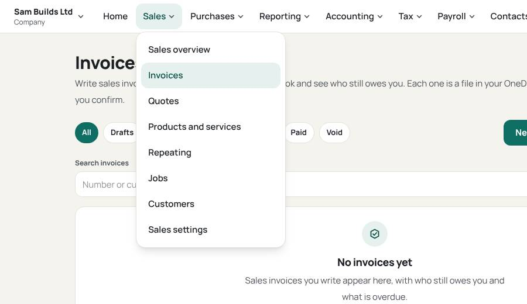
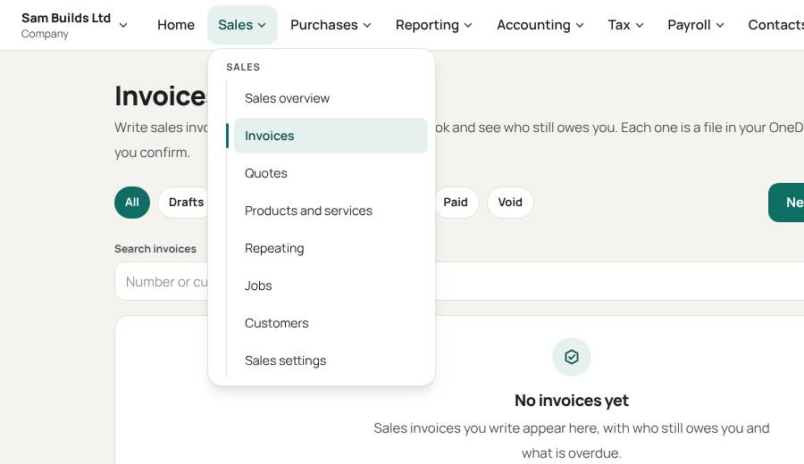
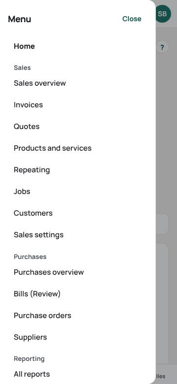
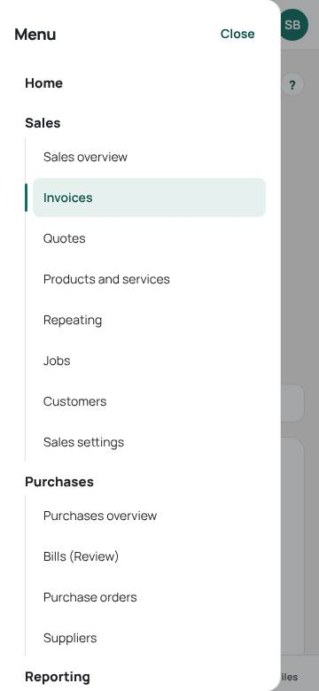
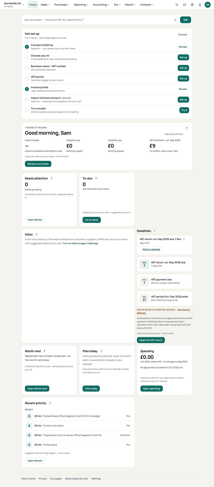
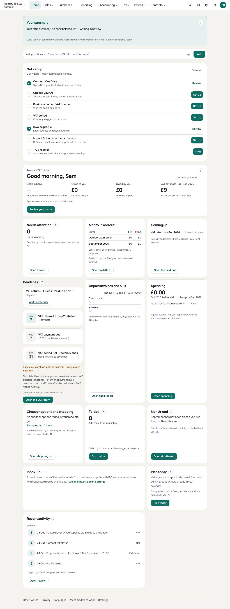
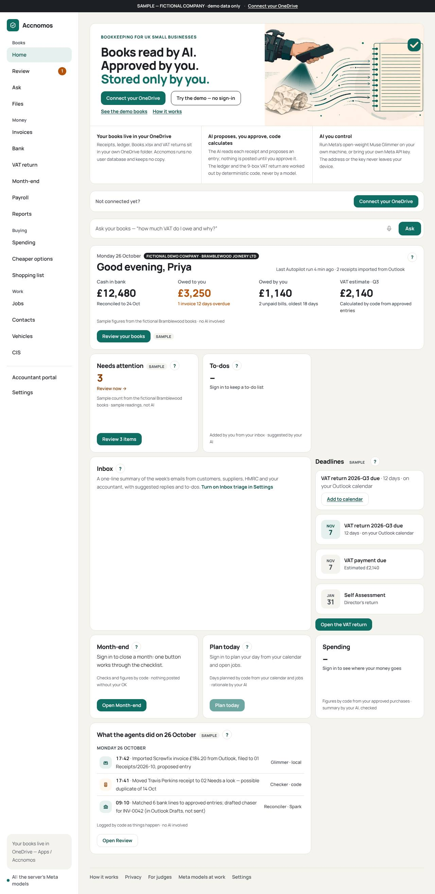
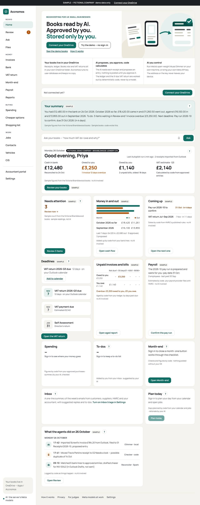

# Review: claude/dashboard-ui (Home dashboard, AI summary, menu hierarchy, header lines)

Branch `claude/dashboard-ui`, from `origin/main` (a56bc91) with `origin/claude/sales-exports-fix` merged in (it was not on
main yet; its conflicts were all places where main already carries the same fix, so main's side was kept, except the
exports page, which keeps the fix branch's wording that its e2e checks). 28 Oct 2026.

The owner asked for: "research and make a dashboard which has everything and an AI summary; make the interface
better; sub menus look the same as the main menu; the header image has lines on it."

## Sources

- `docs/research/DASHBOARD.md`: how Xero, QuickBooks Online, FreeAgent, Sage Accounting and Dext lay out their home
  pages and navigation; GOV.UK Design System (summary list, task list, service navigation, navigate a service), MoJ side
  navigation, Nielsen Norman Group (dashboards and preattentive processing, menu design, local navigation), W3C WAI
  complex images, the Analysis Function's chart guidance. Every source has its URL and the date checked. The vendor
  help sites do not resolve from this environment, so pages were read through a fetch service; those seen only as
  search excerpts are marked so.
- MTD for Income Tax quarterly update deadlines (7 Aug, 7 Nov, 7 Feb, 7 May for standard periods) and the 31 January
  Self Assessment deadline: gov.uk/guidance/use-making-tax-digital-for-income-tax/send-quarterly-updates and
  gov.uk/self-assessment-tax-returns/deadlines, checked 28 Oct 2026 through gov.uk search results (gov.uk does not
  resolve from this environment either). Cited in `services/runtime/app/home_overview.py`.

## Design

**What we copied** (research §7): one card per question (Xero's new homepage), the bank figure beside its
reconciliation date, a "Coming up" list of deadlines with a link per row (FreeAgent's tax timeline), "needs you"
kept apart from figures (Dext), cards that hide themselves when a feature is not used rather than empty widgets, and
every chart with its figures as text.

**Runtime: `GET /books/home`** (`app/home_overview.py`). Reads only; each section worked out on its own, as
`/books/dashboard` does, so one unreadable file blanks one card (named in `unavailable`), and Graph 401/403 still
propagates. Sections: money in and out of the bank this month so far and last month (bank lines, transfers and ignored
lines left out); the last seven days (bank lines plus approvals and proposals from the audit trail); aged debtors and
creditors (the Aged report's own function); the next MTD Income Tax quarterly update (sole traders and anyone with a
property register); Self Assessment; the draft or next pay run; CIS settings, deductions suffered this tax year and
the contractor's CIS300 date; property income this tax year (your share); and all deadlines, soonest first. A section
the books do not use is `null`, and the web card for it renders nothing.

**The summary** (`app/ai/home_summary.py`), the month-end close summary's pattern: code builds `facts` with every
figure already formatted (pounds to 2 dp, dates in words); the user's AI, through the existing provider path
(`call_json_model`, the same headers and providers as Ask), may only word them in two to four sentences; code then
checks the words with Ask's `KnownNumbers` (any figure not among the facts, any link, or "nothing needs doing" while
something does, rejects it). With no AI, or any rejection or model failure, code writes the summary itself from the
same facts, and `fallback_reason` says why; the card says who wrote it. `summary_ai=false` skips the model. The demo
sandbox gets the same endpoint against its sample books (the demo banner marks them); signed out, `/try` shows a
sample summary, labelled Sample. Nothing in the summary or the cards submits anything: the Income Tax card says updates
go to HMRC's sandbox only, as everywhere else in submission mode.

**Web** (`components/home/Overview.tsx`, `OverviewCards.tsx`): order on Home is the summary, the Ask bar, set-up, then
Today (cash, owed, VAT), Needs attention (Review), Money in and out, Coming up, VAT deadlines, Unpaid invoices and
bills (aged), Income Tax, Payroll, CIS, Property income, Spending, Cheaper options and shopping, To-dos, Month-end,
Inbox, Plan today, Recent activity. Each card links to its page. The money bars are `aria-hidden`; the same figures
are a captioned table beside them.

| Card | Company (VAT) | Sole trader | Landlord | Personal |
| --- | --- | --- | --- | --- |
| Summary, Today, Needs attention, Money, Spending, Buying, To-dos, Activity | yes | yes | yes | yes |
| VAT tiles and deadlines | VAT-registered only | VAT-registered only | — | — |
| Unpaid invoices and bills | yes | yes | if not personal | — |
| Income Tax (MTD) | — | yes | yes (property) | only with a property |
| Payroll | with employees or runs | with employees or runs | — | — |
| CIS | Settings › CIS on | Settings › CIS on | — | — |
| Property income | with a property or landlord mode | same | yes | with a property |

**Menus** (`components/TopBar.tsx`, `AppNav.tsx`): sub-menu items now sit one level down: indented behind a 1 px rule,
14 px normal weight (the bar is 15 px semibold), under the group's small uppercase label; the current page gets a teal
bar, a tint, semibold text and `aria-current`. The phone drawer uses the same item style under bold group headings
(15 px extrabold). The signed-out sidebar's group labels are small uppercase too. Tokens unchanged (teal, teal-tint,
muted, border).

**Android** (`apps/mobile`): the summary card at the top of Home, from the same endpoint, with the same "who wrote it"
line (`models/home_summary.dart`, `SummaryCard` in `home_screen.dart`); the summary failing to load leaves the tiles as
they were. The other new cards are web only for now.

**The header lines**: the live site could not be opened from here (accnomos.com does not resolve through the proxy),
so the test-mode build stood in. Two causes, both fixed:
1. The landing hero's green band (and the closing band) had `.ledger-rule`: a 1 px line every 40 px
   (`repeating-linear-gradient`), visible as horizontal stripes across the header (before/after below). Now a soft
   radial light, no pattern.
2. The sample Home's header image (`brand/hero.jpg`, `hero-800.jpg`) was a busy bitmap of hairline strokes that blurred
   into stray lines when scaled by `bg-cover`. Replaced with one 3 kB flat vector (`brand/hero.svg`, no strokes but the
   arrow and tick) at every width; both bitmaps deleted; `docs/PERF.md` and `phone.spec.ts` updated.

## Screenshots (test-mode build, 1280 × 800 unless noted)

| | Before | After |
| --- | --- | --- |
| Landing hero |  |  |
| Sales menu |  |  |
| Phone drawer (360 px) |  |  |
| Home, signed in (company, one receipt) |  |  |
| Sample Home (`/try`) |  |  |

## Tests

- Runtime: `tests/test_home_overview.py`, 19 tests: money in/out leaves out transfers and ignored lines and the days
  outside the month; the next quarterly update for six dates across two tax years (including "due today" and last
  year's Q4 still ahead); Self Assessment's 31 January; the fallback summary's exact wording, sentence count and that
  every figure in it is a fact; the ground check rejects an invented £ figure, an invented percentage, a link, a false
  "nothing needs doing" and an empty reply; the model's words are used when they pass; an invented figure, a malformed
  reply and a model that is down each fall back to code with the reason; no AI means code; the route (reads only, the
  figures for the shared dashboard fixture, the summary's facts and that its figures are all facts); sections per
  profile kind (sole trader: Income Tax and Self Assessment, no VAT; personal: none of them).
  Whole suite: **2359 passed, 2 skipped**. `ruff check`, `ruff format --check` clean; `pyright` 0 errors.
- Web e2e: `e2e/dashboard.spec.ts`, 9 tests: business (stub AI summary and its by-line, money table, aged and Coming up
  links, the business-only cards absent), sole trader (Income Tax 7 Nov, Self Assessment 31 Jan 2027, no VAT),
  landlord (a registered property shows property income and Income Tax), personal (no business cards, no VAT in the
  summary), the signed-out sample (labelled Sample, chart figures as a table), menu hierarchy (sub-menu smaller,
  lighter and indented; current page heavier with `aria-current`), 360 px with no sideways scroll signed in and on
  `/try` plus the drawer's hierarchy, and axe on Home signed in (no serious or critical violations).
  `phone.spec.ts`'s brand-image checks now expect `hero.svg` at both widths. Whole suite: see the gate line below.
  `eslint .` clean.
- Android: `test/home_summary_test.dart`, 4 tests (parsing, the by-line for code and AI, empty summaries, the card at
  360 dp). **Not run**: no Flutter SDK in this environment.

**Gates (28 Oct 2026, Linux):** runtime `pytest -q` 2359 passed, 2 skipped; `ruff check .` and `ruff format --check .`
clean; `pyright` 0 errors; `eslint .` clean; `pnpm run e2e:build` and `pnpm run e2e:test` (CI=1): 476 passed, 94 skipped
(env-gated shot and demo specs), 1 flaky that passed on retry (`review.spec.ts:164`, undo while an approve is in
flight; then 5 of 5 passed alone with `--repeat-each=5`, and it touches nothing changed here). After that run, the aged
card's column labels were shortened (labels only); `dashboard`, `phone` and `home` specs re-run on a fresh build: 91
passed. Flutter: not run (no SDK).

## Risks and what remains

- No real model has written a summary; the number check stops invented figures, not a true figure in the wrong
  sentence. See `docs/HONESTY.md` ("Home dashboard and its summary").
- The Aged card (the Aged report's figures) and the Today tile can differ for an invoice marked paid by hand with no
  payment recorded; worth unifying in the Aged report itself.
- Income Tax shows for every sole trader and landlord, not only those over the MTD threshold; standard update periods
  only.
- Home now makes more requests (`/books/home` re-reads what `/books/dashboard` reads, within one request memo each;
  `/books/prices` and `/shopping` on every visit). Not measured against a real OneDrive.
- The live site and gov.uk could not be opened from here; the header fix was confirmed on the test-mode build only.
- The cards grid stretches rows to the tallest card, so short cards (Aged) can show white space at 1280 px.
- Android shows only the summary of the new cards; `flutter analyze`/`flutter test` not run here.
